# The Complete Trader's Guide: Process, Tools, Routine & Execution

**Author:** Jeff Sun, CFTe ([@jfsrev](https://x.com/jfsrev))  
**Source:** Substack Masterclass & Curated Trading Threads  
**Compilation:** Automated Educational Archive  

---

## Table of Contents

1. [Introduction & Background](#introduction--background)
   * [Content Page](#content-page)
2. [Chapter 1. Glossary of Terms and Expressions I Often Use in my Twitter Commentary](#chapter-1-glossary-of-terms-and-expressions-i-often-use-in-my-twitter-commentary)
3. [Chapter 2. Charting - My Approach Using Tradingview](#chapter-2-charting---my-approach-using-tradingview)
   * [My Templates, Indicators that I used, and how to utilize them:](#my-templates-indicators-that-i-used-and-how-to-utilize-them)
   * [1) Swing Data - ADR% / RVol / PVol / Float % / Avg $ Vol - Over 75k Users](#1-swing-data---adr--rvol--pvol--float---avg--vol---over-75k-users)
   * [Bonus: Video demonstration of the indicator on the Mobile App](#bonus-video-demonstration-of-the-indicator-on-the-mobile-app)
   * [2) ATR% multiple from 50-MA - Over 47k Users](#2-atr-multiple-from-50-ma---over-47k-users)
   * [3) Volatility Adjusted Relative Strength (VARS) with Histogram Version, first inspired by mattishenner (reddit) - Over 5k Users](#3-volatility-adjusted-relative-strength-vars-with-histogram-version-first-inspired-by-mattishenner-reddit---over-5k-users)
   * [4) Simple Volume with Pocket Pivots by @finallynitin](#4-simple-volume-with-pocket-pivots-by-finallynitin)
   * [5) Worthy Mentions](#5-worthy-mentions)
4. [Chapter 3. My Screeners - Workflow: Finviz Post Market & TradingView Pre-/Live-Market RVOL](#chapter-3-my-screeners---workflow-finviz-post-market--tradingview-pre-live-market-rvol)
   * [1) I have 14 screeners for post-market analysis, shifting their results into dedicated watchlists by purpose.](#1-i-have-14-screeners-for-post-market-analysis-shifting-their-results-into-dedicated-watchlists-by-purpose)
   * [2) I have 2 live market screeners for high RVOL based execution on Tradingview](#2-i-have-2-live-market-screeners-for-high-rvol-based-execution-on-tradingview)
5. [Chapter 4. Upgrading Watch-listed Stock to Focus List, Process, & Routine](#chapter-4-upgrading-watch-listed-stock-to-focus-list-process--routine)
   * [My post market daily process flows like this:](#my-post-market-daily-process-flows-like-this)
   * [Screening → Watchlist Management → Focus List Preparation → Situational Awareness from Qualitative Market Reading → Portfolio Stops Management (if required)](#screening--watchlist-management--focus-list-preparation--situational-awareness-from-qualitative-market-reading--portfolio-stops-management-if-required)
6. [Chapter 5. From Post-Market Focus List to Pre-Market Routine, & Situational Awareness](#chapter-5-from-post-market-focus-list-to-pre-market-routine--situational-awareness)
   * [The importance of a daily routine lies in being time-efficient, manageable, and sustainable for long-term trading longevity — it cannot be exhausting.](#the-importance-of-a-daily-routine-lies-in-being-time-efficient-manageable-and-sustainable-for-long-term-trading-longevity--it-cannot-be-exhausting)
7. [Chapter 6. Design of Entry, Stop, % Risk to Equity, for Proficient Trade Execution](#chapter-6-design-of-entry-stop--risk-to-equity-for-proficient-trade-execution)
   * [An astounding trading idea, when it comes up for execution in the live market, must be reassessed by its risk-to-reward potential based on the price action at that moment .](#an-astounding-trading-idea-when-it-comes-up-for-execution-in-the-live-market-must-be-reassessed-by-its-risk-to-reward-potential-based-on-the-price-action-at-that-moment-)
8. [Chapter 7. Post Execution - Trade Management of Stops Adjustment, Partial Profit Taking, and Closing Position](#chapter-7-post-execution---trade-management-of-stops-adjustment-partial-profit-taking-and-closing-position)
   * [Don’t get fixated on price movements; be patient with the factor of time. Remember, a chart has both a y-axis and an x-axis.](#dont-get-fixated-on-price-movements-be-patient-with-the-factor-of-time-remember-a-chart-has-both-a-y-axis-and-an-x-axis)
9. [Chapter 8. Journaling, Investigating, Fine Tuning to Improve Your YoY % Performance](#chapter-8-journaling-investigating-fine-tuning-to-improve-your-yoy--performance)
   * [Trading is a long-term growth game, too many approach it as a short-term income generator.](#trading-is-a-long-term-growth-game-too-many-approach-it-as-a-short-term-income-generator)
10. [Chapter 9. With experience and your own trading stats, internalizing these 6 graphics will give you remarkable trading conviction.](#chapter-9-with-experience-and-your-own-trading-stats-internalizing-these-6-graphics-will-give-you-remarkable-trading-conviction)
   * [I want you to truly internalize these 6 graphics, and their relationship to each other. They are intertwined and may offer you a new perspective, understanding, and belief that reshapes how to tune your current trading performance. Below graphics with links are the expanded discussions. I highly urge you to go through all the comments and replies, they are high quality discussions you don’t get from a trading course or service:](#i-want-you-to-truly-internalize-these-6-graphics-and-their-relationship-to-each-other-they-are-intertwined-and-may-offer-you-a-new-perspective-understanding-and-belief-that-reshapes-how-to-tune-your-current-trading-performance-below-graphics-with-links-are-the-expanded-discussions-i-highly-urge-you-to-go-through-all-the-comments-and-replies-they-are-high-quality-discussions-you-dont-get-from-a-trading-course-or-service)
11. [Chapter 10. So, What does it take to go Full Time Trading? Lots of Hard Truth](#chapter-10-so-what-does-it-take-to-go-full-time-trading-lots-of-hard-truth)
12. [Chapter 11. Five Books I Highly Recommend To Strengthen Your Foundation. You do not know what you don’t know.](#chapter-11-five-books-i-highly-recommend-to-strengthen-your-foundation-you-do-not-know-what-you-dont-know)
   * [You may not have come across some of this books](#you-may-not-have-come-across-some-of-this-books)
13. [Chapter 12. Free Productivity Tools, Resources, and Websites I Rely On](#chapter-12-free-productivity-tools-resources-and-websites-i-rely-on)
14. [Chapter 13. I Delayed My Own Progress by 3 Years Learning the Wrong Things: Refine Your Twitter Feed By Following These Legitimate Traders Who Share With Real “Trading Maturity” Without Selling.](#chapter-13-i-delayed-my-own-progress-by-3-years-learning-the-wrong-things-refine-your-twitter-feed-by-following-these-legitimate-traders-who-share-with-real-trading-maturity-without-selling)
15. [Chapter 14. High-Impression Twitter Posts Of My Personal Deeper Thoughts and Experiences for You to Relate To](#chapter-14-high-impression-twitter-posts-of-my-personal-deeper-thoughts-and-experiences-for-you-to-relate-to)
16. [Chapter 15. Closing Remarks – A Call to Inspiration](#chapter-15-closing-remarks--a-call-to-inspiration)
17. [Chapter 16. Additional Information & FAQ](#chapter-16-additional-information--faq)
   * [Key Annual Market Dates to Know](#key-annual-market-dates-to-know)
   * [FAQs paired with thought-provoking questions](#faqs-paired-with-thought-provoking-questions)

---

# Introduction & Background

Some of you may have noticed I took down my 16-year website late last year. The goal was to reduce my digital footprint, stay compliant with regulations (if required), start assembling my small-scale asset management team , and keep a lower profile—which is also why I’ve politely declined interviews in recent years. I don’t sell courses/services, and my fund is a closed-end vehicle that reports only to one party on a performance-fee basis. Publicity and AUM growth aren’t priorities for me, and shouldn't be one for a trader. That said, my Substack—despite being inactive for two years—has grown to over 10k subscribers. I’m here repurposing it as a content hub: archiving my long-form twitter threads into short links for easy reference, and adding an FAQ plus a glossary for terms I often use (e.g., T+3, VARS, RVoL, XxATR% from 50-MA), and keep the content free and accessible. I also came across another website that published a summary of my process in 2023. https://qullamaggie.net/jeff-suns-method-and-flow/

> 💬 **Jeff Sun, CFTe** ([@jfsrev](https://x.com/jfsrev)) · *2025-07-02*
>
> Another milestone for 2025 H1, finally completed back-to-back purchase on my 12th and 13th investment properties, both optioned since March, with a combined value of USD 1.4 mil. Total reaching 10mil USD in valuation. I’ve also reached a personal milestone: my first USD 1 mil in https://t.co/8CEdJz4Xe6
>
> 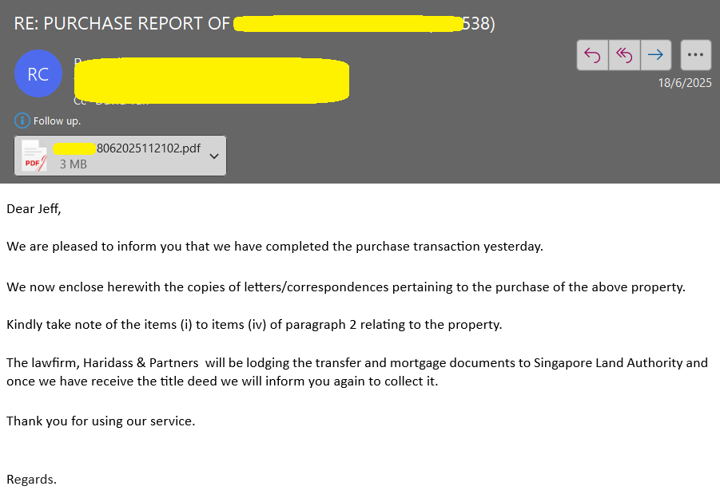
> 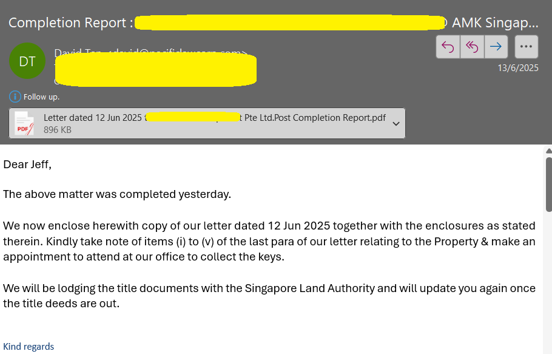
> 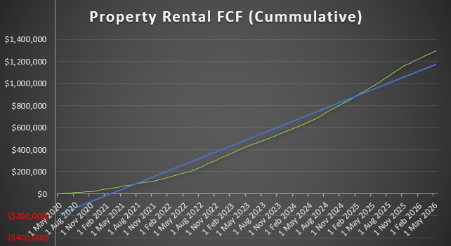
>
> > 🔁 **Quoted: Jeff Sun, CFTe** (@jfsrev):
> > 13th year in the game, this is how trading has changed my life.
> >
> > my 11th property purchase via a 1 million profit cash out over the last 2 weeks.
> >
> > my first full cash purchase, no mortgage repayment obligation. https://t.co/oMg32SAdtU
>
> *[View Original Post on X](https://x.com/jfsrev/status/1940308329982828963) · ❤️ 262 likes*

> 💬 **Jeff Sun, CFTe** ([@jfsrev](https://x.com/jfsrev)) · *2023-07-23*
>
> Grateful for the years of independence, I'll be closing out this brokerage account. I'm thrilled to be embarking on my journey in the realm of fund management with acceptance of a direct closed ended investment from a global macro strategic fund into my one-person LLC. As the https://t.co/GqbaTIEX2b
>
> 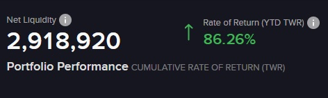
>
> *[View Original Post on X](https://x.com/jfsrev/status/1683198395748585472) · ❤️ 2,002 likes*

That said, I remain active on Twitter , LinkedIn , and Instagram . This space serves as a central FAQ reference and will be continually updated and expanded over time. If any of my content has been helpful, you’re welcome to pledge a gift subscription, buy me a coffee, or subscribe to my Twitter/X for my direct trade ideas and curated market commentary .

Twitter/X Subscription

Give a gift subscription

Buy me a coffee

### Content Page

Glossary – Terms and Expressions I Use

Charting – My Approach Using TradingView

My Screeners – Workflow of Finviz & Tradingview

Process & Routine – Moving Ideas to the Focus List

Pre-Market Routine – Situational Awareness

Proficient Execution– Trade Design, Stops, % Risk

Post-Execution – Trade Management

Journaling – Fine-Tuning to Improve YoY % Return

Conviction – Internalizing These 6 Graphics

Full-Time Trading – What Does It Takes

Five Books I Highly Recommend To Everyone

Free Productivity Tools & Websites I Rely On

How I Delayed My Own Progress by 3 Years

Reflections and Experiences for You to Relate To

Closing Remarks – A Call to Inspiration

FAQ, Paired with Thought-Provoking Questions

Subtle Strategies to Attract Institutional Attention

---

# Chapter 1. Glossary of Terms and Expressions I Often Use in my Twitter Commentary

LoD : Low of intraday price action at the time

RVOL : Relative volume compared to the average (typically 50-Day sessions)

T+3 : T = execution day; +1 = Day 1 after execution; +3 = Day 3 after execution. ‘Day' does not include weekends or market holiday.

VARS : Volatility Adjusted Relative Strength

> 💬 **Jeff Sun, CFTe** ([@jfsrev](https://x.com/jfsrev)) · *2025-04-08*
>
> yes, I thought of this idea as well to increase the RS accuracy with incoporation of atr% of the security and the reference ($SPY for most case) in the RS line. eg. A 10% move in a 20% adr name should not actually have RS day if $SPY is up 2% on 1% ADR. 
>
> thanks for sharing this,
>
> > 🔁 **Quoted: Sasha** (@aktienaha):
> > @jfsrevg @jfsrevg How do you calculate relative strength? Are you aware of the considerations for including ATR in the calculation? https://t.co/E7L8seD3uf
>
> *[View Original Post on X](https://x.com/jfsrev/status/1909486454260351162) · ❤️ 67 likes*

> 💬 **Jeff Sun, CFTe** ([@jfsrev](https://x.com/jfsrev)) · *2025-04-08*
>
> yes, I thought of this idea as well to increase the RS accuracy with incoporation of atr% of the security and the reference ($SPY for most case) in the RS line. eg. A 10% move in a 20% adr name should not actually have RS day if $SPY is up 2% on 1% ADR. 
>
> thanks for sharing this,
>
> > 🔁 **Quoted: Sasha** (@aktienaha):
> > @jfsrevg @jfsrevg How do you calculate relative strength? Are you aware of the considerations for including ATR in the calculation? https://t.co/E7L8seD3uf
>
> *[View Original Post on X](https://x.com/jfsrev/status/1909486454260351162) · ❤️ 67 likes*

VARW : Volatility Adjusted Relative Weakness

ORH : Intraday opening range high at the time

R : “I closed the trade on +16R” etc. The “R” in R-Multiple represents the initial risk on a trade, defined by the difference between the entry price and the stop-loss level. An R-Multiple then expresses the profit or loss of a trade as a multiple of this initial “R” amount, allowing traders to objectively evaluate performance by focusing on the quality of trades relative to the risk taken

M30 Re-ORH : Post-open 30 minutes reclaim of the intraday opening range high

X × ATR% from 50-MA : X ATR% multiple extension from the 50-day moving average.

> 💬 **Jeff Sun, CFTe** ([@jfsrev](https://x.com/jfsrev)) · *2023-06-21*
>
> How can one measure stock price extension?
>
> In my view, decision-making in the trading business should rely on quantifiable data. A method I personally employ for scaling out and taking partial profits involves setting a threshold based on the multiple of Average True Range https://t.co/6oKfNXMFbs
>
> 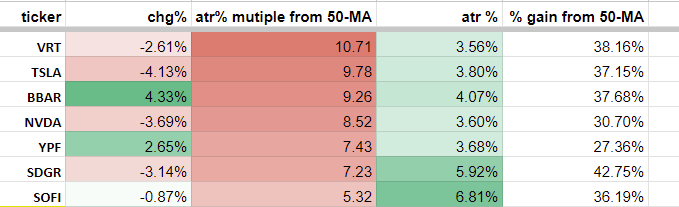
>
> *[View Original Post on X](https://x.com/jfsrev/status/1671541248044457986) · ❤️ 626 likes*

> 💬 **Jeff Sun, CFTe** ([@jfsrev](https://x.com/jfsrev)) · *2023-06-21*
>
> How can one measure stock price extension?
>
> In my view, decision-making in the trading business should rely on quantifiable data. A method I personally employ for scaling out and taking partial profits involves setting a threshold based on the multiple of Average True Range https://t.co/6oKfNXMFbs
>
> 
>
> *[View Original Post on X](https://x.com/jfsrev/status/1671541248044457986) · ❤️ 626 likes*

ATR: Average True Range, & ADR: Average Daily Range, and their differences

VCP : Volatility Contraction Pattern, popularized by Mark Minervini . To upgrade a watchlist stock into actionable focus list will require some form of VCP in price, or both price & volume. Every sustainable price expansion rally will always be preceded by a phase of price contraction/tightening. I will NEVER enter a stock with prior loose price action.

> 💬 **Jeff Sun, CFTe** ([@jfsrev](https://x.com/jfsrev)) · *2024-06-27*
>
> the only trading philosophy you'll ever need to make your first million dollars in the stock market.
>
> apply this principle when analyzing charts for opportunities https://t.co/4rUxp57l9N
>
> > 🔁 **Quoted: Jeff Sun, CFTe** (@jfsrev):
> > @PradeepBonde highlighted a crucial distinction between two types of stock movements, providing valuable insights to laser-focus your own stock selection, even within a breakout strategy. I personally categorize one as a range-expansive momentum move (e.g., $COIN on 20/11), while
>
> *[View Original Post on X](https://x.com/jfsrev/status/1806188623735509403) · ❤️ 606 likes*

> 💬 **Jeff Sun, CFTe** ([@jfsrev](https://x.com/jfsrev)) · *2024-06-27*
>
> the only trading philosophy you'll ever need to make your first million dollars in the stock market.
>
> apply this principle when analyzing charts for opportunities https://t.co/4rUxp57l9N
>
> > 🔁 **Quoted: Jeff Sun, CFTe** (@jfsrev):
> > @PradeepBonde highlighted a crucial distinction between two types of stock movements, providing valuable insights to laser-focus your own stock selection, even within a breakout strategy. I personally categorize one as a range-expansive momentum move (e.g., $COIN on 20/11), while
>
> *[View Original Post on X](https://x.com/jfsrev/status/1806188623735509403) · ❤️ 606 likes*

PEG: Post Earnings Gap , A significant price gap on heavy volume following an earnings report, which can occur as either a gap up or a gap down.

PEAD: Post-Earnings Announcement Drift (Delayed Reaction): is a well-documented market anomaly where stock prices continue to drift in the direction of an earnings surprise for some time following the announcement. This provides traders with an opportunity to exploit the delayed response of the market to new earnings information.

> 💬 **Jeff Sun, CFTe** ([@jfsrev](https://x.com/jfsrev)) · *2024-09-23*
>
> This process flow diagram from @AswathDamodaran's recent YouTube video on $NVDA price fade following an earnings beat is an excellent reference for anyone trading, EP, earnings gap-ups or post-earnings announcement drift (PEAD) strategies. 
>
> The chart also highlights how earnings https://t.co/Zynup02LXy
>
> 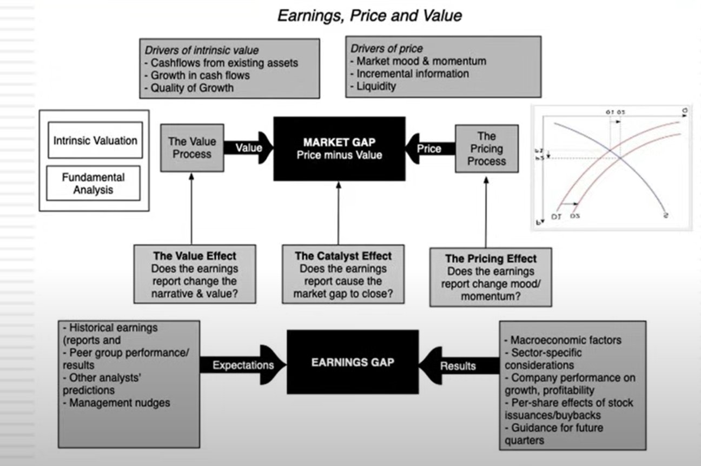
>
> *[View Original Post on X](https://x.com/jfsrev/status/1838201736043057192) · ❤️ 105 likes*

Rate of Change (ROC) : Measures the pace at which a stock's price is changing over time, helping identify accelerating or weakening momentum.

---

# Chapter 2. Charting - My Approach Using Tradingview

### My Templates, Indicators that I used, and how to utilize them:

2023 Version: https://x.com/jfsrev/status/1649333754215948290

> 💬 **Jeff Sun, CFTe** ([@jfsrev](https://x.com/jfsrev)) · *2023-04-21*
>
> Over the years, I have received numerous DMs expressing interest in my @tradingview indicators and setup. I would like to take this opportunity to delve deeper into the subject and share 4 indicators that I believe can provide extreme value, especially for free users. https://t.co/VzI4TBU1a7
>
> 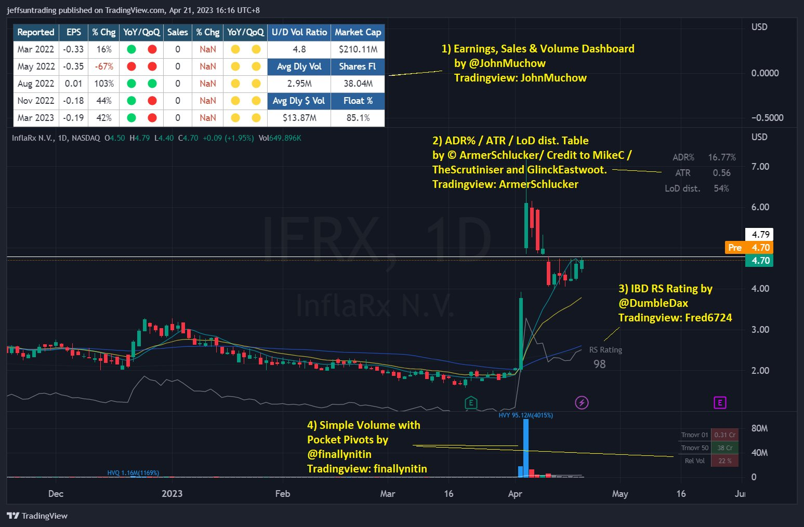
>
> *[View Original Post on X](https://x.com/jfsrev/status/1649333754215948290) · ❤️ 1,280 likes*

2024 Version: https://x.com/jfsrev/status/1818297619338395847

> 💬 **Jeff Sun, CFTe** ([@jfsrev](https://x.com/jfsrev)) · *2024-07-30*
>
> It's time to share my latest @tradingview template, as it's been over 15 months since I last shared it. I've now settled on two separate templates: the default template and the post-earnings template. You may have also noticed how I've overlaid two separate indicators within a https://t.co/7XVVtKdJnN
>
> 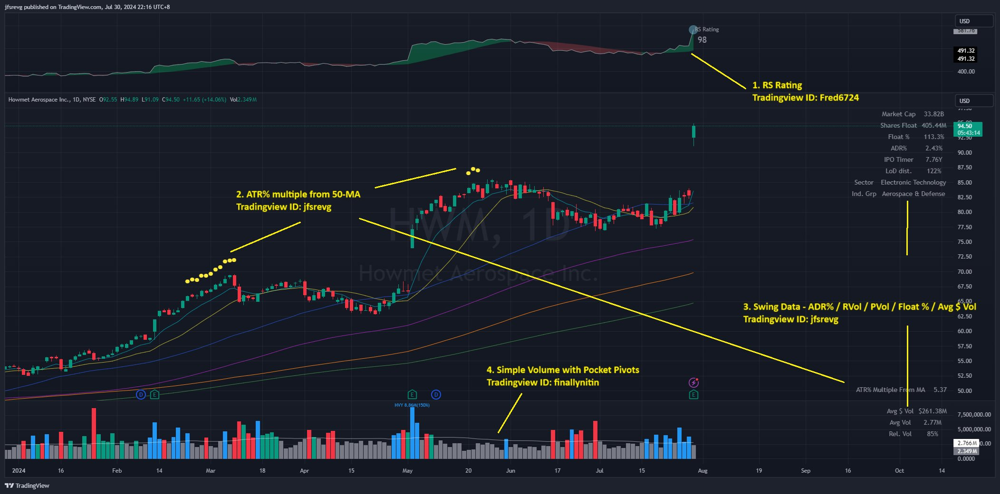
> 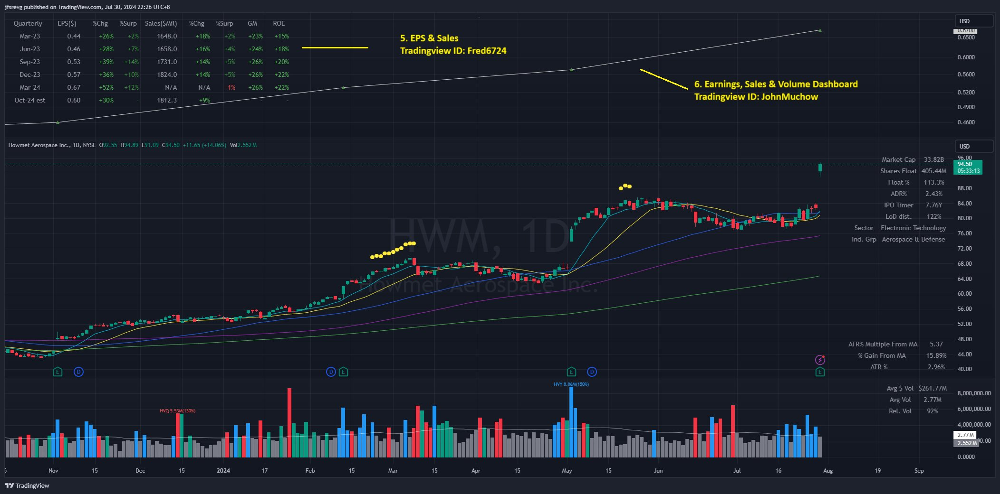
>
> > 🔁 **Quoted: Jeff Sun, CFTe** (@jfsrev):
> > Over the years, I have received numerous DMs expressing interest in my @tradingview indicators and setup. I would like to take this opportunity to delve deeper into the subject and share 4 indicators that I believe can provide extreme value, especially for free users. https://t.co/VzI4TBU1a7
>
> *[View Original Post on X](https://x.com/jfsrev/status/1818297619338395847) · ❤️ 689 likes*

2025 Version: Free indicators that have remained consistent pillars; (Direct Link to their Tradingview scripts, and explanation thread below)

2026: A commonly misunderstood concept: should you use a log chart or a linear chart?

### 1) Swing Data - ADR% / RVol / PVol / Float % / Avg $ Vol - Over 75k Users

https://www.tradingview.com/v/uloAa2EI/

### Bonus: Video demonstration of the indicator on the Mobile App

1. Understanding of ADR%

a) ADR%: Examining Trend-Following vs. Range- Expansive Move Behavior

> 💬 **Jeff Sun, CFTe** ([@jfsrev](https://x.com/jfsrev)) · *2024-11-03*
>
> ADR%: Examining Trend-Following vs. Range-Expansive Move Behavior
>
> I received an overwhelming response and numerous DMs (apologies if my replies are delayed, as I’m working to respond to each message constructively) across platforms, including LinkedIn and IG, about my recent https://t.co/h63mTBF1zc
>
> 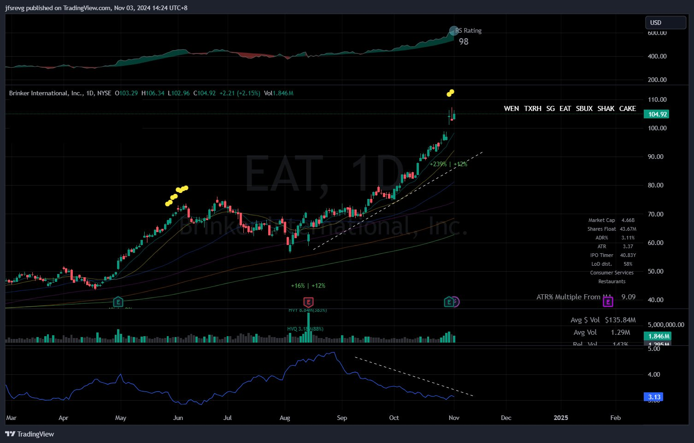
> 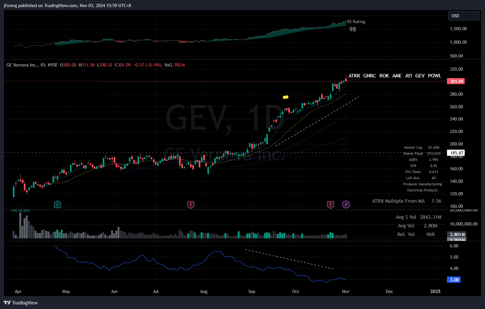
> 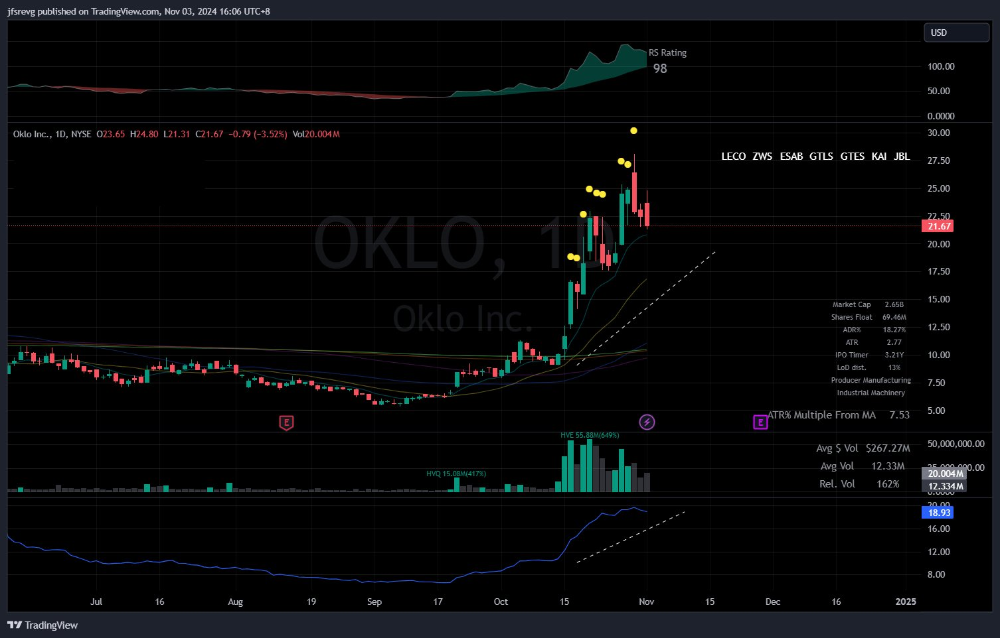
> 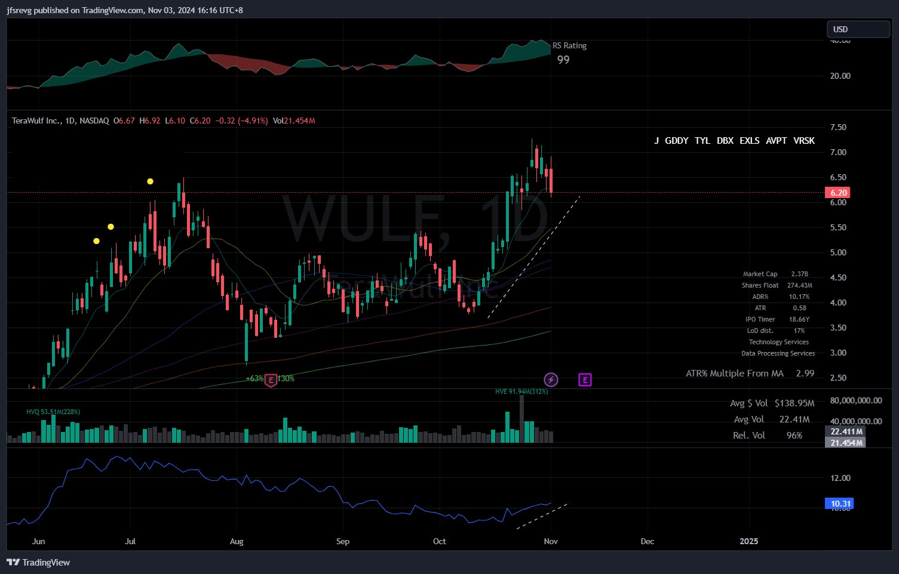
>
> > 🔁 **Quoted: Jeff Sun, CFTe** (@jfsrev):
> > @PradeepBonde highlighted a crucial distinction between two types of stock movements, providing valuable insights to laser-focus your own stock selection, even within a breakout strategy. I personally categorize one as a range-expansive momentum move (e.g., $COIN on 20/11), while
>
> *[View Original Post on X](https://x.com/jfsrev/status/1852994791795282188) · ❤️ 367 likes*

b) Understanding the Benefits of High ADR% Securities Relative to your Position Sizing

> 💬 **Jeff Sun, CFTe** ([@jfsrev](https://x.com/jfsrev)) · *2024-11-12*
>
> Understanding the Infeasibility of '1% Risk to Equity' and Benefits of High ADR% Securities
>
> Your question is excellent, and I’d like to clarify why aiming for a 1% risk-to-equity ratio is often unrealistic due to position sizing constraints. I’ll also compare lower ADR% https://t.co/oiqI6uyoMg
>
> 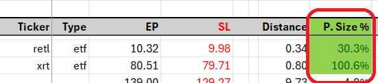
>
> > 🔁 **Quoted: Bearyo** (@bearyotrades):
> > @jfsrevg Good day boss!
> >
> > Does your pos size based on the average exit price based on the 3 size out - stop levels my good sir? 
> >
> > also, with these kind of trades is it advisable to keep the % risk below 1% or do you go way above the standard 1%?
>
> *[View Original Post on X](https://x.com/jfsrev/status/1856232860107350147) · ❤️ 406 likes*

c) Ballpark estimate of % capital allocation needed for executing securities based on different ADR% levels

> 💬 **Jeff Sun, CFTe** ([@jfsrev](https://x.com/jfsrev)) · *2025-07-01*
>
> Use this as a reference: the trade entry and stop are structured within a single candle print, based on fixed variables for risk percentage and % of Low-of-Day execution.
>
> 1% ADR, (30% LoD execution), 0.3% Risk to Equity = 
> 50% Capital Required
>
> 2% ADR, (30% LoD execution), 0.3%
>
> *[View Original Post on X](https://x.com/jfsrev/status/1939966489475547529) · ❤️ 127 likes*

d) Quallamaggie will always choose the leveraged ETF of the underlying securities, if available, for its higher ADR%.

> 💬 **Jeff Sun, CFTe** ([@jfsrev](https://x.com/jfsrev)) · *2025-09-24*
>
> the reason why we should trade leveraged ETFs of underlying products.
>
> halving the capital requirement for every 100% increase in adr%.
>
> > 🔁 **Quoted: Kristjan Kullamägi 🇺🇦** (@Qullamaggie):
> > @TedHZhang More like $IONX $RGTX $QUBX personally :)
>
> *[View Original Post on X](https://x.com/jfsrev/status/1970761700472430903) · ❤️ 149 likes*

e) Here is where I get my full leveraged ETF list, and update them on monthly basis

> 💬 **Jeff Sun, CFTe** ([@jfsrev](https://x.com/jfsrev)) · *2025-11-06*
>
> https://t.co/Q1Qye80rWe
>
> You might find this useful for building your own complete list of tradable leveraged ETFs:
>
> Here’s how I create my liquid leveraged ETF list:
> 1. Copy the full list from the site.
> 2. Use ChatGPT to extract only the ticker symbols separated by commas (e.g.
>
> *[View Original Post on X](https://x.com/jfsrev/status/1986252984481960281) · ❤️ 72 likes*

f) I track only 30 (out of 147) liquid leveraged ETFs with higher ADR% its holdings, and over $100M in average dollar volume - Updated 24th April 2026

> 💬 **Jeff Sun, CFTe** ([@jfsrev](https://x.com/jfsrev)) · *2026-04-24*
>
> $SOXL (3x SOXX) has drawn significant interest after 17 straight higher closes, +135% MTD run. 
>
> I track only 30 (out of 147) liquid leveraged ETFs with higher ADR% its holdings, and over 100M in average dollar volume - offering similar advantages, which is also advocated by https://t.co/B5uj0Zdr0L
>
> 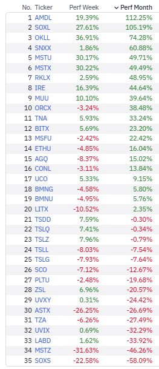
>
> > 🔁 **Quoted: Jeff Sun, CFTe** (@jfsrev):
> > $SOXL - Why I Don't Recommend Your Brokerage's Automated Moving Average Trailing Stop System
> >
> > $SOXL position has been held for 68 calendar days since the May 8 entry. I strongly advise against using automated trailing stop systems offered by your brokerage due to wide price https://t.co/rI2JItPTmD
>
> *[View Original Post on X](https://x.com/jfsrev/status/2047520220613628387) · ❤️ 155 likes*

g) Overlooked Perks of Using Leveraged ETFs: positive compounding ARM +90% vs ARMG (2x) + 220% (not +180% ) - Updated 3rd June 2026

> 💬 **Jeff Sun, CFTe** ([@jfsrev](https://x.com/jfsrev)) · *2026-06-03*
>
> Under the FAQ session, this is extensively covered. I also want to highlight a few pointers discussed in the previous thread that is misunderstood;
>
> 1. if underlying asset rises steadily, a 2× or 3× ETF can actually outperform the expected multiple due to positive compounding. https://t.co/MSTIV93XZo
>
> 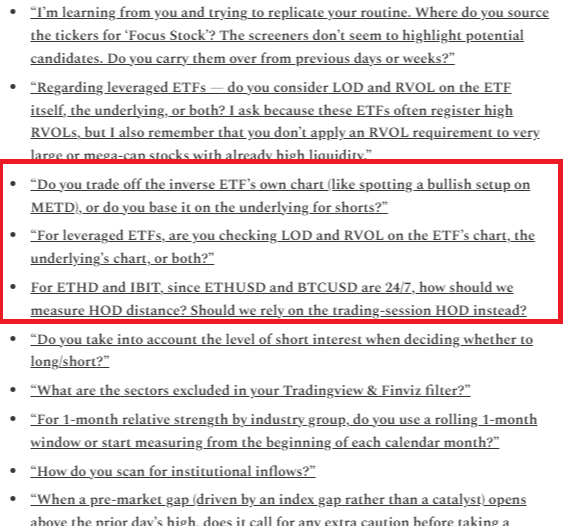
>
> *[View Original Post on X](https://x.com/jfsrev/status/2062166612686598646) · ❤️ 75 likes*

> 💬 **Jeff Sun, CFTe** ([@jfsrev](https://x.com/jfsrev)) · *2026-06-03*
>
> Under the FAQ session, this is extensively covered. I also want to highlight a few pointers discussed in the previous thread that is misunderstood;
>
> 1. if underlying asset rises steadily, a 2× or 3× ETF can actually outperform the expected multiple due to positive compounding. https://t.co/MSTIV93XZo
>
> 
>
> *[View Original Post on X](https://x.com/jfsrev/status/2062166612686598646) · ❤️ 75 likes*

f) Overlooked Perks of Using Leveraged ETFs: Analogy of using $2 to make $4 instead of $4 to make $4 without borrowing cost . - Updated 3rd June 2026

> 💬 **Jeff Sun, CFTe** ([@jfsrev](https://x.com/jfsrev)) · *2026-06-03*
>
> $INTC (7.7% ADR) via $INTW (15.6% ADR) at $200 Mil Avg Dollar Vol
>
> This is actually one of the five focus ideas I shared with my group today, but I think it’s helpful to show how ADR%, the 3-stop framework, T+3 partial sale, and tight LoD entries all integrate within my process. https://t.co/WTY2heoStH
>
> 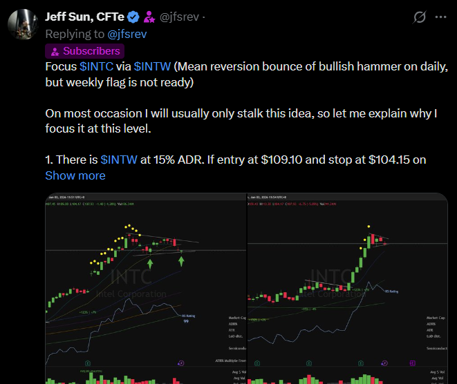
> 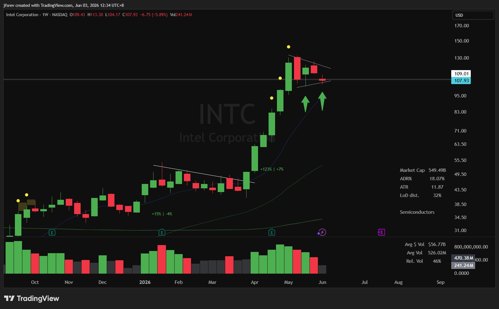
>
> > 🔁 **Quoted: thegolden** (@fareast06):
> > @jfsrev Would you consider INTC the same setup as GLW yesterday?
>
> *[View Original Post on X](https://x.com/jfsrev/status/2062030307604517029) · ❤️ 131 likes*

> 💬 **Jeff Sun, CFTe** ([@jfsrev](https://x.com/jfsrev)) · *2026-06-03*
>
> $INTC (7.7% ADR) via $INTW (15.6% ADR) at $200 Mil Avg Dollar Vol
>
> This is actually one of the five focus ideas I shared with my group today, but I think it’s helpful to show how ADR%, the 3-stop framework, T+3 partial sale, and tight LoD entries all integrate within my process. https://t.co/WTY2heoStH
>
> 
> 
>
> > 🔁 **Quoted: thegolden** (@fareast06):
> > @jfsrev Would you consider INTC the same setup as GLW yesterday?
>
> *[View Original Post on X](https://x.com/jfsrev/status/2062030307604517029) · ❤️ 131 likes*

> 💬 **Jeff Sun, CFTe** ([@jfsrev](https://x.com/jfsrev)) · *2026-06-03*
>
> $INTC (7.7% ADR) via $INTW (15.6% ADR) at $200 Mil Avg Dollar Vol
>
> This is actually one of the five focus ideas I shared with my group today, but I think it’s helpful to show how ADR%, the 3-stop framework, T+3 partial sale, and tight LoD entries all integrate within my process. https://t.co/WTY2heoStH
>
> 
> 
>
> > 🔁 **Quoted: thegolden** (@fareast06):
> > @jfsrev Would you consider INTC the same setup as GLW yesterday?
>
> *[View Original Post on X](https://x.com/jfsrev/status/2062030307604517029) · ❤️ 131 likes*

g) A Swing Trader's Product Edge: Capturing Positive Compounding, While Halving Capital with Leveraged ETFs - SOXX vs SOXL in 2 months - Updated 9th June 2026

> 💬 **Jeff Sun, CFTe** ([@jfsrev](https://x.com/jfsrev)) · *2026-06-09*
>
> A Swing Trader's Product Edge: Capturing Positive Compounding, While Halving Capital with Leveraged ETFs
>
> $SOXX vs. $SOXL (3× $SOXX)
>
> Trade Setup
> Entry: April 8 High
> Stop: April 8 Low
> Current Reference: June 8 Close
> Holding Period: 42 trading days (2 months + 1 day)
>
> Performance https://t.co/Qje6Tv0UbI
>
> 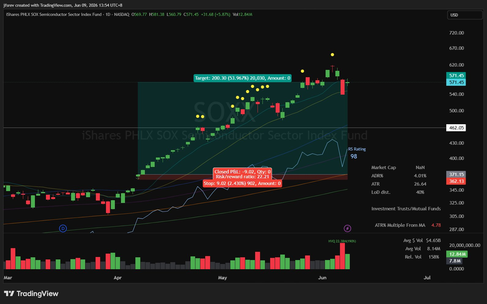
> 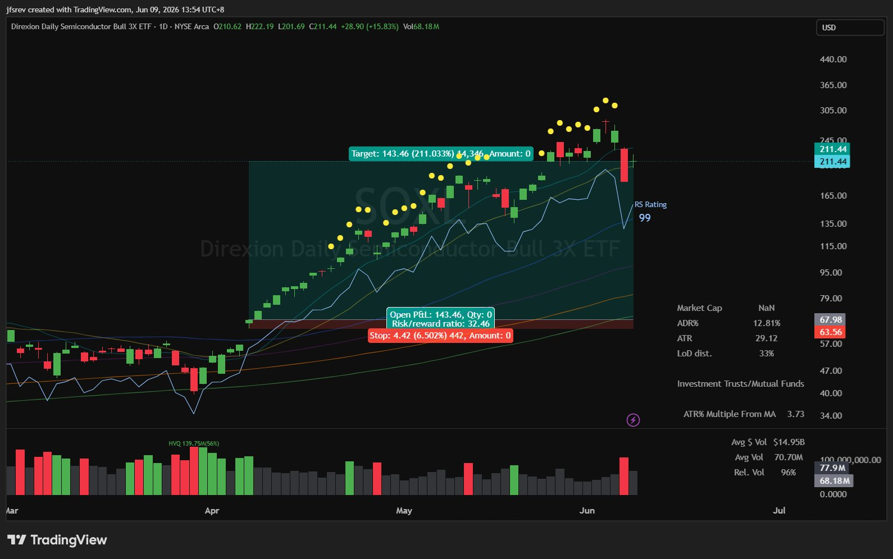
>
> > 🔁 **Quoted: Jeff Sun, CFTe** (@jfsrev):
> > Under the FAQ session, this is extensively covered. I also want to highlight a few pointers discussed in the previous thread that is misunderstood;
> >
> > 1. if underlying asset rises steadily, a 2× or 3× ETF can actually outperform the expected multiple due to positive compounding. https://t.co/MSTIV93XZo
>
> *[View Original Post on X](https://x.com/jfsrev/status/2064230774463926684) · ❤️ 245 likes*

> 💬 **Jeff Sun, CFTe** ([@jfsrev](https://x.com/jfsrev)) · *2026-06-09*
>
> A Swing Trader's Product Edge: Capturing Positive Compounding, While Halving Capital with Leveraged ETFs
>
> $SOXX vs. $SOXL (3× $SOXX)
>
> Trade Setup
> Entry: April 8 High
> Stop: April 8 Low
> Current Reference: June 8 Close
> Holding Period: 42 trading days (2 months + 1 day)
>
> Performance https://t.co/Qje6Tv0UbI
>
> 
> 
>
> > 🔁 **Quoted: Jeff Sun, CFTe** (@jfsrev):
> > Under the FAQ session, this is extensively covered. I also want to highlight a few pointers discussed in the previous thread that is misunderstood;
> >
> > 1. if underlying asset rises steadily, a 2× or 3× ETF can actually outperform the expected multiple due to positive compounding. https://t.co/MSTIV93XZo
>
> *[View Original Post on X](https://x.com/jfsrev/status/2064230774463926684) · ❤️ 245 likes*

h) My Latest Full List of Stock Based Liquid Leverage and Inverse ETFs - Updated 19th June 2026

i) Misconception of Leverage ETF explained by youtuber WallStreetMillennial via "South Korea Stock Market Crash, Foreshadowing For USA” - Updated 4th August 2026

> 💬 **Jeff Sun, CFTe** ([@jfsrev](https://x.com/jfsrev)) · *2026-08-18*
>
> One common misconception about leveraged ETFs is that “leverage” means you’re borrowing against your equity. In reality, the leverage is embedded within the ETF itself, the fund uses derivatives and other instruments to amplify the underlying asset's daily returns. I am a strong https://t.co/LOxAczu4yo
>
> 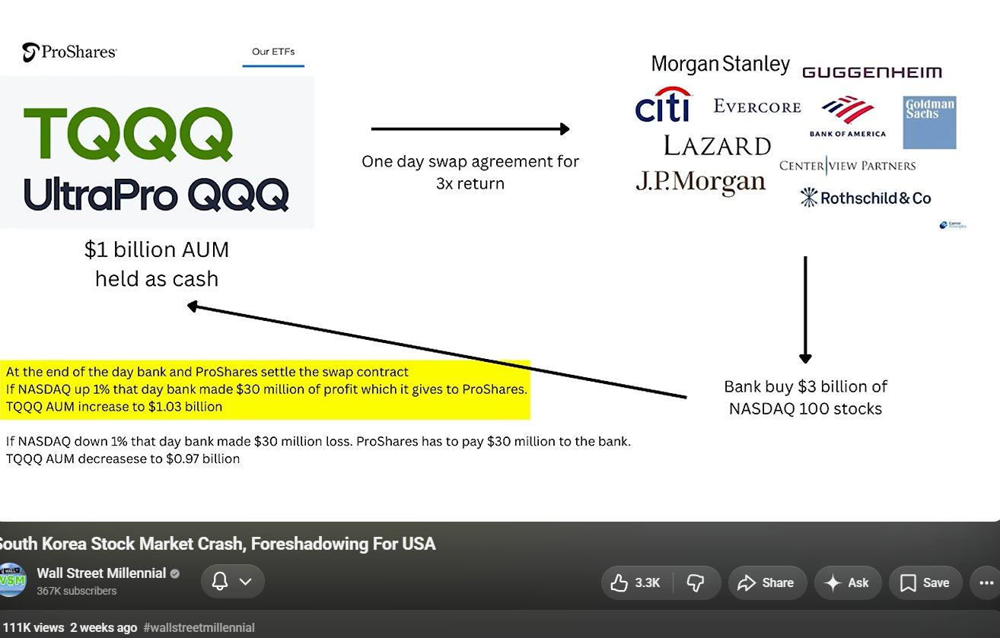
>
> > 🔁 **Quoted: Jeff Sun, CFTe** (@jfsrev):
> > This is how we do it 💪🏻 
> >
> > "Build a stringent process that you own and could follow with longevity." https://t.co/AkYy8nzvHo
>
> *[View Original Post on X](https://x.com/jfsrev/status/2089568694863265929) · ❤️ 142 likes*

> 💬 **Jeff Sun, CFTe** ([@jfsrev](https://x.com/jfsrev)) · *2026-08-18*
>
> One common misconception about leveraged ETFs is that “leverage” means you’re borrowing against your equity. In reality, the leverage is embedded within the ETF itself, the fund uses derivatives and other instruments to amplify the underlying asset's daily returns. I am a strong https://t.co/LOxAczu4yo
>
> 
>
> > 🔁 **Quoted: Jeff Sun, CFTe** (@jfsrev):
> > This is how we do it 💪🏻 
> >
> > "Build a stringent process that you own and could follow with longevity." https://t.co/AkYy8nzvHo
>
> *[View Original Post on X](https://x.com/jfsrev/status/2089568694863265929) · ❤️ 142 likes*

2. Understanding of LoD distance of ATR

a) What does “60% ATR below LoD” mean at the execution level? It’s a concept often emphasized in Qullamaggie’s streams

> 💬 **Jeff Sun, CFTe** ([@jfsrev](https://x.com/jfsrev)) · *2024-05-09*
>
> I got several questions about an earlier post in comments and via DMs, particularly about this statement and a simple rule I swear by, "If you're precise and efficient with your entries—ensuring entries are always below 50/60% from the LoD stop based on ATR nature of the https://t.co/uwZGWoAkL5
>
> 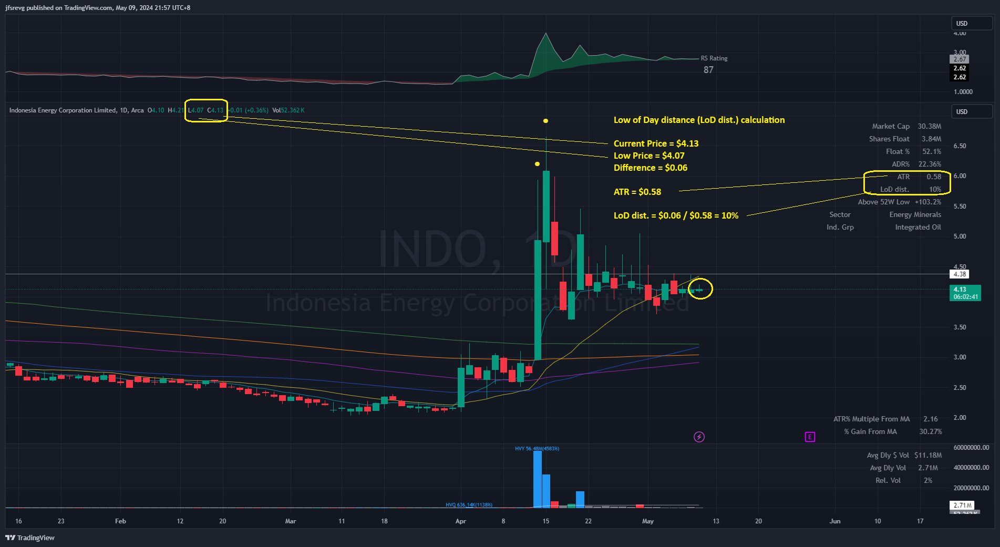
> 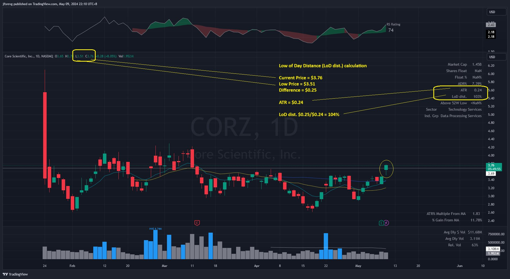
>
> > 🔁 **Quoted: Jeff Sun, CFTe** (@jfsrev):
> > I love this sharing, I totally relate to this. If you're precise and efficient with your entries—ensuring entries are always below 50/60% from the LoD stop based on ATR nature of the securities volatility—then taking a 0.15% risk to your net liquidation value can easily scale up
>
> *[View Original Post on X](https://x.com/jfsrev/status/1788583106418541011) · ❤️ 501 likes*

b) Perks of <60% LoD Execution

> 💬 **Jeff Sun, CFTe** ([@jfsrev](https://x.com/jfsrev)) · *2024-05-08*
>
> I love this sharing, I totally relate to this. If you're precise and efficient with your entries—ensuring entries are always below 50/60% from the LoD stop based on ATR nature of the securities volatility—then taking a 0.15% risk to your net liquidation value can easily scale up
>
> > 🔁 **Quoted: Dario** (@TMLitalia):
> > My positions are usually 10-20%...this is the risk table of the last open positions...you don't have to risk so much to have good positions and move the portfolio, especially at this point...better to buy intelligently https://t.co/9XO2ezOYgg
>
> *[View Original Post on X](https://x.com/jfsrev/status/1788135099273281737) · ❤️ 199 likes*

c) This is why you should trade tight

> 💬 **Jeff Sun, CFTe** ([@jfsrev](https://x.com/jfsrev)) · *2023-04-18*
>
> $ETHE $IREN $BGXX $AQST
>
> some graphical explanation of RRR from last week's trade highlighted in my daily market diary on why I prioritize executing tight before expansion.
>
> you can't just jump into the bandwagon because everyone is doing so.
>
> "Only in murky water, you catch big https://t.co/zVMlrjoDZB
>
> 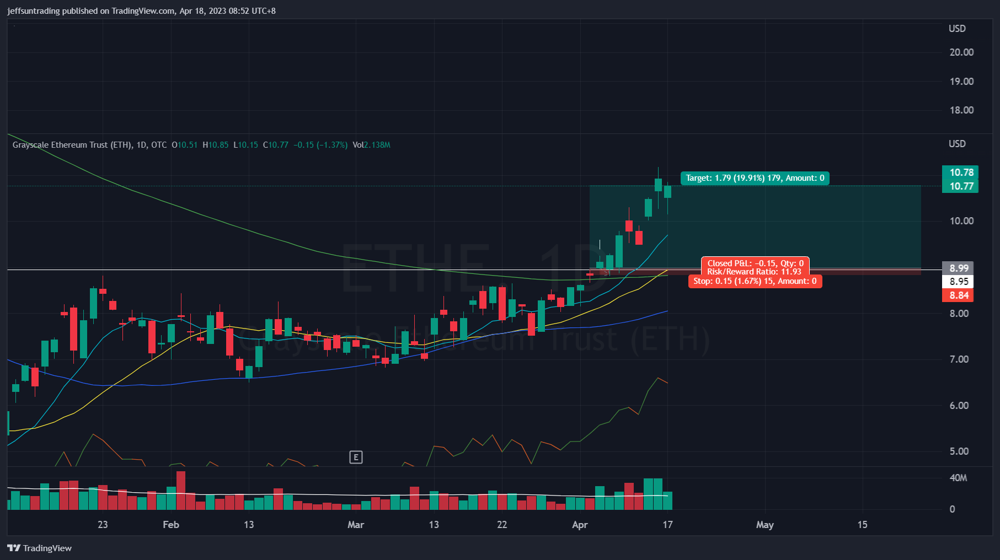
> 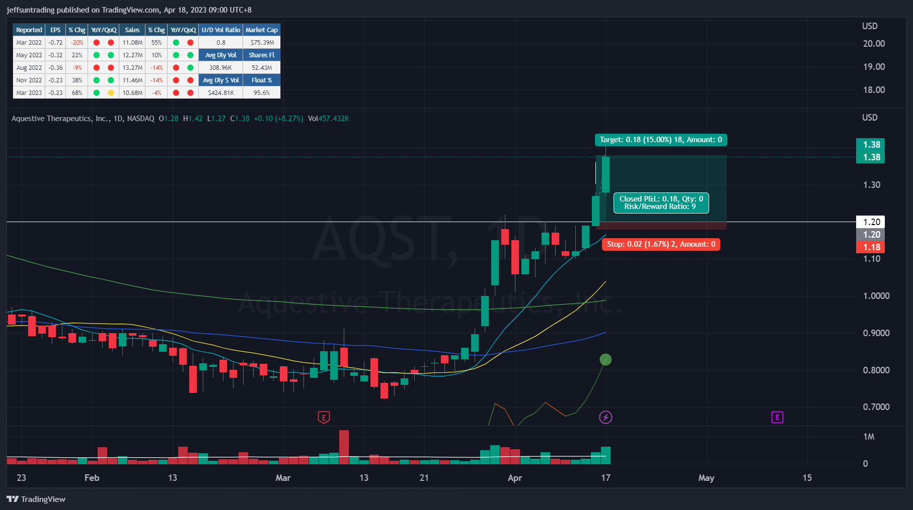
> 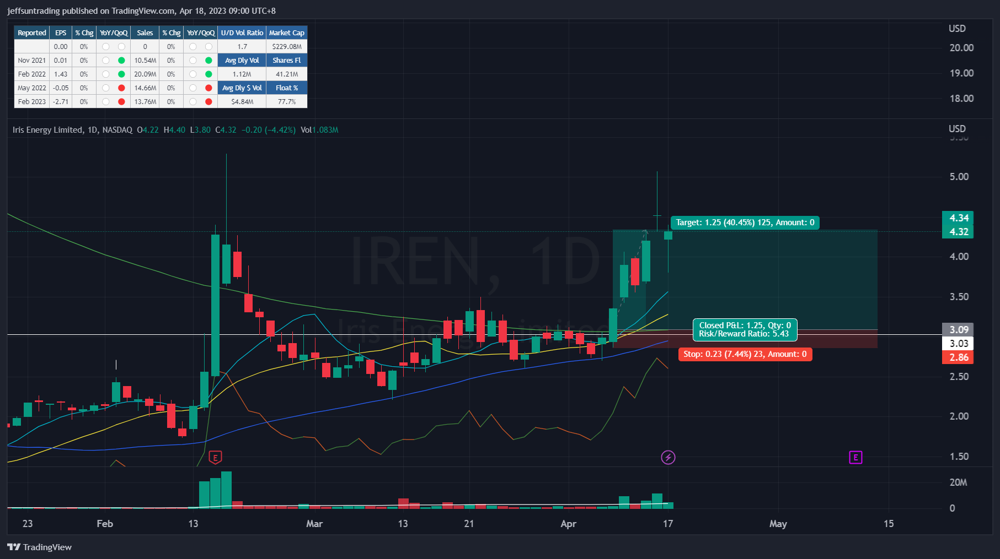
> 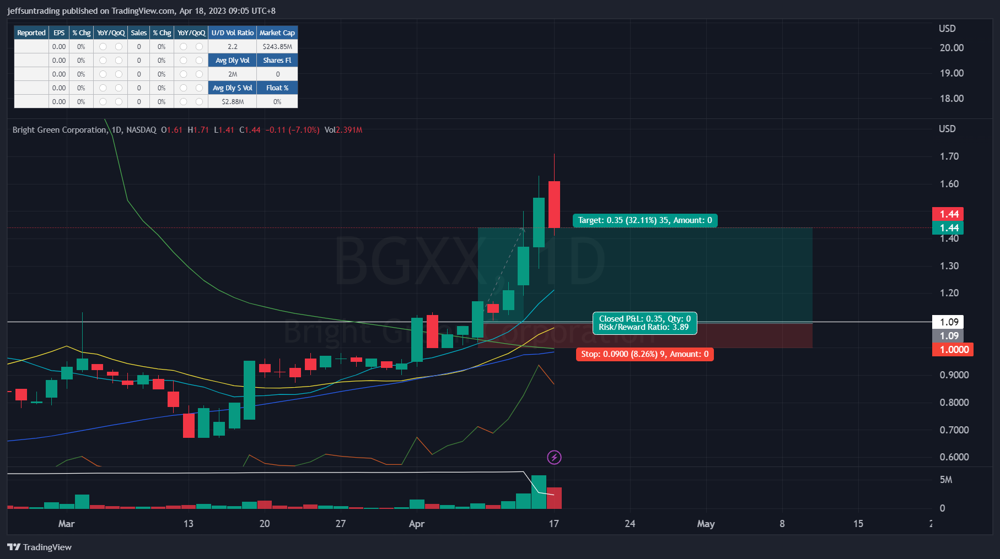
>
> *[View Original Post on X](https://x.com/jfsrev/status/1648131096901726209) · ❤️ 60 likes*

d) I kicked started USIC 2023 in 2nd Place based on small caps, high volume turnover to market cap, and entry at breakout level without LoD exceeding 60% ATR

> 💬 **Jeff Sun, CFTe** ([@jfsrev](https://x.com/jfsrev)) · *2023-02-23*
>
> @Big_Poppyy the smaller the cap, the more violent the % move when range starts expanding. most stocks in my wl have daily avg $ vol of at least 5% to their market cap 
>
> entries are also extremely impt. I refined to only take trades that can bid up BO lvl without LoD exceeding 60% ATR,
>
> *[View Original Post on X](https://x.com/jfsrev/status/1628559711917473793) · ❤️ 108 likes*

3. Understanding of RVOL (Relative Volume)

a) Using RVOL for entry confirmation: Strong volume run-rate as first proof of strong buying for exceptional short term return (eg. my +180% KC trade in 6 weeks)

> 💬 **Jeff Sun, CFTe** ([@jfsrev](https://x.com/jfsrev)) · *2025-07-20*
>
> https://t.co/pycxlJCnbm
>
> the principle of implementing RVOL to entry affirmation is that you want a strong volume run rate as evidence of strong buying footprints and to reduce subpar trading (sniping vs. firing a machine gun)
>
> > 🔁 **Quoted: Stephen Trades** (@Stephen_Trades1):
> > @jfsrev Yeah, I’ve been making up for the minimal size left by the first/second stop out by adding the position back to full size if price comes back through the buy point. I did this with APLD twice before the trade eventually worked and went very green. 
> >
> > I’ve been using this strategy
>
> *[View Original Post on X](https://x.com/jfsrev/status/1946777562648383700) · ❤️ 38 likes*

b) RVOL based entry on ORH have proven statistical edge in the market

> 💬 **Jeff Sun, CFTe** ([@jfsrev](https://x.com/jfsrev)) · *2024-07-05*
>
> ORH + Relative Volume has a big edge in the market
>
> > 🔁 **Quoted: Concretum Research** (@ConcretumR):
> > Valuable insights from market wizard and systematic trader @mars10p during his interview by @chatwithtraders
> >
> > I was not aware of him trading breakouts/breakdowns on high-volume stocks since the 90s. Very similar to the strategy we presented in our awarded paper
> >
> > A Profitable Day https://t.co/LTnnhJO7t9
>
> *[View Original Post on X](https://x.com/jfsrev/status/1809139555041518052) · ❤️ 299 likes*

c) RVOL based entry rules have saved me from countless unnecessary stop losses year after year

> 💬 **Jeff Sun, CFTe** ([@jfsrev](https://x.com/jfsrev)) · *2025-08-14*
>
> This week, price alerts kept triggering, but the outcome today served as a reminder of the importance of Relative Volume (RVOL) based execution in individual stock, and the timeless principle of relative strength (volatility adjusted RS for my case).
>
> 1. I avoided numerous
>
> > 🔁 **Quoted: Jeff Sun, CFTe** (@jfsrev):
> > $ITB (Update) - Took $PAVE instead due to $ITB previous session loose action. equal weight $XHB outperforms among the three. https://t.co/5mHZ0IlXpz
>
> *[View Original Post on X](https://x.com/jfsrev/status/1955826518644678725) · ❤️ 170 likes*

d) Adam H. Grimes explains the concept of RVOL in 2015 better than anyone else

> 💬 **Adam Grimes** ([@AdamHGrimes](https://x.com/AdamHGrimes)) · *2025-08-19*
>
> @jfsrev I'll try to write a blog post on this topic soon. I quantified the concepts and wrote the original code (that's still being used in many places) for RVol nearly 15 years ago.
>
> *[View Original Post on X](https://x.com/AdamHGrimes/status/1957795316066873464) · ❤️ 24 likes*

e) Honored that Adam H. Grimes wrote a piece on RVOL in 2025 after my tweet caught his attention.

> 💬 **Adam Grimes** ([@AdamHGrimes](https://x.com/AdamHGrimes)) · *2025-08-22*
>
> @jfsrev https://t.co/PoN2LasYhS
>
> *[View Original Post on X](https://x.com/AdamHGrimes/status/1958884198430703784) · ❤️ 28 likes*

g) Think of RVOL based entry as surfing ocean waves, not drifting through a river stream. - 5th June 2026 Update

f) Volume Expansion Based Entry Is a Quality Filter Itself. - 5th June 2026 Update

> 💬 **Jeff Sun, CFTe** ([@jfsrev](https://x.com/jfsrev)) · *2026-06-05*
>
> Volume Expansion Based Entry Is a Quality Filter Itself.
>
> Volume buzz is the one constant I've observed across 7 years of @Qullamaggie's stream (it elevated to also pre-buzz in 2024 for his EP). It's the foundation of his execution—similar to using RVOL to identify stocks with https://t.co/kEOtmZVnXS
>
> 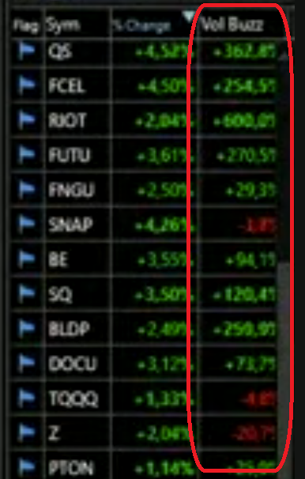
> 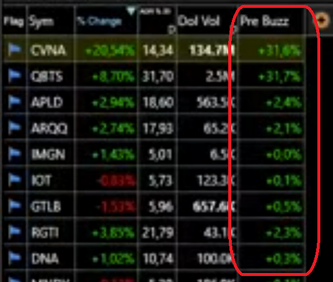
>
> > 🔁 **Quoted: Jeff Sun, CFTe** (@jfsrev):
> > @Qullamaggie was the reason I started diving deep into the importance of ADR%, volume run rate (his vol buzz) and LoD &lt;ATR entries to sharpen my performance. He wouldn’t have repeated the same concepts across every streams for 7 years without reason.
> >
> > I wasn’t as focused on
>
> *[View Original Post on X](https://x.com/jfsrev/status/2062758324358238644) · ❤️ 293 likes*

g) The importance of selectivity in execution: Low RVOL breakout failures - 24th July 2026 Update

4. Understanding Average $ Volume and Average Share Volume

a) Slippage and widen spreads at execution have cost me 6-7% of my 2021 total equity

> 💬 **Jeff Sun, CFTe** ([@jfsrev](https://x.com/jfsrev)) · *2022-11-12*
>
> To give u an idea, slippages in turnaround alone in my 9 years with 4 diff brokers cost me almost 6-7% of my current equity. my risk is only 0.15%-0.25% per trade on current equity.
>
> this is very substantial. back-testing is skewed and distorted, not reliable to prove yr edge
> 7/
>
> *[View Original Post on X](https://x.com/jfsrev/status/1591446897100824577) · ❤️ 87 likes*

5. Understanding of Market Cap, Low Float %, Short Float

a) The best % performers almost always have these three ingredients.

> 💬 **Jeff Sun, CFTe** ([@jfsrev](https://x.com/jfsrev)) · *2025-07-14*
>
> 1. High ADR%
> 2. Low Float
> 3. High Short Float %
>
> https://t.co/vu5gqy7ABf
>
> > 🔁 **Quoted: Lone** (@lonextrades):
> > Qullamaggie’s Perfect Stock - TASR (2003-2004)
> >
> > “Yeah, I’m going to show you the perfect stock. I’m going to show you a ticker I have in my database - TASR. Went from 35 cents to 30 bucks - almost a 100 bagger in a year. This thing had several high tight flags. Okay, pay https://t.co/vBIL5SfK7d
>
> *[View Original Post on X](https://x.com/jfsrev/status/1944595506853970049) · ❤️ 419 likes*

b) I pulled all top 100% performers from 2018 to 2024 for you to study

> 💬 **Jeff Sun, CFTe** ([@jfsrev](https://x.com/jfsrev)) · *2024-11-02*
>
> We can't ignore the timeless principle of relative strength. I was reviewing this week pullback price action of the top 100 stocks by YTD percentage gain on @Barchart, and the results are incredible how some do not even revisit their 10-MA,while most don't violate their 20-MA.
>
> > 🔁 **Quoted: Ross Haber** (@RossHaber):
> > Don’t just track price. Pay attention to relative strength. When there is a divergence, and RS breaks new highs before price, it’s a strong sign of a stock ready to lead. This edge has made all the difference.
>
> *[View Original Post on X](https://x.com/jfsrev/status/1852524466510962850) · ❤️ 327 likes*

### 2) ATR% multiple from 50-MA - Over 47k Users

https://www.tradingview.com/script/oimVgV7e-ATR-multiple-from-50-MA/

1. Understanding ATR-Defined Volatility Extensions of Stock Prices in Relation to the 50-Day Moving Average

a) One core trading philosophy is all it takes to make your first million from swing trading

> 💬 **Jeff Sun, CFTe** ([@jfsrev](https://x.com/jfsrev)) · *2024-06-27*
>
> the only trading philosophy you'll ever need to make your first million dollars in the stock market.
>
> apply this principle when analyzing charts for opportunities https://t.co/4rUxp57l9N
>
> > 🔁 **Quoted: Jeff Sun, CFTe** (@jfsrev):
> > @PradeepBonde highlighted a crucial distinction between two types of stock movements, providing valuable insights to laser-focus your own stock selection, even within a breakout strategy. I personally categorize one as a range-expansive momentum move (e.g., $COIN on 20/11), while
>
> *[View Original Post on X](https://x.com/jfsrev/status/1806188623735509403) · ❤️ 606 likes*

b) How can stock price extension be quantified objectively?

> 💬 **Jeff Sun, CFTe** ([@jfsrev](https://x.com/jfsrev)) · *2023-06-21*
>
> How can one measure stock price extension?
>
> In my view, decision-making in the trading business should rely on quantifiable data. A method I personally employ for scaling out and taking partial profits involves setting a threshold based on the multiple of Average True Range https://t.co/6oKfNXMFbs
>
> 
>
> *[View Original Post on X](https://x.com/jfsrev/status/1671541248044457986) · ❤️ 626 likes*

c) My favorite indicator for partial profit taking into strength

> 💬 **Jeff Sun, CFTe** ([@jfsrev](https://x.com/jfsrev)) · *2023-06-27*
>
> The ATR% Multiples From 50-MA signal is further enhanced. Big credits to @DumbleDax and all the suggestions and contributions from you guys!
>
> 1. Corrected the calculation to use a % base for detection - Used the high of the candle as a reference for the detection to remain on the https://t.co/jMILYapr18
>
> 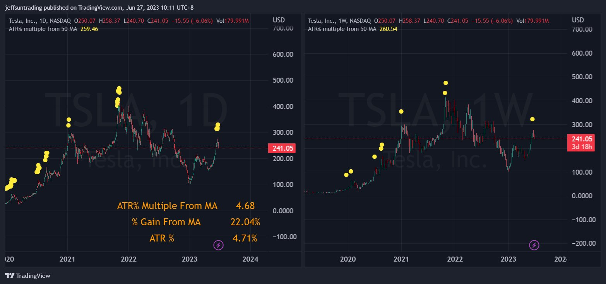
>
> > 🔁 **Quoted: Jeff Sun, CFTe** (@jfsrev):
> > We have publish the signal on @tradingview with all your suggestions. I would like to express my utmost gratitude to @DumbleDax for creating this tool amidst his other commitments and projects.
> >
> > Settings options allows you to setup your own comfortable ATR Multiple (eg. 5, 6, 7 https://t.co/l72S17SXhz
>
> *[View Original Post on X](https://x.com/jfsrev/status/1673515883271159809) · ❤️ 484 likes*

d) Advantage of utilizing ATR% extension for scaling out profits

> 💬 **Jeff Sun, CFTe** ([@jfsrev](https://x.com/jfsrev)) · *2023-06-21*
>
> The advantage of utilizing ATR% extension for scaling out profits is that every stock exhibits unique behavior in terms of daily ranges and volatility. Employing ATR% extension as a profit-taking strategy provides a straightforward and quantifiable approach, allowing decisions to
>
> *[View Original Post on X](https://x.com/jfsrev/status/1671543338422640641) · ❤️ 121 likes*

e) Employing 6-7 x ATR% multiple from 50-MA for Indexes

> 💬 **Jeff Sun, CFTe** ([@jfsrev](https://x.com/jfsrev)) · *2023-06-27*
>
> Lower ADR% ticker such as Indexes, I will employ '7' instead of '10' 
>
> Example on $QQQ https://t.co/fHsp731Z7l
>
> 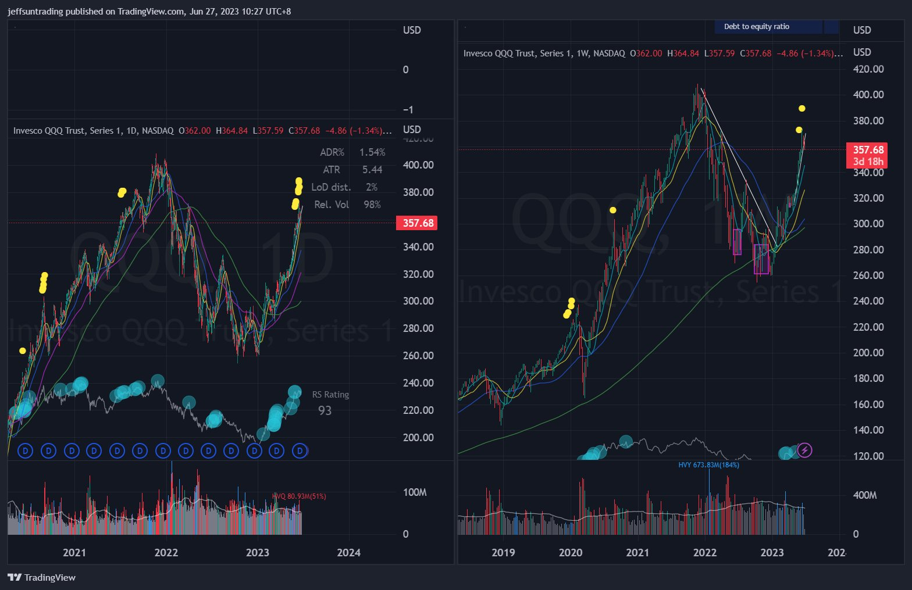
>
> *[View Original Post on X](https://x.com/jfsrev/status/1673518673318002688) · ❤️ 57 likes*

f) 10x ATR% compression can unfold at higher prices without any pullback ($LIF)

> 💬 **Jeff Sun, CFTe** ([@jfsrev](https://x.com/jfsrev)) · *2025-07-13*
>
> $LIF - *Educational Post*: Example of 10x ATR% Compression Without a Pullback, but at Higher Price.
>
> Many believe a 10x ATR% extension in a stock rally requires a significant price pullback (y-axis on chart) for ATR% compression. However, time (x-axis on chart) can also compress https://t.co/dMprClzgU7
>
> 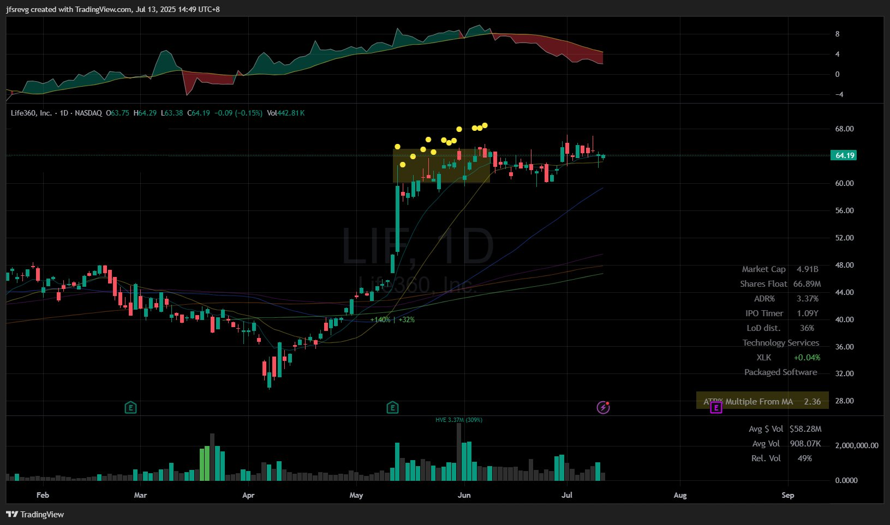
>
> *[View Original Post on X](https://x.com/jfsrev/status/1944301326453944377) · ❤️ 145 likes*

g) This is what happened to LIF after 10 weeks, without hindsight

> 💬 **Jeff Sun, CFTe** ([@jfsrev](https://x.com/jfsrev)) · *2025-09-27*
>
> $LIF - Update https://t.co/cjn7AFiCO8
>
> 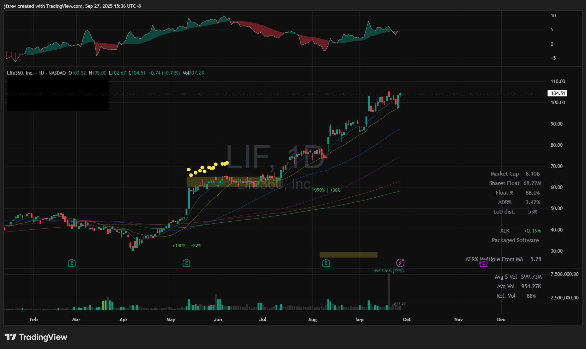
>
> > 🔁 **Quoted: Jeff Sun, CFTe** (@jfsrev):
> > $LIF - *Educational Post*: Example of 10x ATR% Compression Without a Pullback, but at Higher Price.
> >
> > Many believe a 10x ATR% extension in a stock rally requires a significant price pullback (y-axis on chart) for ATR% compression. However, time (x-axis on chart) can also compress https://t.co/dMprClzgU7
>
> *[View Original Post on X](https://x.com/jfsrev/status/1971841529808670905) · ❤️ 65 likes*

h) A reminder in patience: STX showed ATR% compression at $154, and the stock rallied +20% after tightened price action.

> 💬 **Jeff Sun, CFTe** ([@jfsrev](https://x.com/jfsrev)) · *2025-08-04*
>
> $STX – RS Leader in Electronics Tech, Strong Post-Earnings Momentum
>
> Last week we played a game to examine $STX ATR multiple extension from its 50-MA. It was 4.8x on Thursday and it further tightened to 4x on Friday. It also marked 3 straight sessions of notable relative strength https://t.co/cJrX9aluW5
>
> 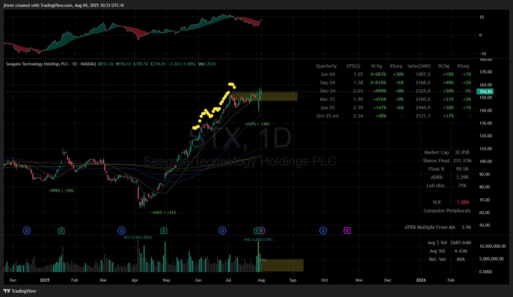
>
> > 🔁 **Quoted: Jeff Sun, CFTe** (@jfsrev):
> > Let’s play a game—make a guess (I’ve hidden the ATR% multiple).
> >
> > From June 3rd to July 7th, $STX ran up to a $152 peak, extending beyond 10x its ATR% from the 50-day MA throughout the period. Since then, it’s moved sideways for 18 sessions before closing at a new all-time high of https://t.co/aPPID6N1vP
>
> *[View Original Post on X](https://x.com/jfsrev/status/1952199616923062404) · ❤️ 58 likes*

i) ATR% Multiple to MA Accounts For Volatility vs % Extension From MA

> 💬 **Jeff Sun, CFTe** ([@jfsrev](https://x.com/jfsrev)) · *2024-03-01*
>
> I do not use a fixed % extension from 50-MA on individual stocks because you need to account for the volatility adjustment of the stock price daily average range behaviour. 
>
> When $TSLA was a stock in play back in 2019-2021, its volatility was as high as 6.5% ATR. If you fixate a
>
> > 🔁 **Quoted: Jeff Sun, CFTe** (@jfsrev):
> > I visualize entry spot as a launch pad for potential follow through with range expansive move when it happened with high relative volume to 50-MA Vol at the very moment. The nearer it is steadied to 50-MA (10-week MA), the better risk reward if u account for the historical ATR%
>
> *[View Original Post on X](https://x.com/jfsrev/status/1763496767579103718) · ❤️ 51 likes*

j) A 13-year study (2012-2025) on ATR extensions across 5,506 US stocks (~50M stock-days) Study by Denis Hame l - Sept 2025

> 💬 **Denis Hamel** ([@denis__hamel](https://x.com/denis__hamel)) · *2025-09-24*
>
> @SteveDJacobs ,@jfsrev  I ran a 13-year study (2012-2025) on ATR extensions across 5,506 US stocks (~50M stock-days).
> How often do stocks actually hit those 7–11 ATR levels above the 50-SMA? 👇
>
> *[View Original Post on X](https://x.com/denis__hamel/status/1970963942920077326) · ❤️ 130 likes*

> 💬 **Denis Hamel** ([@denis__hamel](https://x.com/denis__hamel)) · *2025-09-24*
>
> @SteveDJacobs ,@jfsrev  I ran a 13-year study (2012-2025) on ATR extensions across 5,506 US stocks (~50M stock-days).
> How often do stocks actually hit those 7–11 ATR levels above the 50-SMA? 👇
>
> *[View Original Post on X](https://x.com/denis__hamel/status/1970963942920077326) · ❤️ 130 likes*

> 💬 **Denis Hamel** ([@denis__hamel](https://x.com/denis__hamel)) · *2025-09-24*
>
> @SteveDJacobs ,@jfsrev  I ran a 13-year study (2012-2025) on ATR extensions across 5,506 US stocks (~50M stock-days).
> How often do stocks actually hit those 7–11 ATR levels above the 50-SMA? 👇
>
> *[View Original Post on X](https://x.com/denis__hamel/status/1970963942920077326) · ❤️ 130 likes*

k) Never chase an extended trade that already moved, it will come back. MSOS August 2025 vs MSOS September 2025

> 💬 **Jeff Sun, CFTe** ([@jfsrev](https://x.com/jfsrev)) · *2025-09-25*
>
> $MSOS – This risk-reward setup looks much better today compared to August.
>
> I quoted my reply to a question back then about why I wasn’t chasing the $MSOS and $CNBS move in late August. Looking back, it’s clear—you don’t chase after the rocket has already left the launch pad (the https://t.co/g5NJI2FEu1
>
> 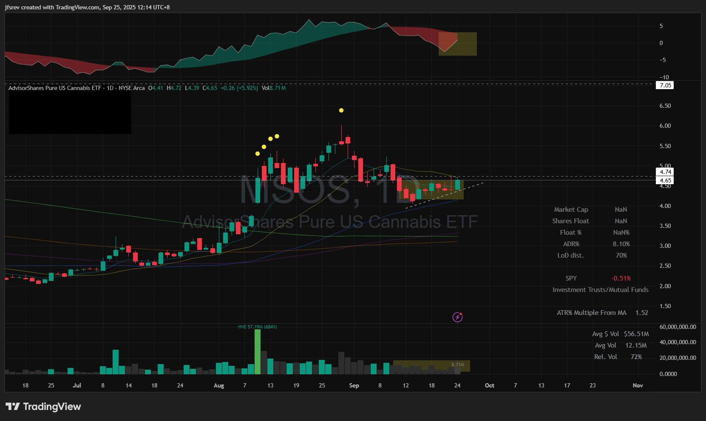
>
> > 🔁 **Quoted: Jeff Sun, CFTe** (@jfsrev):
> > @aperiwal93 impossible i will be looking at $CNBS $MSOS group now. they already moved and still remain extended. any stock that is setting up now are laggard and moving slowly up on sympathy
>
> *[View Original Post on X](https://x.com/jfsrev/status/1971067014346310018) · ❤️ 70 likes*

l) “How Often Do Stocks Hit 7-12+ ATR Above SMA50?” - Study By Denis Hamel - May 2026

> 💬 **Denis Hamel** ([@denis__hamel](https://x.com/denis__hamel)) · *2026-05-17*
>
> https://t.co/8ZKmM4Kdit
>
> *[View Original Post on X](https://x.com/denis__hamel/status/2056088634382537028) · ❤️ 490 likes*

j) “Trim at 7 ATR or hold for 8 weeks? A head-to-head on 890 historical big-winners” - Study By Denis Hamel - May 2026

> 💬 **Denis Hamel** ([@denis__hamel](https://x.com/denis__hamel)) · *2026-05-17*
>
> https://t.co/JGLCMOBaIy
>
> *[View Original Post on X](https://x.com/denis__hamel/status/2056102435857268826) · ❤️ 276 likes*

k) “Backtesting Jeff Sun’s 50 SMA ATR extension heuristic” - Study By theStrat Lab - May 2026

l) Gap up to 10 x ATR% from 50-MA mostly pullback without immediate follow through - May 2026

> 💬 **Jeff Sun, CFTe** ([@jfsrev](https://x.com/jfsrev)) · *2026-05-22*
>
> Don’t get drawn in by the one or two outliers everyone posts on Twitter/X. What rarely gets shown are the stop losses from chasing majority of other EPs.
>
> I strongly believe every stock has its own historical ATR% extension range, and many tend to peak around the 10x level. https://t.co/obAQX3DoaT
>
> 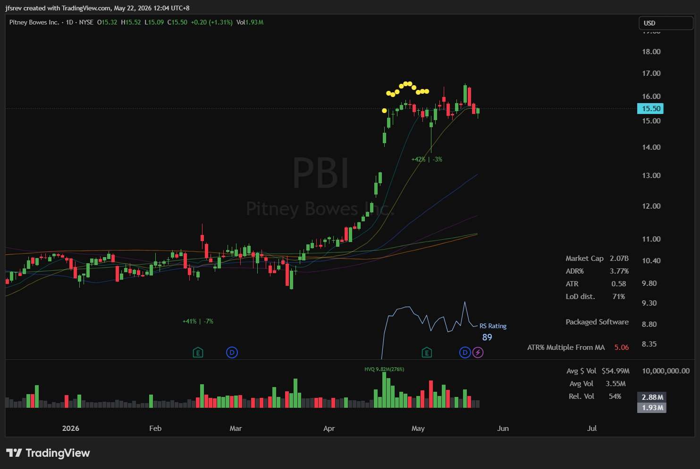
> 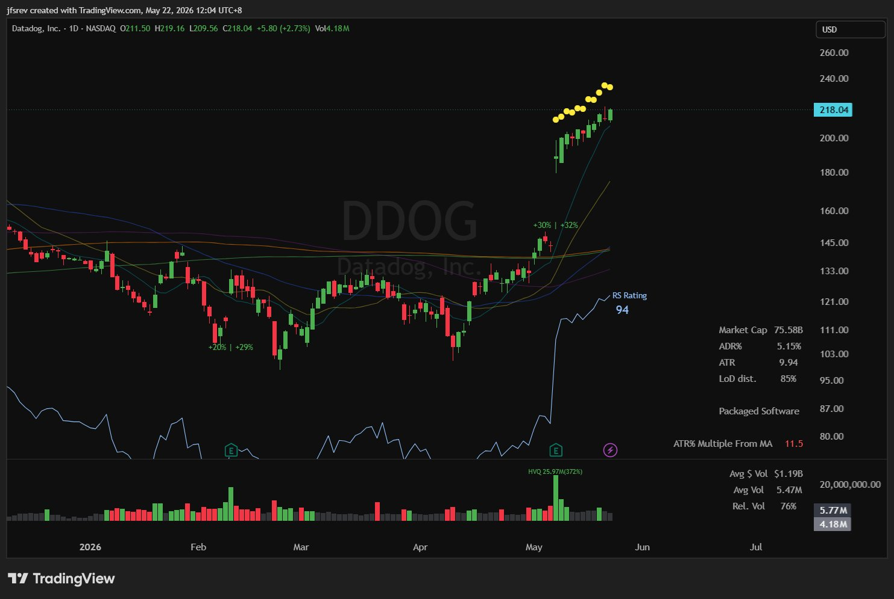
> 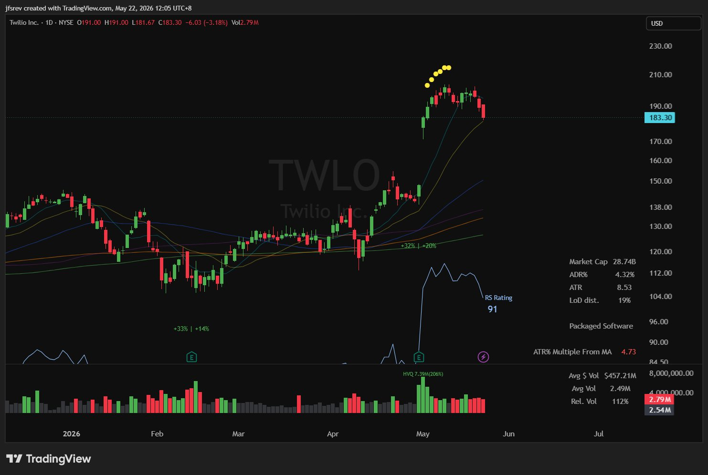
> 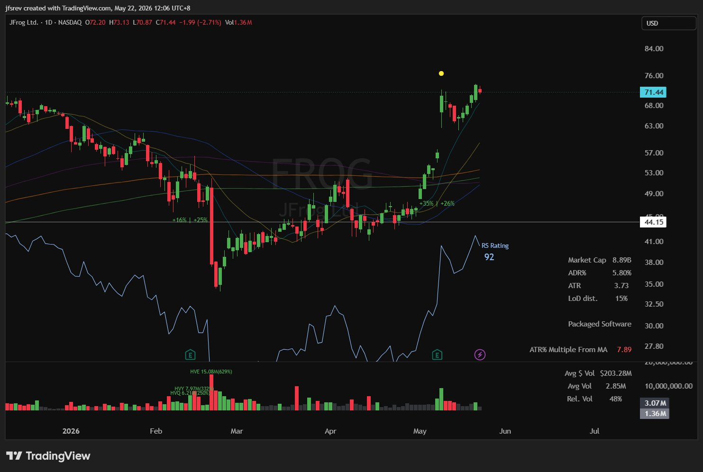
>
> *[View Original Post on X](https://x.com/jfsrev/status/2057674479715885424) · ❤️ 202 likes*

m) “Does ATR Extension Predict a Reversal? 25 Years of Nasdaq 100 Data Says Not What You Think” - Study by Trading Time Machine (X: thetrading ) - June 2026

2. Another great ATR% indicator to investigate historical multiple from 50-MA by Will Hu

a) Useful to recalibrate x multiple entry into micro meme stock/short squeeze rally with eccentric multiples (eg. FFIE, OPEN. AMC, BB)

3. ATR% Band indicator for projection of multiple from 50-MA by Cotton Dog (f/k/a Goosifer)

a) Useful for projection of ATR% multiple from current share price

> 💬 **Cotton Dog** ([@GoosiferTrading](https://x.com/GoosiferTrading)) · *2025-09-27*
>
> @version Well, I hit the publish button in TV, filled out a few things, and it was immediately published!? I had heard horror stories about the process. Anyway, here is the link to not have to do the copy and paste bit. https://t.co/hrUszLjIkJ Even got several likes already. Go figure :)
>
> *[View Original Post on X](https://x.com/GoosiferTrading/status/1972225421438779724) · ❤️ 39 likes*

### 3) Volatility Adjusted Relative Strength (VARS) with Histogram Version, first inspired by mattishenner (reddit) - Over 5k Users

https://www.tradingview.com/script/nbgyYwu1-Volatility-Adjusted-Relative-Strength-VARS-Histogram-Option/

1. Understanding VARS vs Traditional RS

a) It began as an idea to enhance the accuracy of traditional RS by factoring volatility that is unique to each different stock/securities, until I found a 2023 reddit thread with similar discussion by Matt.

> 💬 **Jeff Sun, CFTe** ([@jfsrev](https://x.com/jfsrev)) · *2025-04-08*
>
> yes, I thought of this idea as well to increase the RS accuracy with incoporation of atr% of the security and the reference ($SPY for most case) in the RS line. eg. A 10% move in a 20% adr name should not actually have RS day if $SPY is up 2% on 1% ADR. 
>
> thanks for sharing this,
>
> > 🔁 **Quoted: Sasha** (@aktienaha):
> > @jfsrevg @jfsrevg How do you calculate relative strength? Are you aware of the considerations for including ATR in the calculation? https://t.co/E7L8seD3uf
>
> *[View Original Post on X](https://x.com/jfsrev/status/1909486454260351162) · ❤️ 67 likes*

b) My VARS settings for the indicator as a swing trader

> 💬 **Jeff Sun, CFTe** ([@jfsrev](https://x.com/jfsrev)) · *2025-08-17*
>
> @amphtrading this is my setting for volatility adjusted relative strength for swing trading based on price compression/contraction as short as 5 days https://t.co/bmtPmjePvm
>
> 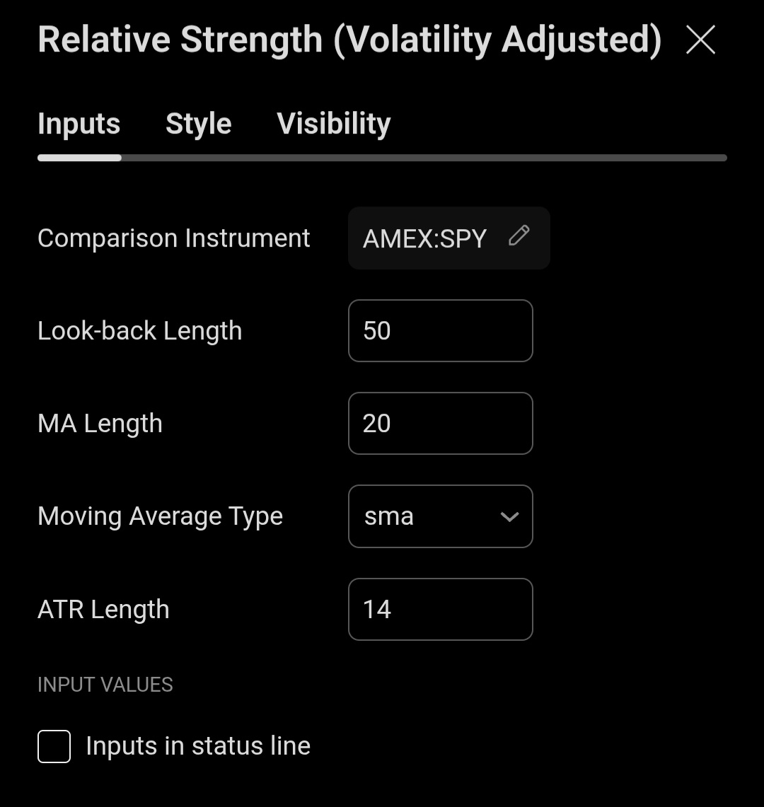
>
> *[View Original Post on X](https://x.com/jfsrev/status/1956894936185614378) · ❤️ 56 likes*

c) I published my own VARS with histogram - October 2025

> 💬 **Jeff Sun, CFTe** ([@jfsrev](https://x.com/jfsrev)) · *2025-10-09*
>
> VARS – Volatility-Adjusted RS with Histogram
>
> I’ve developed a new version of VARS that includes an option to toggle it into a histogram view. I recommend using a single neutral color rather than the conventional “red below 0, green above 0” scheme — because true RS analysis https://t.co/wfAROKNhOx
>
> 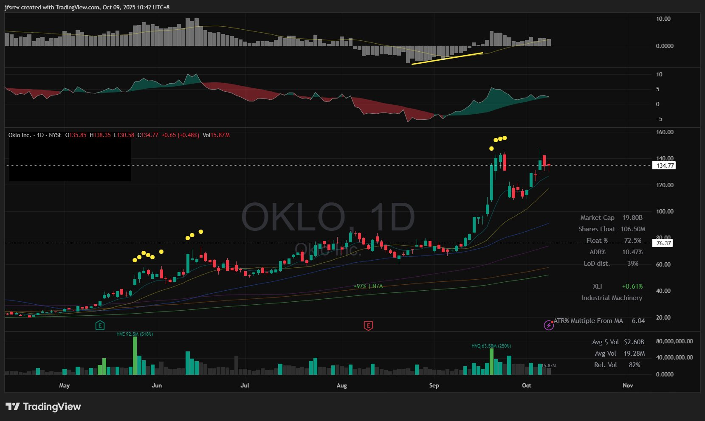
>
> *[View Original Post on X](https://x.com/jfsrev/status/1976121442086564329) · ❤️ 240 likes*

2. If you want old school, I highly recommend IBD RS Indicator by @ Fred6724

a) If you want traditional Relative Strength line similar to IBD with RS Rating, I highly recommend this by Fred6724. He have customized the full MarketSmith model on Tradingview and it’s available for free

> 💬 **Jeff Sun, CFTe** ([@jfsrev](https://x.com/jfsrev)) · *2023-04-21*
>
> 3. MarketSmith setup in Tradingview by @DumbleDax (also IBD RS Rating), and @amphtrading 
>
> Over  100+ hours spent coding every indicators to save your $150/month. 2 different version below
>
> @DumbleDax version
> https://t.co/kmR3HPjvAY
>
> @amphtrading version
>
> https://t.co/SwNS5OLubO
>
> *[View Original Post on X](https://x.com/jfsrev/status/1649338005302415360) · ❤️ 246 likes*

### 4) Simple Volume with Pocket Pivots by @finallynitin

https://www.tradingview.com/script/JkB0iCFp-Simple-Volume-with-Pocket-Pivots/

I’ve tried many great free volume scripts on TradingView, but this one is simple and has everything I need. Here is the full script introduction written by himself in 2022

> 💬 **Nitin R** ([@finallynitin](https://x.com/finallynitin)) · *2022-04-19*
>
> The time has finally arrived to simplify how we use the volume indicator on our charts. With a Tradingview script at the end, here is a thread🧵 on what “simple” volumes are, &amp; how to use them: 👇 https://t.co/D7RBdbyg1C
>
> 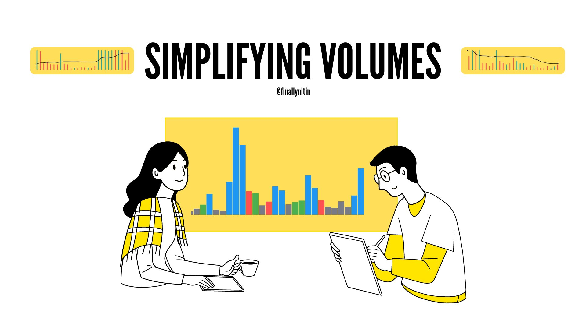
>
> *[View Original Post on X](https://x.com/finallynitin/status/1516415566936182793) · ❤️ 1,990 likes*

1. Understanding Volume

a) A single day of strong price move supported by heightened volume can reshape the narrative and bias of three months of price action.

> 💬 **Jeff Sun, CFTe** ([@jfsrev](https://x.com/jfsrev)) · *2025-08-24*
>
> @Surreal_trades i only trust volume on the price. 1 day of heightened volume can shift the narrative and bias of a 3 months price action easily
>
> *[View Original Post on X](https://x.com/jfsrev/status/1959451625145434489) · ❤️ 39 likes*

b) If you find it hard to define what qualifies as high RVOL, use Projected Volume in the script with a 50% haircut.

> 💬 **Jeff Sun, CFTe** ([@jfsrev](https://x.com/jfsrev)) · *2025-07-29*
>
> Simple way to read RVOL: use a Projected Volume Display (per‑second run rate) — via @finallynitin free script. (eg. $SOFI)
>
> https://t.co/c3bJxT8tHk https://t.co/9zN2aG8PJo
>
> 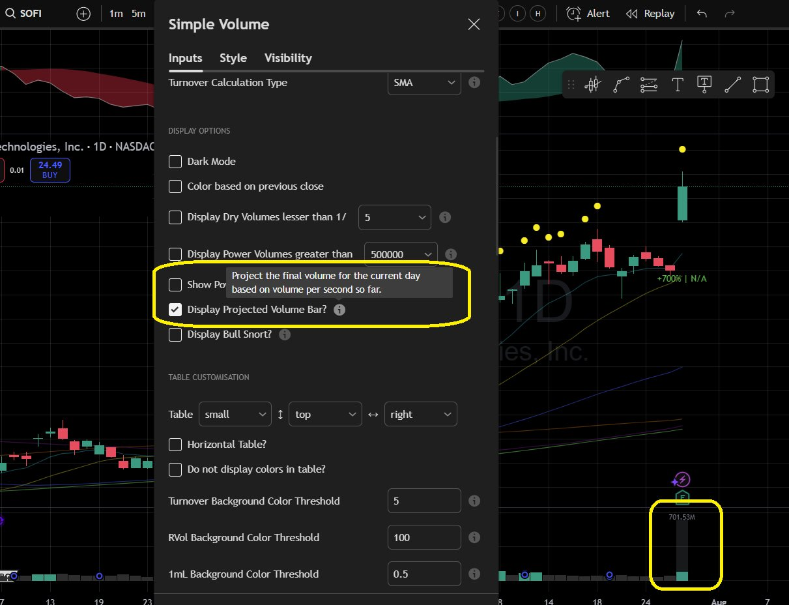
>
> > 🔁 **Quoted: Jeff Sun, CFTe** (@jfsrev):
> > 4. Simple Volume with Pocket Pivots by @finallynitin 
> >
> > https://t.co/WJFIhbZUcn
>
> *[View Original Post on X](https://x.com/jfsrev/status/1950202147787977058) · ❤️ 359 likes*

### 5) Worthy Mentions

The below indicators are applied on a separate template, not my main daily one.

a) EPS & Sales @ Fred6724

b) Industry Group Strength by @amphtrading , hyperlink here is the discussion of how i use it

> 💬 **Jeff Sun, CFTe** ([@jfsrev](https://x.com/jfsrev)) · *2024-10-14*
>
> Last week, @amphtrading indicator on @tradingview caught my attention. It provides an instant display of industry group peers at above 2B market cap ranked by either i) RS, ii) % Gain, iii) and YTD %. I've been using FinanceCharts website 'Competitors Key Metrics' to assess https://t.co/aHexYter68
>
> 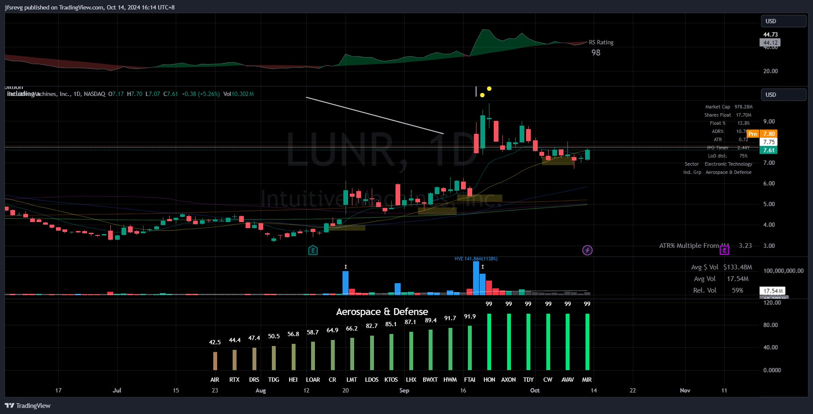
> 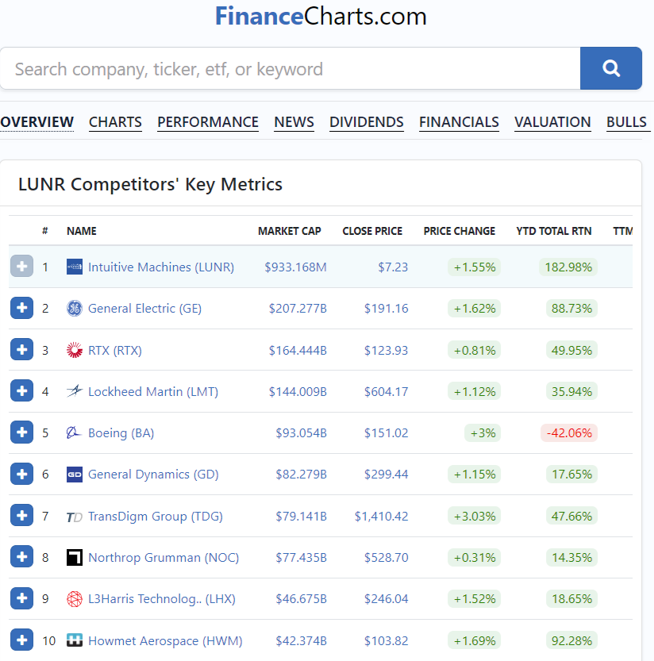
>
> > 🔁 **Quoted: Brandon** (@amphtrading):
> > Excited to see my Industry Group Strength indicator was selected as a @tradingview editors pick by @PineCoders! Check it out here
> >
> > https://t.co/LgfDFd0vLf
>
> *[View Original Post on X](https://x.com/jfsrev/status/1845744867047354535) · ❤️ 212 likes*

c) I wrote an overall piece on the best free 8 Tradingview Public Script in 2024

> 💬 **Jeff Sun, CFTe** ([@jfsrev](https://x.com/jfsrev)) · *2024-11-19*
>
> This will mark my 8th year of Black Friday using Tradingview.
>
> Here are 8 FREE public scripts I highly recommend exploring to refine your workflow, templates, or layouts. They’re listed alphabetically by script name:  
>
> 1. **ADR% - Average Daily Range %** - By @zerokapital https://t.co/AydyJ96DLT
>
> 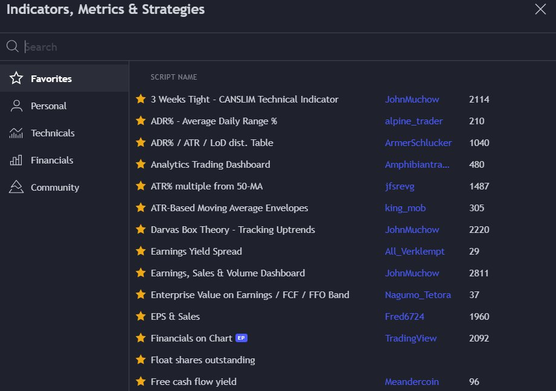
>
> *[View Original Post on X](https://x.com/jfsrev/status/1858822375015661742) · ❤️ 1,461 likes*

d) TradingView Seasonality Table - 2025

> 💬 **Jeff Sun, CFTe** ([@jfsrev](https://x.com/jfsrev)) · *2025-09-27*
>
> The latest introduction of Seasonality (table view) by @tradingview looks incredible analyze seasonality data outside of price charts in a clear, structured table. eg. $AAPL
>
> Below is the free access link
> https://t.co/F1qOjwLXS3
>
> This is the description
> https://t.co/wXMcmdOIWh https://t.co/yz1eC8Ofz2
>
> 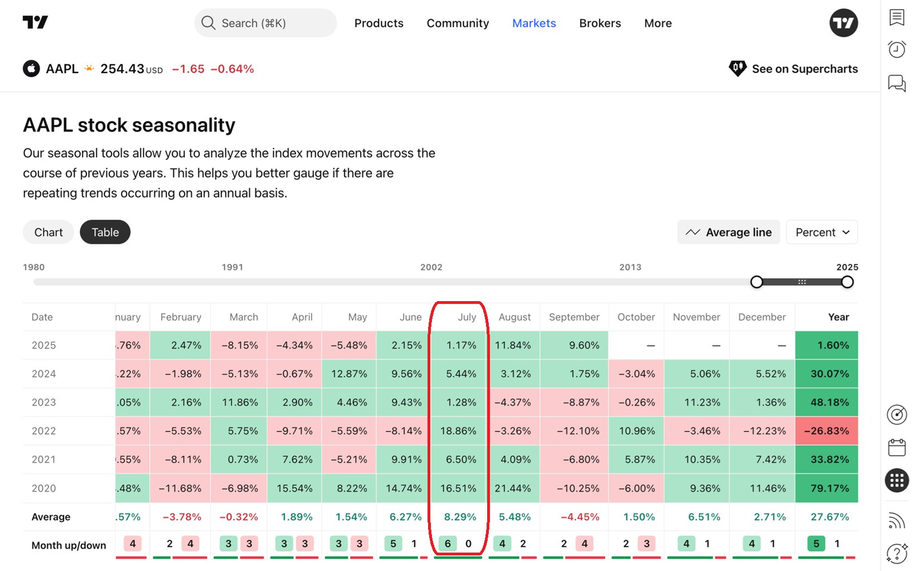
>
> *[View Original Post on X](https://x.com/jfsrev/status/1971824458341274083) · ❤️ 6 likes*

e) RVOL Centric Volume Script by @ETFbreakouts - 24th July 2026 Update

> 💬 **Jeff Sun, CFTe** ([@jfsrev](https://x.com/jfsrev)) · *2026-06-26*
>
> Another free script by @ETFbreakouts on RVOL. very useful for volume based breakout traders
>
> IBD Style Relative Volume - https://t.co/gkspVLefSf https://t.co/YgKGA5RDO7
>
> 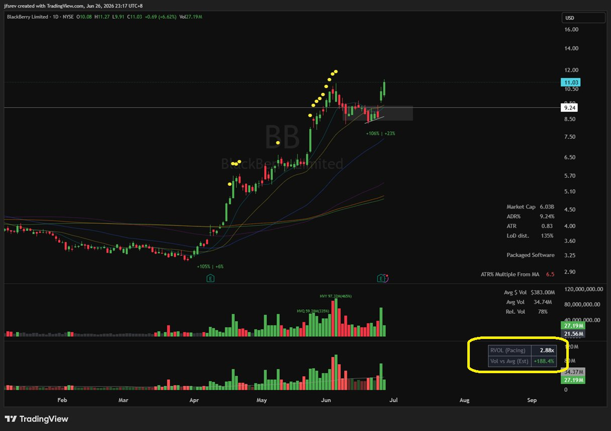
>
> > 🔁 **Quoted: Jeff Sun, CFTe** (@jfsrev):
> > i came across this VCP tightness indicator which may be useful for some. Chart displayed on $UPST here is based on default setting. there's also some other incredible scripts by joshdm_94 on @tradingview 
> >
> > VCP tightness (ADR Adjusted) - https://t.co/isgrSCwjDB
> >
> > 15 other scripts - https://t.co/7FJycQVx8e
>
> *[View Original Post on X](https://x.com/jfsrev/status/2070527401118007473) · ❤️ 335 likes*

f) VCP Tightness Indicator Script by @ETFbreakouts - 24th July 2026 Update

> 💬 **Jeff Sun, CFTe** ([@jfsrev](https://x.com/jfsrev)) · *2026-06-26*
>
> i came across this VCP tightness indicator which may be useful for some. Chart displayed on $UPST here is based on default setting. there's also some other incredible scripts by joshdm_94 on @tradingview 
>
> VCP tightness (ADR Adjusted) - https://t.co/isgrSCwjDB
>
> 15 other scripts - https://t.co/7FJycQVx8e
>
> 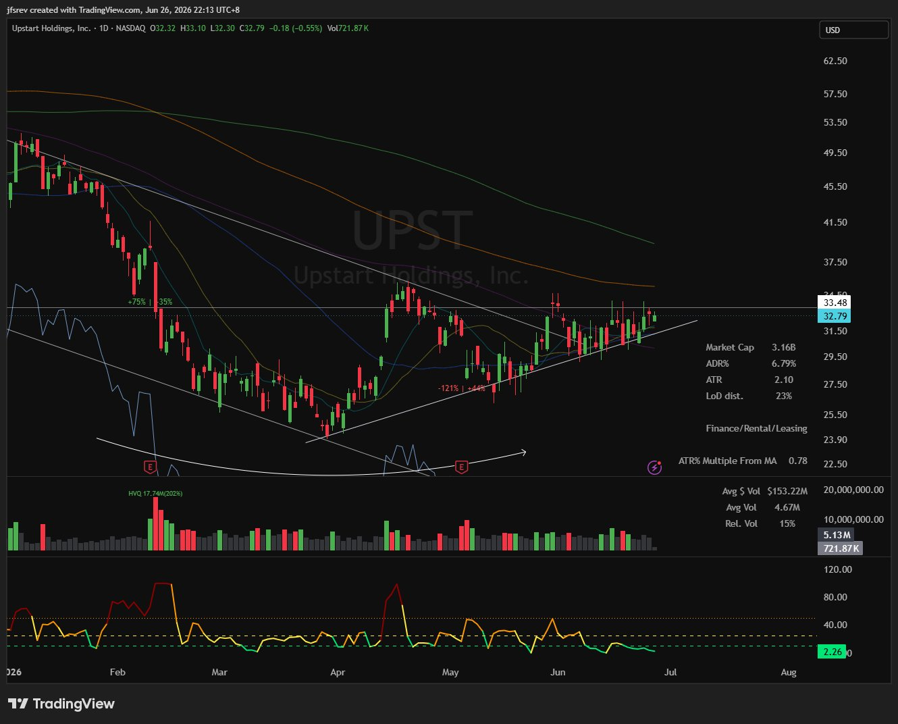
>
> *[View Original Post on X](https://x.com/jfsrev/status/2070512507241000975) · ❤️ 462 likes*

PS: On a fun note, I relied on something like this back in 2000s

> 💬 **Jeff Sun, CFTe** ([@jfsrev](https://x.com/jfsrev)) · *2024-11-19*
>
> Over 11 years ago, I relied on something like this for over 6 years through a paid subscription.  
>
> We should count ourselves lucky now. 😅 https://t.co/UcgnMrGa4A
>
> 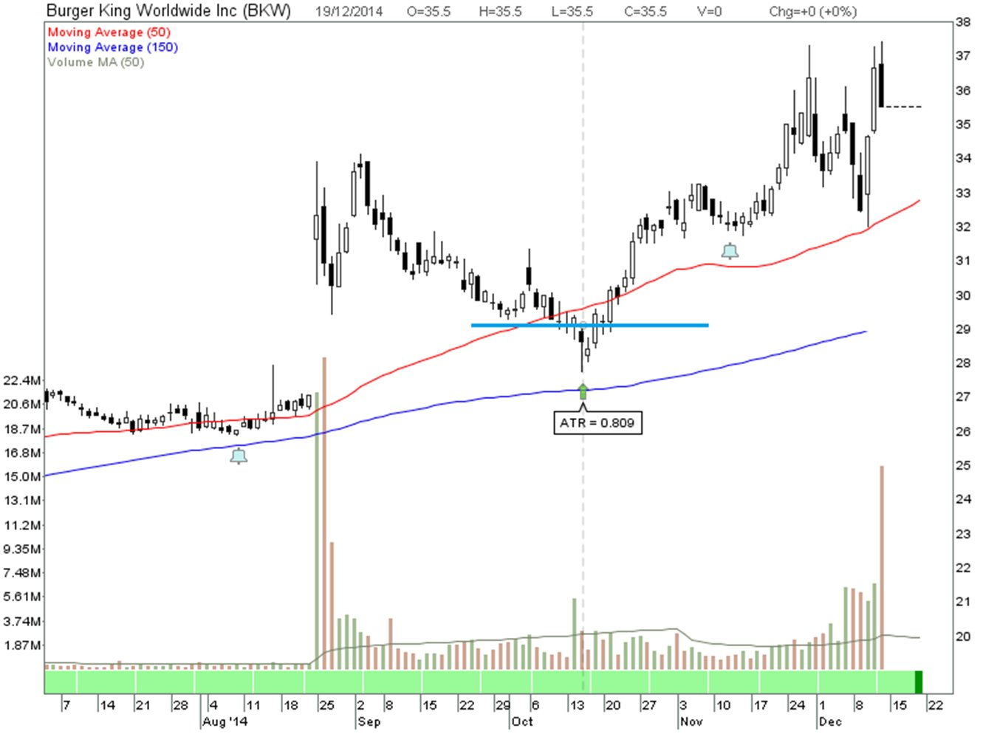
> 
>
> *[View Original Post on X](https://x.com/jfsrev/status/1858842565296222636) · ❤️ 51 likes*

---

# Chapter 3. My Screeners - Workflow: Finviz Post Market & TradingView Pre-/Live-Market RVOL

### 1) I have 14 screeners for post-market analysis, shifting their results into dedicated watchlists by purpose.

Do read this discussion beforehand—it will give you perspective on the dedication necessary despite having these tools.

Bonus: Screening & Watchlist Management — A Commonly Misunderstood Skill for New Traders

> 💬 **Jeff Sun, CFTe** ([@jfsrev](https://x.com/jfsrev)) · *2025-07-15*
>
> I just want to add to @1ChartMaster’s tweet on screening and watchlist management — something I believe is often misunderstood by newer traders who dive into trading without proper guidance on the actual routines and processes required for longevity, and the need to manage https://t.co/SwUvcuFTnM
>
> 
> 
> 
> 
>
> > 🔁 **Quoted: Elite Swing Traders** (@1ChartMaster):
> > I keep getting the same question over and over again. 
> > "What scanner do I use to put my watchlist together?"
> > The truth is my scanner is my eyes. I scan my watchlists manually to put the weekly watchlist together.
>
> *[View Original Post on X](https://x.com/jfsrev/status/1945042238817624213) · ❤️ 627 likes*

If you’re struggling to generate alpha, reassess your process or screens. The hard truth: if you’re in tune, you won’t be sidelined at the wrong time.

> 💬 **Jeff Sun, CFTe** ([@jfsrev](https://x.com/jfsrev)) · *2023-09-15*
>
> If you're still facing challenges in generating alpha this year, it might be a good idea to reevaluate and recalibrate your processes, or screening parameters. Hard truth is if you are in tune, you will not be sitting out of the market in the past 3 weeks. - Don’t cut ‘flowers’
>
> > 🔁 **Quoted: Jeff Sun, CFTe** (@jfsrev):
> > 5. Interpreting my daily diary and process, my screener settings, my watchlist, my influences, my strategy
> >
> > https://t.co/a0CD8QER9L
>
> *[View Original Post on X](https://x.com/jfsrev/status/1702657049124057258) · ❤️ 59 likes*

LATEST: On 24th October 2025, TradingView has introduced Screen Sharing, a new feature that lets you share your custom screener setups through a single link. I’ve uploaded all 14 of my screeners — covering pre-market, live-market, and post-market for both stocks and ETFs — for direct access to my configurations.

CANSLIM-inspired calibrated screener – Over 1.9 million Twitter impressions, making it one of the most popular in my sharing.

a) Tradingview Version

> 💬 **Jeff Sun, CFTe** ([@jfsrev](https://x.com/jfsrev)) · *2024-06-01*
>
> I share the results of this weekly scan on every end of the week session (Saturday/Sunday) because my primary focus each week starts with this names. Let me dissect down why we should keep an eye on these leaders for opportunities in both swing and positional trading:
>
> 1. https://t.co/m6nScOnp6T
>
> 
>
> *[View Original Post on X](https://x.com/jfsrev/status/1796806706028302775) · ❤️ 772 likes*

b) Finviz Version (2025) - Leveraging it now for the ‘Institutional Transaction’ filter.

> 💬 **Jeff Sun, CFTe** ([@jfsrev](https://x.com/jfsrev)) · *2025-09-06*
>
> This week net positive institutional transaction in last 3 months are found in this 24 standout growth stock. I have tightened the parameter to avg vol 5M to keep the results within 25 liquid names.
>
> $AFRM $AG $ALAB $BMNR $CDE $EOSE $GTLB $HIMS $IONQ $IREN $LCID $PLTR $QBTS $QXO https://t.co/04HD6sa4tN
>
> 
>
> > 🔁 **Quoted: Jeff Sun, CFTe** (@jfsrev):
> > I share the results of this weekly scan on every end of the week session (Saturday/Sunday) because my primary focus each week starts with this names. Let me dissect down why we should keep an eye on these leaders for opportunities in both swing and positional trading:
> >
> > 1. https://t.co/m6nScOnp6T
>
> *[View Original Post on X](https://x.com/jfsrev/status/1964130023751004326) · ❤️ 188 likes*

c) Finviz mobile web screener

> 💬 **Jeff Sun, CFTe** ([@jfsrev](https://x.com/jfsrev)) · *2025-07-27*
>
> Direct link for mobile users with all filters applied on @FINVIZ_com - easy to scroll through the mini charts. ADR% (week) is 4%, but can be loosened for more value centric names (eg. precious metal miners)
>
> https://t.co/3i9X0HC2N6 https://t.co/2w7FcM7hFt
>
> 
>
> > 🔁 **Quoted: Jeff Sun, CFTe** (@jfsrev):
> > This week net positive institutional transaction in last 3 months are found in this 23 standout growth stock.
> >
> > $ALAB $APH $APP $ASTS $BMNR $CLSK $CRDO $ENVX $FSM $IREN $LCID $MARA $RBLX $RDDT $RIOT $RKLB $RUM $SE $SMR $SOUN $SYM $UPST $ZETA
> >
> > PS: same screen is build on https://t.co/J3LWXoBSk1
>
> *[View Original Post on X](https://x.com/jfsrev/status/1949313660167532903) · ❤️ 302 likes*

High ADR% Hottest Stock screener

a) Tradingview Version

> 💬 **Jeff Sun, CFTe** ([@jfsrev](https://x.com/jfsrev)) · *2024-05-12*
>
> I've just build a quick screen called "Hottest Stock" off @tradingview v2 tailored for individuals seeking stocks akin to $POET chart. This scan sifts through stocks that have exhibited significant momentum over the past month of trading, while also consolidating within a defined https://t.co/AzwpT8oZX2
>
> 
>
> > 🔁 **Quoted: Jeff Sun, CFTe** (@jfsrev):
> > Seeing this type of chart is sure to make you nostalgic on those days of watching stream from @Qullamaggie
> >
> > $POET https://t.co/fyT8hp35jt
>
> *[View Original Post on X](https://x.com/jfsrev/status/1789602959782977668) · ❤️ 617 likes*

b) Finviz Version (2025)

> 💬 **Jeff Sun, CFTe** ([@jfsrev](https://x.com/jfsrev)) · *2025-09-07*
>
> 16 Hot/Theme Stocks Categorized by Industry Group, with Net Positive Institutional Transactions to Watchlist For Coming Week. 
>
> $BKSY $SEDG $PGY $SOUN $REAL $LMND $BBAI $TEM $EOSE $UPST $AAOI $ASTS $WULF $RIOT $CIFR $ULCC
>
> PS: My screeners are now all build on @FINVIZ_com https://t.co/XYHZlSFg82
>
> 
> 
>
> > 🔁 **Quoted: Jeff Sun, CFTe** (@jfsrev):
> > I've just build a quick screen called "Hottest Stock" off @tradingview v2 tailored for individuals seeking stocks akin to $POET chart. This scan sifts through stocks that have exhibited significant momentum over the past month of trading, while also consolidating within a defined https://t.co/AzwpT8oZX2
>
> *[View Original Post on X](https://x.com/jfsrev/status/1964512257918062970) · ❤️ 112 likes*

c) Finviz Version (Quallamaggie Style, 2003-2004 TASR)

> 💬 **Jeff Sun, CFTe** ([@jfsrev](https://x.com/jfsrev)) · *2025-07-14*
>
> 1. High ADR%
> 2. Low Float
> 3. High Short Float %
>
> https://t.co/vu5gqy7ABf
>
> > 🔁 **Quoted: Lone** (@lonextrades):
> > Qullamaggie’s Perfect Stock - TASR (2003-2004)
> >
> > “Yeah, I’m going to show you the perfect stock. I’m going to show you a ticker I have in my database - TASR. Went from 35 cents to 30 bucks - almost a 100 bagger in a year. This thing had several high tight flags. Okay, pay https://t.co/vBIL5SfK7d
>
> *[View Original Post on X](https://x.com/jfsrev/status/1944595506853970049) · ❤️ 419 likes*

My 2024 +180% KC trade inspired screener - Extended bases and prolonged consolidations, such as Cup & Handle patterns.

a) Discussion: “Does the stock want to go higher?”

> 💬 **Jeff Sun, CFTe** ([@jfsrev](https://x.com/jfsrev)) · *2025-07-21*
>
> “Does the stock want to go higher?” 
>
> The sentence in both @traderwillhu and @mkl85 tweets yesterday really resonates with me. It’s such a simple question, but one you should always ask when deciding whether to move a stock from your watchlist to your actionable focus list. https://t.co/5cm441qFre
>
> 
>
> > 🔁 **Quoted: Maikel** (@mkl85):
> > The question to really answer as a (long biased) trader is: does the stock wants to go higher? From this perspective we can explain a lot of concepts. It explains why RS works (if the general market is moving but the stock is underperforming, does it really wants to go higher?).
>
> *[View Original Post on X](https://x.com/jfsrev/status/1947145787479331055) · ❤️ 202 likes*

b) Finviz Version (2025)

> 💬 **Jeff Sun, CFTe** ([@jfsrev](https://x.com/jfsrev)) · *2025-09-10*
>
> This week’s 18 beaten-down stocks — potential long-term cup-and-handle setups with positive institutional accumulation over the past 3 months
>
> $AAOI $AIOT $BILL $BTBT $BTE $CGC $CIVI $GEVO $HPP $MXL $NWL $NXDR $OGN $RC $RCAT $SERV $ULCC $UNIT
>
> PS: My screeners are now all build https://t.co/sZl21kwUxN
>
> 
>
> > 🔁 **Quoted: Jeff Sun, CFTe** (@jfsrev):
> > “Does the stock want to go higher?” 
> >
> > The sentence in both @traderwillhu and @mkl85 tweets yesterday really resonates with me. It’s such a simple question, but one you should always ask when deciding whether to move a stock from your watchlist to your actionable focus list. https://t.co/5cm441qFre
>
> *[View Original Post on X](https://x.com/jfsrev/status/1965598848761700696) · ❤️ 96 likes*

Strongest Mover screener - 1-Week, 1-Month, 3-Month, 6-Month

a) Tradingview Version

> 💬 **Jeff Sun, CFTe** ([@jfsrev](https://x.com/jfsrev)) · *2023-05-20*
>
> 10. Focus List (Part 4)
>
> iv) Scans - @tradingview  Free Version
>
> Below is a Screenshot for parameters of Scan for '1-Week Mover Exceeding 20%' on @tradingview 
>
> You can do the same adjustment based on the filters from Finviz for each scans on @tradingview 
>
> Although the https://t.co/ububrR83XA
>
> 
>
> *[View Original Post on X](https://x.com/jfsrev/status/1659789002814414850) · ❤️ 88 likes*

b) Finviz Version

> 💬 **Jeff Sun, CFTe** ([@jfsrev](https://x.com/jfsrev)) · *2023-05-20*
>
> 10. Focus List (Part 3)
>
> iii) Scans - Finviz Free Version
>
> I strongly advocate for utilizing the free tools available on the internet for those who are still striving to become proficient in trading. Trading itself carries significant costs and unforeseen events that can disrupt https://t.co/aGnCDLpIlL
>
> 
>
> *[View Original Post on X](https://x.com/jfsrev/status/1659786288067928064) · ❤️ 228 likes*

c) Perks of the Finviz mobile web screener: effortless to use at work or on breaks

> 💬 **Jeff Sun, CFTe** ([@jfsrev](https://x.com/jfsrev)) · *2023-09-10*
>
> If you find yourself swamped with responsibilities and time commitments beyond the financial market, a quick and effortless free finviz scan (preset) on your mobile browser can help you stay informed about the top-performing stocks/etf in this pull-back, all within just a minute https://t.co/UiAw5JkHfZ
>
> 
>
> *[View Original Post on X](https://x.com/jfsrev/status/1700710382523084964) · ❤️ 358 likes*

IPO screener (Screen Frequency: Weekly)

a) Finviz Version (Only Finviz filtering parameter is capable to do this)

> 💬 **Jeff Sun, CFTe** ([@jfsrev](https://x.com/jfsrev)) · *2025-07-06*
>
> Finviz Free IPO Screener - Just do it once a week
>
> https://t.co/JuCs1JuDEk
>
> A highly simplified yet curated IPO screen that has surfaced names like $CRWV, $CRCL, $AMTM, and previously $XPEV.
>
> > 🔁 **Quoted: Jeff Sun, CFTe** (@jfsrev):
> > $CRWV reminds me of my $XPEV IPO U-base trade 5 years ago.
> >
> > I won't be surprise to see it go parabolical to $180 (+190%) for a 11% ADR name, and the only way to ride it is through non violation of 10-MA. Study $XPEV (8% ADR when it begin price expansion) if you are in $CRWV https://t.co/4YvMfyZci4
>
> *[View Original Post on X](https://x.com/jfsrev/status/1941836386904285491) · ❤️ 272 likes*

High Short Float screener (Screen Frequency: Weekly)

a) Finviz Version (only Finviz filtering parameter is capable to do this)

> 💬 **Jeff Sun, CFTe** ([@jfsrev](https://x.com/jfsrev)) · *2025-07-11*
>
> If you also add a high short float, these three ingredients combined become rocket fuel for potential % gain based runners.
>
> I scan them in finviz daily. you just need 1 or 2 in a year. look at how monstrous $GRPN this year. it was on this scan for the whole of 2024
>
> > 🔁 **Quoted: Elite Swing Traders** (@1ChartMaster):
> > Low float + high ADR = Explosive
>
> *[View Original Post on X](https://x.com/jfsrev/status/1943548132232663415) · ❤️ 208 likes*

Liquid ETF screener (I also often trade outside of US-listed equities)

‘Exploring ideas in tradable asset classes beyond correlated equities can provide a valuable edge.’ - Stanley Drunkenmiller

> 💬 **Jeff Sun, CFTe** ([@jfsrev](https://x.com/jfsrev)) · *2024-12-09*
>
> 'Exploring ideas in tradable asset classes beyond correlated equities can provide a valuable edge.' - Stanley Drunkenmiller
>
> > 🔁 **Quoted: Adam** (@hiitsgustavo):
> > @jfsrevg Thanks Jeff 🙏I think it’s quite interesting you trading these tiny momentum stock but also look at commodities and macro assets
>
> *[View Original Post on X](https://x.com/jfsrev/status/1866039252477444166) · ❤️ 27 likes*

a) Tradingview Version

> 💬 **Jeff Sun, CFTe** ([@jfsrev](https://x.com/jfsrev)) · *2024-02-14*
>
> @tradingview  ETF Screener Version 2 is on a separate weblink from it's Stock Screener Version 2. 
>
> https://t.co/dn1A9Mkjs6
>
> Below are my scan parameters for strongest 1 week mover inclusive of leverage ETFs. You may further tighten the filter with eg. 'Price above 10-MA &lt;5%' for https://t.co/xyKFQ4hQNE
>
> 
>
> > 🔁 **Quoted: pavnerdninja** (@pavnerdninja):
> > @jfsrevg Thank you for the write up and motivation. You mentioned in one post that TradingView does have etf screener and it looks promising . Will you be able to share your preferred screener settings for leveraged and non leveraged etfs?
>
> *[View Original Post on X](https://x.com/jfsrev/status/1757662271994835388) · ❤️ 95 likes*

b) Finviz Version (2025)

> 💬 **Jeff Sun, CFTe** ([@jfsrev](https://x.com/jfsrev)) · *2025-09-01*
>
> You can try this liquid ETF screener i just build in less than a minute. There's less than 72 results but i go through almost 150 ETF charts daily. You can loosen the parameters by lowering the 'Volatility Week'
>
> https://t.co/mxZl5ia0S3 https://t.co/ts6KVDtPnD
>
> 
>
> > 🔁 **Quoted: SpeculatorSue🇨🇦** (@shelovestotrade):
> > @jfsrev Hi Jeff, how did you identify these ETFs for industry groups?  Do you have an ETF Scan?  I'm just wondering what your process is for getting the latest ones?
>
> *[View Original Post on X](https://x.com/jfsrev/status/1962458102709837975) · ❤️ 94 likes*

c) Tradingview Version (2025)

> 💬 **Jeff Sun, CFTe** ([@jfsrev](https://x.com/jfsrev)) · *2025-09-01*
>
> I have the same ETF screener on @tradingview https://t.co/rtwPAhUC4Z
>
> 
>
> *[View Original Post on X](https://x.com/jfsrev/status/1962458397380632874) · ❤️ 23 likes*

A Simple Parabolic Short Screener (Screen Frequency: Daily)

a) An Example With Short CAR +74% in 22nd April 2026

> 💬 **Jeff Sun, CFTe** ([@jfsrev](https://x.com/jfsrev)) · *2026-04-29*
>
> $CAR +74% 
>
> out today entirely at 200-MA bounce https://t.co/qyDWi4PkXK
>
> 
>
> > 🔁 **Quoted: Jeff Sun, CFTe** (@jfsrev):
> > wanted to trim via trailing to cover some size in $CAR but it just went straight down without MA reclaim. may not be able to cover any today but won't be surprise if it gaps at open tomorrow, will still hold through tomorrow's open.
> >
> > there are also some extended ETF inverse long https://t.co/CAP7ShO4ti
>
> *[View Original Post on X](https://x.com/jfsrev/status/2049494275994632389) · ❤️ 117 likes*

Screen within Screen (Watchlist)

a) Tradingview Version

> 💬 **Jeff Sun, CFTe** ([@jfsrev](https://x.com/jfsrev)) · *2024-03-20*
>
> Latest Update: The free @tradingview v2 screener has responded to our feedback and has now introduced a filter for scanning within your extensive watchlist! 
>
> I've introduced two separate scan parameters, 'Watchlist Scan,'  for tightness of swing trading setups within the range https://t.co/XznX6BxAIR
>
> 
>
> *[View Original Post on X](https://x.com/jfsrev/status/1770337966814363698) · ❤️ 363 likes*

Mean Reversion Screener For Pull Back Entry (Watchlist)

a) Tradingview Version

> 💬 **Jeff Sun, CFTe** ([@jfsrev](https://x.com/jfsrev)) · *2026-05-20*
>
> Simple @tradingview classic reversal screen using bullish candlestick patterns to spot pullback ideas from your watchlist name and help design/structure your trade. 
>
> P.S This is a screen on screen process
> https://t.co/3qr2WsmETV https://t.co/UUC5IrW56b
>
> 
>
> > 🔁 **Quoted: Jeff Sun, CFTe** (@jfsrev):
> > I just want to add to @1ChartMaster’s tweet on screening and watchlist management — something I believe is often misunderstood by newer traders who dive into trading without proper guidance on the actual routines and processes required for longevity, and the need to manage https://t.co/SwUvcuFTnM
>
> *[View Original Post on X](https://x.com/jfsrev/status/2056931989719314462) · ❤️ 1 likes*

I also have a fixed watchlist of Liquid Mega Cap names (Exceeding $1B average dollar volume on constant) I listed their synthetic leveraged ETFs if you want higher ADR% opportunities in them

> 💬 **Jeff Sun, CFTe** ([@jfsrev](https://x.com/jfsrev)) · *2025-08-31*
>
> Latest 1-Month Relative Strength of Liquid 24 (Rank Sorted), Including their Long/Short Synthetic ETFs.
>
> Strongest: $GOOGL $UNH $BABA
> 2. $APP 
> 3. $RIOT 
> 4. $RDDT $AAPL $TEM
> 5. $RGTI
> 6. $AMZN
> 7. $TSLA
> 8. $NFLX 
> 9. $OKLO
> 10. $AVGO
> 11. $MSFT
> 12. $META $HOOD
> 13. $PLTR
> Weakest: $NVDA https://t.co/8NlNtXU9Rr
>
> 
>
> *[View Original Post on X](https://x.com/jfsrev/status/1962094789068996858) · ❤️ 157 likes*

> 💬 **Jeff Sun, CFTe** ([@jfsrev](https://x.com/jfsrev)) · *2025-08-31*
>
> Latest 1-Month Relative Strength of Liquid 24 (Rank Sorted), Including their Long/Short Synthetic ETFs.
>
> Strongest: $GOOGL $UNH $BABA
> 2. $APP 
> 3. $RIOT 
> 4. $RDDT $AAPL $TEM
> 5. $RGTI
> 6. $AMZN
> 7. $TSLA
> 8. $NFLX 
> 9. $OKLO
> 10. $AVGO
> 11. $MSFT
> 12. $META $HOOD
> 13. $PLTR
> Weakest: $NVDA https://t.co/8NlNtXU9Rr
>
> 
>
> *[View Original Post on X](https://x.com/jfsrev/status/1962094789068996858) · ❤️ 157 likes*

> 💬 **Jeff Sun, CFTe** ([@jfsrev](https://x.com/jfsrev)) · *2025-08-31*
>
> Latest 1-Month Relative Strength of Liquid 24 (Rank Sorted), Including their Long/Short Synthetic ETFs.
>
> Strongest: $GOOGL $UNH $BABA
> 2. $APP 
> 3. $RIOT 
> 4. $RDDT $AAPL $TEM
> 5. $RGTI
> 6. $AMZN
> 7. $TSLA
> 8. $NFLX 
> 9. $OKLO
> 10. $AVGO
> 11. $MSFT
> 12. $META $HOOD
> 13. $PLTR
> Weakest: $NVDA https://t.co/8NlNtXU9Rr
>
> 
>
> *[View Original Post on X](https://x.com/jfsrev/status/1962094789068996858) · ❤️ 157 likes*

> 💬 **Jeff Sun, CFTe** ([@jfsrev](https://x.com/jfsrev)) · *2025-08-31*
>
> Latest 1-Month Relative Strength of Liquid 24 (Rank Sorted), Including their Long/Short Synthetic ETFs.
>
> Strongest: $GOOGL $UNH $BABA
> 2. $APP 
> 3. $RIOT 
> 4. $RDDT $AAPL $TEM
> 5. $RGTI
> 6. $AMZN
> 7. $TSLA
> 8. $NFLX 
> 9. $OKLO
> 10. $AVGO
> 11. $MSFT
> 12. $META $HOOD
> 13. $PLTR
> Weakest: $NVDA https://t.co/8NlNtXU9Rr
>
> 
>
> *[View Original Post on X](https://x.com/jfsrev/status/1962094789068996858) · ❤️ 157 likes*

a) How do I identify opportunities within the list

> 💬 **Jeff Sun, CFTe** ([@jfsrev](https://x.com/jfsrev)) · *2025-04-15*
>
> How I use insights from my 15 go-to liquid stocks to identify trading opportunities (you can build your own mega cap list with the same process)
>
> 1. Understand the existing technical environment of major index (both cap weighted, equal weighted, and mega cap growth oriented) $SPY https://t.co/h4ms22ZleH
>
> 
>
> > 🔁 **Quoted: Jeff Sun, CFTe** (@jfsrev):
> > By Popular Demand: Spreadsheet Tutorial for Creating Your Own FREE Relative Strength Histogram (Both Stock and ETF), that Updates Daily After Close.
> >
> > As requested by many of you, I will do my best to break down the steps and details so you can build your own RS tracking list of https://t.co/Musd1gDR7h
>
> *[View Original Post on X](https://x.com/jfsrev/status/1912034116465545492) · ❤️ 283 likes*

b) Why liquidity matters to your trading performance

A Finviz API Hack To Copy All Screen Result Into TradingView Watchlist by @erikcarell

> 💬 **Erik Carell** ([@erikcarell](https://x.com/erikcarell)) · *2025-09-18*
>
> @jfsrev A finviz perk is definatly the API. This started out with needing to copy tickers to tradingview in a easy way. https://t.co/XKQjHBrn7l
>
> *[View Original Post on X](https://x.com/erikcarell/status/1968688679905341497) · ❤️ 31 likes*

a) The full code are shared here.

> 💬 **Erik Carell** ([@erikcarell](https://x.com/erikcarell)) · *2025-09-19*
>
> A simple version, copy paste functionality, is now public code. I tried to be as explicit as possible in the README to make it easy for anyone to set up on their own.
>
> https://t.co/yUIYgInM95
>
> @jfsrev
>
> > 🔁 **Quoted: Erik Carell** (@erikcarell):
> > @jfsrev A finviz perk is definatly the API. This started out with needing to copy tickers to tradingview in a easy way. https://t.co/XKQjHBrn7l
>
> *[View Original Post on X](https://x.com/erikcarell/status/1968978995778650488) · ❤️ 61 likes*

b) Latest 10th July 2026 Version

> 💬 **Jeff Sun, CFTe** ([@jfsrev](https://x.com/jfsrev)) · *2026-07-10*
>
> @Pradeep_Alphaa @erikcarell https://t.co/etE3e8UXEr
>
> *[View Original Post on X](https://x.com/jfsrev/status/2075448326204645712) · ❤️ 18 likes*

A consolidation of how I screen all the screeners and transfer them into various watchlist daily (3-min Video)

> 💬 **Jeff Sun, CFTe** ([@jfsrev](https://x.com/jfsrev)) · *2024-03-26*
>
> My Daily Routine on @TradingView Screeners: Discovering Daily Swing Setups Through Multiple Screening, Watchlist Management, and Tightness Screening within Watchlist.
>
> Note: This 3-minute video is played at 2x normal speed from real-time.
>
> Upon uncovering the screening feature https://t.co/k8XgcMTmUk
>
> > 🔁 **Quoted: Jeff Sun, CFTe** (@jfsrev):
> > Latest Update: The free @tradingview v2 screener has responded to our feedback and has now introduced a filter for scanning within your extensive watchlist! 
> >
> > I've introduced two separate scan parameters, 'Watchlist Scan,'  for tightness of swing trading setups within the range https://t.co/XznX6BxAIR
>
> *[View Original Post on X](https://x.com/jfsrev/status/1772522489446543679) · ❤️ 926 likes*

Presenting the consolidated Focus List (with some overlapping names across screeners) - 6th October 2025

> 💬 **Jeff Sun, CFTe** ([@jfsrev](https://x.com/jfsrev)) · *2025-10-06*
>
> A show case of 14 screeners compiled — this is the consolidated focus list (some stocks have already overlap across screeners). 
> https://t.co/T4aTMruROA
>
> Hottest Stock Screen: 
> $SBET $OPAD $BBAI $SFRM $OPEN
>
> Beaten-Down Long Bases Stock Screen:
> $XPRO $LAB $HYLN $CLMT
>
> IPO Screen: https://t.co/uDpVNbXSUE
>
> 
>
> > 🔁 **Quoted: Jeff Sun, CFTe** (@jfsrev):
> > https://t.co/OxoxgHQz0d https://t.co/EDHS5orDfj
>
> *[View Original Post on X](https://x.com/jfsrev/status/1975058662432608568) · ❤️ 208 likes*

Importance and Purpose of Post Market Screening

> 💬 **Jeff Sun, CFTe** ([@jfsrev](https://x.com/jfsrev)) · *2024-07-30*
>
> Post market up days, 
> you'll focus more on screening to identify stocks with relative strength. 
>
> Post market down days, 
> you'll spend more time refining your watchlist to filter out stocks showing relative weakness.
>
> No matter the market conditions, post-market analysis is
>
> *[View Original Post on X](https://x.com/jfsrev/status/1818190221592465450) · ❤️ 135 likes*

This Is A Full Video Walkthrough of My Daily Process: How I merge my Finviz screener, TradingView watchlists, and a ‘Compression’ screener to generate stalk & focused ideas. - 8th December 2025

> 💬 **Jeff Sun, CFTe** ([@jfsrev](https://x.com/jfsrev)) · *2025-12-08*
>
> Video Walkthrough of My Daily Process: How I merge my Finviz screener, TradingView watchlists, and a 'Compression' screener to generate stalk &amp; focused ideas.
>
> Here’s a quick walkthrough of how I generate my stalk/focused ideas—also shared exclusively with my X subscribers https://t.co/pZbANpJY54
>
> > 🔁 **Quoted: Erik Carell** (@erikcarell):
> > A simple version, copy paste functionality, is now public code. I tried to be as explicit as possible in the README to make it easy for anyone to set up on their own.
> >
> > https://t.co/yUIYgInM95
> >
> > @jfsrev
>
> *[View Original Post on X](https://x.com/jfsrev/status/1997975342699696445) · ❤️ 904 likes*

BONUS: Julian Komar's Strongest Stock Scan in both Tradingview and Finviz

> 💬 **Jeff Sun, CFTe** ([@jfsrev](https://x.com/jfsrev)) · *2023-09-21*
>
> One of my favorite weekend scan is going through @BlogJulianKomar 's strongest stock scan, which is shared publicly for free in his #240 weekend newsletter. 
>
> For those using @tradingview to manage their watchlists, I've developed an enhanced version of similar scan settings on https://t.co/KIzly6qSL2
>
> 
>
> *[View Original Post on X](https://x.com/jfsrev/status/1704767941835936037) · ❤️ 235 likes*

BONUS: High ADR% + Inside Day Scan on Tradingview

> 💬 **Jeff Sun, CFTe** ([@jfsrev](https://x.com/jfsrev)) · *2024-08-21*
>
> 'ADR%' and 'Inside Day Candle' Across All Time Frame
>
> For those who have been requesting it for years, the 'ADR%' filter (along with 'ATR%') has finally been introduced by @tradingview. I've replaced the 'Volatility Month' filter with 'ADR%'. Additionally, the candlestick pattern https://t.co/fSqzzEyEmY
>
> 
> 
>
> > 🔁 **Quoted: Jeff Sun, CFTe** (@jfsrev):
> > My Daily Routine on @TradingView Screeners: Discovering Daily Swing Setups Through Multiple Screening, Watchlist Management, and Tightness Screening within Watchlist.
> >
> > Note: This 3-minute video is played at 2x normal speed from real-time.
> >
> > Upon uncovering the screening feature https://t.co/k8XgcMTmUk
>
> *[View Original Post on X](https://x.com/jfsrev/status/1826136493452308698) · ❤️ 298 likes*

BONUS: Tracking Relative Volume of Watchlist on Tradingview (Similar To TC2000 Volume Buzz)

> 💬 **Jeff Sun, CFTe** ([@jfsrev](https://x.com/jfsrev)) · *2024-02-29*
>
> Here is a FREE solution, for those on @tradingview and wondering how to track relative volume at time LIVE without going through the ticker chart 1 by 1. This is similar to the volume buzz capability on TC2000 watchlist.
>
> 1. Create a watchlist of your focus stock
>
> 2. Flag all the https://t.co/QyBveLx2m9
>
> 
>
> *[View Original Post on X](https://x.com/jfsrev/status/1763217976478609894) · ❤️ 862 likes*

My personal long-term investment High Velocity Quality Screener (Weekly Chart) , and Entry Tactics. It focuses exclusively on elite businesses at reasonable valuations and has surfaced only 33 names in the last two months. Quality over quantity - 2nd June 2026 Update

PEG Delayed Reaction Screener on request of my X subscribers - 2nd June 2026 Update

### 2) I have 2 live market screeners for high RVOL based execution on Tradingview

Tradingview - Focus List Based

> 💬 **Jeff Sun, CFTe** ([@jfsrev](https://x.com/jfsrev)) · *2024-06-14*
>
> @tradingview has streamline and removed the v1 screener existing browser to reduce latency on the platform. This is how my tab RVOL tracking tab looks like from the new integration of the v2 screener tab (I personally do hope the next update will allow the screener dock-able https://t.co/QD6ldAwsHT
>
> 
>
> *[View Original Post on X](https://x.com/jfsrev/status/1801498691746021731) · ❤️ 54 likes*

Tradingview - Pre-market Gapper Based

> 💬 **Jeff Sun, CFTe** ([@jfsrev](https://x.com/jfsrev)) · *2024-07-09*
>
> 4. Live Pre-market Screener by @tradingview 
>
> I spoke about this previously. I caught $MLGO $KOSS in last 3 weeks with this. I've made even more refined adjustment to my filter (refer to screenshot). 
>
> Try to double check the result 5 minutes pre-open and let this be the final https://t.co/Vo6SYTZaES
>
> 
>
> > 🔁 **Quoted: Jeff Sun, CFTe** (@jfsrev):
> > The latest free web screener introduced by @tradingview is a truly exceptional,  a game-changer to time saving for me. I've successfully developed a 'Pre-Market Gainer' screener, encompassing pre-market price change %, pre-market volume, and relative volume over time (compared to https://t.co/t2oTSBRbID
>
> *[View Original Post on X](https://x.com/jfsrev/status/1810643031592497162) · ❤️ 162 likes*

This is 2025 update to relocation of screener based on our feedback in 2024

> 💬 **Jeff Sun, CFTe** ([@jfsrev](https://x.com/jfsrev)) · *2024-06-06*
>
> The latest relocation of the @tradingview screener to the right side involves integrating the V2 web screener (https://t.co/KL9cBmJ8b4) directly with your existing TradingView platform. You can now directly click on the screened result for chart to be displayed on your platform. https://t.co/Vd21tYcMz4
>
> 
>
> > 🔁 **Quoted: Jeff Sun, CFTe** (@jfsrev):
> > 1. if you are using browser, refresh the site
> > 2. see the new prompt on the bottom right corner
> >
> > thank you @tradingview https://t.co/dxAecCN8sJ
>
> *[View Original Post on X](https://x.com/jfsrev/status/1798726526961405954) · ❤️ 175 likes*

This is the setup of my mainframe for live market trading with RVOL monitoring

> 💬 **Jeff Sun, CFTe** ([@jfsrev](https://x.com/jfsrev)) · *2025-07-18*
>
> This is my main frame if it helps. Almost all the tools are free, aside from live market data and my MS360 subscription. @tradingview now allows you to dock your watchlist and RVOL/live screener next to the chart, which saves a lot of hassle and space.
>
> 1. Chart Setup Guide - https://t.co/XzRoHyHoDn
>
> 
>
> > 🔁 **Quoted: Jeff Sun, CFTe** (@jfsrev):
> > Focus List at 10AM ET (% sorted, RVOL sorted)
> >
> > Clarity. https://t.co/PRsIwTeRH3
>
> *[View Original Post on X](https://x.com/jfsrev/status/1946214673482969302) · ❤️ 449 likes*

An example of High RVOL I am seeking at open, KOSS on 3rd July 2024

> 💬 **Jeff Sun, CFTe** ([@jfsrev](https://x.com/jfsrev)) · *2024-07-03*
>
> $KOSS
>
> this is The Relative Volume https://t.co/VAgpmyJZHj
>
> 
>
> > 🔁 **Quoted: Jeff Sun, CFTe** (@jfsrev):
> > Here is a FREE solution, for those on @tradingview and wondering how to track relative volume at time LIVE without going through the ticker chart 1 by 1. This is similar to the volume buzz capability on TC2000 watchlist.
> >
> > 1. Create a watchlist of your focus stock
> >
> > 2. Flag all the https://t.co/QyBveLx2m9
>
> *[View Original Post on X](https://x.com/jfsrev/status/1808502472606134494) · ❤️ 48 likes*

> 💬 **Jeff Sun, CFTe** ([@jfsrev](https://x.com/jfsrev)) · *2024-07-03*
>
> $KOSS
>
> this is The Relative Volume https://t.co/VAgpmyJZHj
>
> 
>
> > 🔁 **Quoted: Jeff Sun, CFTe** (@jfsrev):
> > Here is a FREE solution, for those on @tradingview and wondering how to track relative volume at time LIVE without going through the ticker chart 1 by 1. This is similar to the volume buzz capability on TC2000 watchlist.
> >
> > 1. Create a watchlist of your focus stock
> >
> > 2. Flag all the https://t.co/QyBveLx2m9
>
> *[View Original Post on X](https://x.com/jfsrev/status/1808502472606134494) · ❤️ 48 likes*

---

# Chapter 4. Upgrading Watch-listed Stock to Focus List, Process, & Routine

### My post market daily process flows like this:

### Screening → Watchlist Management → Focus List Preparation → Situational Awareness from Qualitative Market Reading → Portfolio Stops Management (if required)

My Daily Process Workflow

a) Screening only builds a generic watchlist

> 💬 **Jeff Sun, CFTe** ([@jfsrev](https://x.com/jfsrev)) · *2023-07-31*
>
> @Boaes2022 @OkotoWfc screening builds a generic watchlist.
>
> it is stalking the daily and weekly price actions of the watchlist that filter to your actionable focus list every week, for my case
>
> *[View Original Post on X](https://x.com/jfsrev/status/1685982477561790464) · ❤️ 39 likes*

b) Actionable ideas only come after watchlist management

> 💬 **Jeff Sun, CFTe** ([@jfsrev](https://x.com/jfsrev)) · *2024-08-13*
>
> This is the process that often shared. Actionable ideas usually comes after watchlist management, not directly from screener unless you are trading immediate pre-market gainers play
>
> https://t.co/CjrWOCwsBF
>
> > 🔁 **Quoted: Jeff Sun, CFTe** (@jfsrev):
> > @MOONBENG1 it came out of my screen over the past 2 weeks and i put them all in a consolidated watchlist for further development.
> >
> > ultimately, it comes from screener -&gt; watchlist management
>
> *[View Original Post on X](https://x.com/jfsrev/status/1823332977679671753) · ❤️ 10 likes*

c) My detailed daily workflow

> 💬 **Jeff Sun, CFTe** ([@jfsrev](https://x.com/jfsrev)) · *2025-07-15*
>
> I just want to add to @1ChartMaster’s tweet on screening and watchlist management — something I believe is often misunderstood by newer traders who dive into trading without proper guidance on the actual routines and processes required for longevity, and the need to manage https://t.co/SwUvcuFTnM
>
> 
> 
> 
> 
>
> > 🔁 **Quoted: Elite Swing Traders** (@1ChartMaster):
> > I keep getting the same question over and over again. 
> > "What scanner do I use to put my watchlist together?"
> > The truth is my scanner is my eyes. I scan my watchlists manually to put the weekly watchlist together.
>
> *[View Original Post on X](https://x.com/jfsrev/status/1945042238817624213) · ❤️ 627 likes*

d) If maintaining a consistent watchlist feels challenging, consider segmenting it into three sets to review on a rotating, day-by-day basis

> 💬 **Jeff Sun, CFTe** ([@jfsrev](https://x.com/jfsrev)) · *2024-02-13*
>
> I may not have a foolproof solution for you because it is strategy and timeframe dependent. here is what I do
>
> 1. master watchlist of various setups. all screening outputs all go into them. I usually do this screen on a weekly basis. (if u trade 2 types of setups, u should have 2
>
> > 🔁 **Quoted: pavnerdninja** (@pavnerdninja):
> > @jfsrevg 
> > I am having hard time in maintaining the watch list where it grows exponentially over a time and gets difficult to manage.  This is leading to miss many opportunities where decision making gets difficult to choose among many. Any guidelines to contain the list to x?
>
> *[View Original Post on X](https://x.com/jfsrev/status/1757271020007006704) · ❤️ 121 likes*

e) An additional ‘Back Watchlist’ for ideas to calibrate screeners

> 💬 **Jeff Sun, CFTe** ([@jfsrev](https://x.com/jfsrev)) · *2024-02-13*
>
> just 1 more to add.
>
> for runners in my stall watchlist, I will move them into a 'back watchlist'. I track the development of the outcome in this list on a weekly basis and go through a thought process if there's any adjustment required to get the winning names into my focus list.
>
> *[View Original Post on X](https://x.com/jfsrev/status/1757277320677904721) · ❤️ 21 likes*

What Qualifies My Focus List

a) A summary written in 2023 - Part 1

> 💬 **Jeff Sun, CFTe** ([@jfsrev](https://x.com/jfsrev)) · *2023-05-20*
>
> 10. Focus List (Part 1)
>
> Before we proceed, I kindly request you to refer to the link below for the configuration of my charting template and the indicators that I find particularly valuable.
>
> https://t.co/gD3T6jboTl
>
> i) Setups &amp; Execution
>
> Primarily, my trading revolves around https://t.co/UlScw1T4yB
>
> 
>
> > 🔁 **Quoted: Jeff Sun, CFTe** (@jfsrev):
> > 2. ADR&amp; / ATR/ LoD dist. Table
> >
> > -ADR%: Average daily range (in percent).
> > -ATR: Average true range (hidden by default).
> > -LoD dist.: Distance of current price to low of the day as a percentage of ATR
> >
> > I have been communicating with ArmerSchlucker over TV platform for some tweak as
>
> *[View Original Post on X](https://x.com/jfsrev/status/1659775853574893569) · ❤️ 179 likes*

b) A summary written in 2023 - Part 2

> 💬 **Jeff Sun, CFTe** ([@jfsrev](https://x.com/jfsrev)) · *2023-05-20*
>
> 10. Focus List (Part 2)  
>
> ii) Watchlist Management
>
> Prior to delving into the parameters of my scans, I cannot stress enough the significance of maintaining a comprehensive global watchlist that fulfills criteria but not ripe for action.   
>
> It is crucial to understand that many https://t.co/e6UWURgg6t
>
> 
>
> *[View Original Post on X](https://x.com/jfsrev/status/1659780808364916737) · ❤️ 70 likes*

c) A summary written in 2023 - Part 3 (sub-heading in post should be Stalk List Focus List)

> 💬 **Jeff Sun, CFTe** ([@jfsrev](https://x.com/jfsrev)) · *2023-05-20*
>
> 11. Stalk List
>
> So in my earlier post, I highlighted on my global watchlist consisting of 142 stocks (at the point of writing) which I meticulously review this list every day, adding new promising stocks that emerge from my scans and removing any with disrupted price action. https://t.co/KhF1dDkYoK
>
> 
>
> *[View Original Post on X](https://x.com/jfsrev/status/1659795676925145090) · ❤️ 83 likes*

d) Further discussion of upgrading stock to Focus List

> 💬 **Jeff Sun, CFTe** ([@jfsrev](https://x.com/jfsrev)) · *2023-05-16*
>
> @Feproor Thank you for sharing @Feproor, we both are using similar MAs (I'm using the conventional 10,20,50,100 &amp; 200 SMA), and I suggest you change your green MA line to of different color from your price for better clarity. 
>
> 1. high momentum 9% ADR
> 2. strong RS as evident from the https://t.co/xlF1ppmoB8
>
> 
>
> *[View Original Post on X](https://x.com/jfsrev/status/1658343561212067840) · ❤️ 51 likes*

e) My Rule: Relative Strength First, Setup Second ( Also, Quallamaggie True Focus is always Relative Strength )

> 💬 **Jeff Sun, CFTe** ([@jfsrev](https://x.com/jfsrev)) · *2025-05-03*
>
> My Rule: Relative Strength First, Setup Second—Always.
>
> I shared the quoted tweet 3 weeks ago, sorted the 15 stocks via RS strength. Note that $MSFT ranked 2nd in RS despite a modest 1-month gain of just 1.93%, 7th in 1-Month % gain ranking.
>
> The following is the 1-Month % gain https://t.co/Bw14KCx7HM
>
> 
>
> > 🔁 **Quoted: Jeff Sun, CFTe** (@jfsrev):
> > How I use insights from my 15 go-to liquid stocks to identify trading opportunities (you can build your own mega cap list with the same process)
> >
> > 1. Understand the existing technical environment of major index (both cap weighted, equal weighted, and mega cap growth oriented) $SPY https://t.co/h4ms22ZleH
>
> *[View Original Post on X](https://x.com/jfsrev/status/1918527933955883091) · ❤️ 397 likes*

> 💬 **Jeff Sun, CFTe** ([@jfsrev](https://x.com/jfsrev)) · *2025-09-06*
>
> fully agree
>
> relative strength always precedes setup
>
> $IWM $GLD $BABA $GOOGL $OPEN $OPAD
>
> > 🔁 **Quoted: Kyna Kosling** (@KynaKosling):
> > For me, the true focus of Qullamaggie’s CWT interview wasn’t breakouts, but relative strength. https://t.co/uyPzawvB8B
>
> *[View Original Post on X](https://x.com/jfsrev/status/1964234400637288671) · ❤️ 203 likes*

i) Importance of Relative Strength: 14th November 2025 Example, Intraday Strength and Weakness of Top 10 and Bottom 10 Industry Groups, Before (First Hour into session)

> 💬 **Jeff Sun, CFTe** ([@jfsrev](https://x.com/jfsrev)) · *2025-11-13*
>
> Intraday Change % Comparison: Strongest 1-Month RS Groups vs Weakest 1-Month RS Groups
>
> Always prioritize relative strength first, setup second. Try working it top-down: from segement i.e. $IVE value vs $IVW growth, to sector i.e. $XLV vs $XLC, to industry groups. You’ll often https://t.co/Un5z38sCNu
>
> 
> 
>
> > 🔁 **Quoted: Jeff Sun, CFTe** (@jfsrev):
> > My Rule: Relative Strength First, Setup Second—Always.
> >
> > I shared the quoted tweet 3 weeks ago, sorted the 15 stocks via RS strength. Note that $MSFT ranked 2nd in RS despite a modest 1-month gain of just 1.93%, 7th in 1-Month % gain ranking.
> >
> > The following is the 1-Month % gain https://t.co/Bw14KCx7HM
>
> *[View Original Post on X](https://x.com/jfsrev/status/1988989182489030890) · ❤️ 33 likes*

jj) 14th November 2025, After (End of Day)

> 💬 **Jeff Sun, CFTe** ([@jfsrev](https://x.com/jfsrev)) · *2025-11-14*
>
> End of Day Change % Comparison: Strongest 1-Month RS Groups vs Weakest 1-Month RS Groups (Non Sorted from quoted post)
>
> Even after the sell-off, the strongest groups continued to hold up better than the weakest ones. https://t.co/Hg6Xn4ckg9
>
> 
> 
>
> > 🔁 **Quoted: Jeff Sun, CFTe** (@jfsrev):
> > Intraday Change % Comparison: Strongest 1-Month RS Groups vs Weakest 1-Month RS Groups
> >
> > Always prioritize relative strength first, setup second. Try working it top-down: from segement i.e. $IVE value vs $IVW growth, to sector i.e. $XLV vs $XLC, to industry groups. You’ll often https://t.co/Un5z38sCNu
>
> *[View Original Post on X](https://x.com/jfsrev/status/1989227059168821380) · ❤️ 34 likes*

f) A detailed write up on focus listed COIN idea in late January 2024, before it ran +110% from early February 2024

> 💬 **Jeff Sun, CFTe** ([@jfsrev](https://x.com/jfsrev)) · *2024-01-29*
>
> $COIN , Why I perceive it as an exceptionally profitable opportunistic trade.
>
> While $COIN currently only resides in my 'Stalk' list for the week as it hasn't exactly reflect signs of setup validation for this week, I'd like to go through my thought process when analyzing charts https://t.co/fp0VNaRVdJ
>
> 
>
> > 🔁 **Quoted: Jeff Sun, CFTe** (@jfsrev):
> > Week of 29/1/2024 Market Diary,               
> >
> > Crucial Week of Pivotal Events in Economic, Key Earnings and Technical Development
> >
> > &gt;RS Rating 90, Strongest Group, Highly Liquid
> > $VRT $DKNG $NUVL $CENX $UEC $EU
> >
> > Strong Weekly/Monthly Move, High Beta
> > $FOUR $SANA $ALXO $BLND
> >
> > High https://t.co/xp2OZZOjv1
>
> *[View Original Post on X](https://x.com/jfsrev/status/1751903862225776941) · ❤️ 212 likes*

g) A detailed breakdown of my 2024 +180% KC trade, from screening, watchlist management, entry day insights, and systematic risk management for holdin g

> 💬 **Jeff Sun, CFTe** ([@jfsrev](https://x.com/jfsrev)) · *2024-12-06*
>
> $KC - A Breakdown of My Trade on $KC's +180% Move in a Month (Scans, Watchlist Management, Entry Day Insights, and Systematic Risk Management for Holding)
>
> Rather than replying to individual DMs about my $KC position (ironically, my earlier post was about $FBTC), I decided it’s https://t.co/fm8EdT0ElF
>
> 
>
> > 🔁 **Quoted: Jeff Sun, CFTe** (@jfsrev):
> > $BTCUSD $FBTC (Update) - The focus shouldn’t be on watching Bitcoin hit 100k from the sidelines but studying how to take the setup early to get paid for the outcome today. https://t.co/YlZztIqrQ7
>
> *[View Original Post on X](https://x.com/jfsrev/status/1864933928924254327) · ❤️ 464 likes*

h) This is how tight Quallamaggie traded RGTI on 9th September 2025 from my focus list

> 💬 **Jeff Sun, CFTe** ([@jfsrev](https://x.com/jfsrev)) · *2025-09-13*
>
> $RGTI - This is how tight @Qullamaggie executes his trade, hallmark of tight risk for asymmetrical idea
>
> A few pointers to also observed,
> 1. Liquidity
> 2. RS
> 3. High ADR%
> 4. Price traded out of 5 days consolidated price action (0 anticipation trade)
> 5. Entry is not extended from https://t.co/HqWQrEyQFA
>
> 
>
> > 🔁 **Quoted: Kristjan Kullamägi 🇺🇦** (@Qullamaggie):
> > @Surreal_trades @TedHZhang The breakout was 3 days ago
>
> *[View Original Post on X](https://x.com/jfsrev/status/1966729241707544714) · ❤️ 571 likes*

i) 4 similar types of charts that meet the criteria for my Focus List. Take note of the highlighted parameters within each chart.

> 💬 **Jeff Sun, CFTe** ([@jfsrev](https://x.com/jfsrev)) · *2025-09-15*
>
> Here are 4 similar types of charts that meet the criteria for my Focus List that may remain off your radar. Take note of the highlighted parameters within each chart.
>
> $SOUN $DFDV $GEVO $XPRO https://t.co/J0zu9lgWNb
>
> 
> 
> 
> 
>
> > 🔁 **Quoted: Jeff Sun, CFTe** (@jfsrev):
> > $RGTI - This is how tight @Qullamaggie executes his trade, hallmark of tight risk for asymmetrical idea
> >
> > A few pointers to also observed,
> > 1. Liquidity
> > 2. RS
> > 3. High ADR%
> > 4. Price traded out of 5 days consolidated price action (0 anticipation trade)
> > 5. Entry is not extended from https://t.co/HqWQrEyQFA
>
> *[View Original Post on X](https://x.com/jfsrev/status/1967408667587916219) · ❤️ 160 likes*

j) You don’t need a company to be fundamentally legitimate in order to trade it. A trade on FFIE in 2024

> 💬 **Jeff Sun, CFTe** ([@jfsrev](https://x.com/jfsrev)) · *2025-08-19*
>
> One of my biggest R-multiple winning trades last year was in a company that didn’t even have a registered address. We had a good time and laughed about it on twitter. $FFIE
>
> I highly suggest keeping things simple and removing complexity in trading, especially if liquidity is https://t.co/Y4DUbpsQUp
>
> 
>
> > 🔁 **Quoted: TheSamurai** (@the_wisetrader):
> > @jfsrev In the last 12 months, BMNR had revenue of $5.45 million and -$6.53 million in losses. Loss per share was -$2.89.
> >
> > The company has $1.47 million in cash and $1.88 million in debt, giving a net cash position of -$401,499 or -$0.00 per share.
> >
> > This is pure speculation play.
>
> *[View Original Post on X](https://x.com/jfsrev/status/1957637737143746719) · ❤️ 32 likes*

k) My thought process on only picking WULF within WGMI group, before it ran +120% in 2 months, emerging as the strongest leader

> 💬 **Jeff Sun, CFTe** ([@jfsrev](https://x.com/jfsrev)) · *2025-07-11*
>
> $WULF is my go to among the 11 tickers. i will second $BITF but $WULF has a stronger overall price structure
>
> Thought process
>
> 1. Less than 4xATR% from 50-MA, only 3: $WULF $BITF $APLD. Think of my ATR% from 50-MA multiple as how far u can stretch/pull a slingshot from a base https://t.co/9R6nEiVUtl
>
> 
>
> > 🔁 **Quoted: Jeff Sun, CFTe** (@jfsrev):
> > I’ve highlighted 11 tickers in $WGMI posting, but by my rules, only one is seemingly actionable for focus list.
> >
> > Curious to know which one would you pick for your focus list?  Let’s see if we’re aligned. Reply open to all.
>
> *[View Original Post on X](https://x.com/jfsrev/status/1943657148703224228) · ❤️ 89 likes*

l) “before a dancer leaps into their air he goes into a crouch to set himself for the spring. I found it was the same with stocks" - World-famous dancer Nicolas Darvas turned $10,000 into $2 million in 18 months in 1957-1958.

> 💬 **Jeff Sun, CFTe** ([@jfsrev](https://x.com/jfsrev)) · *2026-06-14*
>
> "before a dancer leaps into their air he goes into a crouch to set himself for the spring. I found it was the same with stocks"
>
> -World-famous dancer Nicolas Darvas turned $10,000 into $2 million in 18 months in 1957-1958.
>
> > 🔁 **Quoted: Jeff Sun, CFTe** (@jfsrev):
> > the only trading philosophy you'll ever need to make your first million dollars in the stock market.
> >
> > apply this principle when analyzing charts for opportunities https://t.co/4rUxp57l9N
>
> *[View Original Post on X](https://x.com/jfsrev/status/2066112681623359723) · ❤️ 106 likes*

When Market Volatility Picks Up, Stay Highly Active in Managing your Watchlist

a) Focus List Educational Thread on 22nd August 2025

> 💬 **Jeff Sun, CFTe** ([@jfsrev](https://x.com/jfsrev)) · *2025-08-22*
>
> My Focus List (Educational Thread) - AMA (I’ll leave the reply section open for everyone to ask why any of the listed ticker is on my focus list, and you’re also welcome to share your ticker and ask why I do not like it.)
>
> Focus List Stock (RVOL required)
> $KRMN $DKNG $SE $SHOP https://t.co/SAXK2JRWQQ
>
> 
> 
>
> > 🔁 **Quoted: Stephen Trades** (@Stephen_Trades1):
> > @jfsrev @closetothemoney @Qullamaggie Can you share some of the names you’re watching, Jeff?
>
> *[View Original Post on X](https://x.com/jfsrev/status/1958740868342698388) · ❤️ 196 likes*

b) Focus List & Portfolio Update on 23rd August 2025 - A showcase of how quick Focus List evolves

> 💬 **Jeff Sun, CFTe** ([@jfsrev](https://x.com/jfsrev)) · *2025-08-23*
>
> Focus List and new Portfolio Update (Educational Thread) - Strong session for Small Cap and China. This is exactly how quick Focus List changes!
>
> Focus List Stock (RVOL required)
> $STX $KRMN $OMDA $MP $NFGC $GCI $SBET $RCAT $ALB $IAS $GRRR $CC $SOUN
>
> Focus List Stock (Liquid, https://t.co/S3aPWmvM7J
>
> 
>
> > 🔁 **Quoted: Jeff Sun, CFTe** (@jfsrev):
> > My Focus List (Educational Thread) - AMA (I’ll leave the reply section open for everyone to ask why any of the listed ticker is on my focus list, and you’re also welcome to share your ticker and ask why I do not like it.)
> >
> > Focus List Stock (RVOL required)
> > $KRMN $DKNG $SE $SHOP https://t.co/SAXK2JRWQQ
>
> *[View Original Post on X](https://x.com/jfsrev/status/1959086277841600580) · ❤️ 124 likes*

c) Focus List & Portfolio Update on 26th August 2025 - It can be your most lucrative opportunity of the year, you need to be active with screening.

> 💬 **Jeff Sun, CFTe** ([@jfsrev](https://x.com/jfsrev)) · *2025-08-26*
>
> Focus List and latest Portfolio Update (Educational Thread part 3) - This is exactly how quick Focus List changes, you need to be active on your pre-market preparation when volatility picks up.
>
> Focus List Stock (RVOL required) 
> $LIDR $RCAT $KRMN $ALB $OMDA $IAS $GRRR $GCI $SBET https://t.co/3Uy9Eo2yo5
>
> 
>
> > 🔁 **Quoted: Jeff Sun, CFTe** (@jfsrev):
> > Focus List and new Portfolio Update (Educational Thread) - Strong session for Small Cap and China. This is exactly how quick Focus List changes!
> >
> > Focus List Stock (RVOL required)
> > $STX $KRMN $OMDA $MP $NFGC $GCI $SBET $RCAT $ALB $IAS $GRRR $CC $SOUN
> >
> > Focus List Stock (Liquid, https://t.co/S3aPWmvM7J
>
> *[View Original Post on X](https://x.com/jfsrev/status/1960244719000392001) · ❤️ 87 likes*

d) Focus List & Portfolio Update on 19th September 2025 - If you’ve already built a durable portfolio, priority should be lurking for opportunity to add to your existing positions, while being highly selective with new exposure

> 💬 **Jeff Sun, CFTe** ([@jfsrev](https://x.com/jfsrev)) · *2025-09-19*
>
> Focus List &amp; Latest Portfolio Update (Educational Thread Part 4) – It’s been 3 weeks since the last post. If you’ve already built a durable portfolio (beyond T+3), the priority now should be lurking for opportunity to add to your existing positions (if u have good cushion from https://t.co/JTldjjDzpc
>
> 
>
> > 🔁 **Quoted: Jeff Sun, CFTe** (@jfsrev):
> > Focus List and latest Portfolio Update (Educational Thread part 3) - This is exactly how quick Focus List changes, you need to be active on your pre-market preparation when volatility picks up.
> >
> > Focus List Stock (RVOL required) 
> > $LIDR $RCAT $KRMN $ALB $OMDA $IAS $GRRR $GCI $SBET https://t.co/3Uy9Eo2yo5
>
> *[View Original Post on X](https://x.com/jfsrev/status/1968946399740940605) · ❤️ 86 likes*

e) Portfolio Update on 2nd October 2025 - Don’t second guess your partial profit-taking or your eventual exit. A 10-MA sell rule can sit you as long as 5 months.

> 💬 **Jeff Sun, CFTe** ([@jfsrev](https://x.com/jfsrev)) · *2025-10-02*
>
> Portfolio Update (Educational Thread Part 5) - Don’t second guess your partial profit-taking or your eventual exit. A 10-MA sell rule can sit you as long as 5 months.
>
> $BABX have now exceeded +100% in a calendar month. $TNA (41 days), $XAUUSD gold (35 days) are also notable https://t.co/BXUhc1Dnqa
>
> 
>
> > 🔁 **Quoted: Jeff Sun, CFTe** (@jfsrev):
> > Focus List &amp; Latest Portfolio Update (Educational Thread Part 4) – It’s been 3 weeks since the last post. If you’ve already built a durable portfolio (beyond T+3), the priority now should be lurking for opportunity to add to your existing positions (if u have good cushion from https://t.co/JTldjjDzpc
>
> *[View Original Post on X](https://x.com/jfsrev/status/1973655851937476920) · ❤️ 99 likes*

f) I’ve limited my daily focus list sharing to Twitter/X subscribers only since mid October 2025 due to flood of spam bots.

> 💬 **Jeff Sun, CFTe** ([@jfsrev](https://x.com/jfsrev)) · *2025-10-17*
>
> Some genuinely good and thoughtful questions from non-verified accounts often get lost in the flood of spam bots whenever a post is open, replies to everyone for a more constructive discussion. I do not think this would be resolved because it will not be in the commercial https://t.co/t5gPideOHZ
>
> 
>
> > 🔁 **Quoted: Nikita Bier** (@nikitabier):
> > This week we purged 1.7 million bots engaging in reply spam. You should start noticing improvements in the coming days. We will be focusing on DM spam next.
>
> *[View Original Post on X](https://x.com/jfsrev/status/1979027014721114490) · ❤️ 101 likes*

> 💬 **Jeff Sun, CFTe** ([@jfsrev](https://x.com/jfsrev)) · *2025-10-17*
>
> Some genuinely good and thoughtful questions from non-verified accounts often get lost in the flood of spam bots whenever a post is open, replies to everyone for a more constructive discussion. I do not think this would be resolved because it will not be in the commercial https://t.co/t5gPideOHZ
>
> 
>
> > 🔁 **Quoted: Nikita Bier** (@nikitabier):
> > This week we purged 1.7 million bots engaging in reply spam. You should start noticing improvements in the coming days. We will be focusing on DM spam next.
>
> *[View Original Post on X](https://x.com/jfsrev/status/1979027014721114490) · ❤️ 101 likes*

> 💬 **Jeff Sun, CFTe** ([@jfsrev](https://x.com/jfsrev)) · *2025-10-17*
>
> Some genuinely good and thoughtful questions from non-verified accounts often get lost in the flood of spam bots whenever a post is open, replies to everyone for a more constructive discussion. I do not think this would be resolved because it will not be in the commercial https://t.co/t5gPideOHZ
>
> 
>
> > 🔁 **Quoted: Nikita Bier** (@nikitabier):
> > This week we purged 1.7 million bots engaging in reply spam. You should start noticing improvements in the coming days. We will be focusing on DM spam next.
>
> *[View Original Post on X](https://x.com/jfsrev/status/1979027014721114490) · ❤️ 101 likes*

> 💬 **Jeff Sun, CFTe** ([@jfsrev](https://x.com/jfsrev)) · *2025-10-17*
>
> Some genuinely good and thoughtful questions from non-verified accounts often get lost in the flood of spam bots whenever a post is open, replies to everyone for a more constructive discussion. I do not think this would be resolved because it will not be in the commercial https://t.co/t5gPideOHZ
>
> 
>
> > 🔁 **Quoted: Nikita Bier** (@nikitabier):
> > This week we purged 1.7 million bots engaging in reply spam. You should start noticing improvements in the coming days. We will be focusing on DM spam next.
>
> *[View Original Post on X](https://x.com/jfsrev/status/1979027014721114490) · ❤️ 101 likes*

g) How I utilize my liquid mega watchlist to streamline opportunities within it

> 💬 **Jeff Sun, CFTe** ([@jfsrev](https://x.com/jfsrev)) · *2025-04-15*
>
> How I use insights from my 15 go-to liquid stocks to identify trading opportunities (you can build your own mega cap list with the same process)
>
> 1. Understand the existing technical environment of major index (both cap weighted, equal weighted, and mega cap growth oriented) $SPY https://t.co/h4ms22ZleH
>
> 
>
> > 🔁 **Quoted: Jeff Sun, CFTe** (@jfsrev):
> > By Popular Demand: Spreadsheet Tutorial for Creating Your Own FREE Relative Strength Histogram (Both Stock and ETF), that Updates Daily After Close.
> >
> > As requested by many of you, I will do my best to break down the steps and details so you can build your own RS tracking list of https://t.co/Musd1gDR7h
>
> *[View Original Post on X](https://x.com/jfsrev/status/1912034116465545492) · ❤️ 283 likes*

i) Example of short on AMZN (via AMZD long)

> 💬 **Jeff Sun, CFTe** ([@jfsrev](https://x.com/jfsrev)) · *2025-09-24*
>
> $AMZN (Short) - Update https://t.co/qnlIjQgTXf
>
> 
>
> > 🔁 **Quoted: Jeff Sun, CFTe** (@jfsrev):
> > $AMZN (Short) - Weakest Liquid Mega, VARS Weakness, Bearish Divergence, Lost 10 &amp; 20-MA with immediate MA death cross.
> >
> > I am looking at $AMZD (Inverse Long $AMZN) as a focus list idea this week. The high RRR positioning in the short term will be tilted towards going swing short. https://t.co/iMV8TcO5Hq
>
> *[View Original Post on X](https://x.com/jfsrev/status/1970693106849960114) · ❤️ 77 likes*

h) Key nuances when trading US listed ETFs that track futures with 24-hour underlying markets. eg. GLD (XAUUSD), SPXL (ES), IBIT (BTCUSD), SOLT (SOLUSD), BOIL (NG), FXI (CHINA A50), UCO (WTI)

> 💬 **Jeff Sun, CFTe** ([@jfsrev](https://x.com/jfsrev)) · *2025-08-28*
>
> because the underlying $SOLUSD has already exceeded 80% LoD when $SOLT price action triggered ORH. the expected value is already reached, so $SOLT getting sold after further intraday extension should not come as surprised.
>
> you need to consider the full 24-hour range if there's https://t.co/X04nr1Onka
>
> 
>
> > 🔁 **Quoted: SoSuerte** (@so_suerte):
> > @jfsrev @rashfordsalt what made you not take the trade? I entered today at 24.65
>
> *[View Original Post on X](https://x.com/jfsrev/status/1960873535687286891) · ❤️ 29 likes*

i) Another caveat on executing US listed crypto ETFs on Friday session

> 💬 **Jeff Sun, CFTe** ([@jfsrev](https://x.com/jfsrev)) · *2025-09-12*
>
> If you’re thinking to execute the trade on $ETHA ETF today (Friday) with position sizing based on LoD stop, instead of spot $ETHUSD, consider the downside risk for Monday’s open since spot trades over the weekend.
>
> *[View Original Post on X](https://x.com/jfsrev/status/1966505551040225362) · ❤️ 43 likes*

j) High volatile environment shouldn’t be a day you stay in cash—you need to know when to hunt. - 28th March My Biggest Shorts in 2025

> 💬 **Jeff Sun, CFTe** ([@jfsrev](https://x.com/jfsrev)) · *2025-03-29*
>
> If you're a swing trader, it really shouldn't be a day you stay in cash—you need to know when to hunt. I was up until 3:30 AM local time (GMT+8) , the first time in months. 
>
> Go through all the 10 setups here, it's the same thing repeating. RS takes precedence to have a place in https://t.co/dfVoKcRxEJ
>
> 
> 
> 
> 
>
> > 🔁 **Quoted: Jeff Sun, CFTe** (@jfsrev):
> > Below are a list of magnificent 7 &amp; group based setups in my watchlist for post reaction to 8.30AM ET (Pre-Market) Core PCE Price Index m/m in this recessionary and tariff-driven environment right now.
> >
> > Inverse:
> > $SQQQ $SPXS $TZA $SARK $DRV $LABD $AMZD $MSFD $TSLS $AAPD
> >
> > Positive: https://t.co/W7moG1iv7u
>
> *[View Original Post on X](https://x.com/jfsrev/status/1905817183399375283) · ❤️ 270 likes*

Internalize This Chart — it’s even my screensaver. It outlines the key ingredients for how a stock sets up to move exponentially higher.

a) Simplified Version

b) Expanded Version (But with traditional RS indicator)

PS: Ultimately, I only seek to trade ‘A-Rated’ idea strictly.

> 💬 **Jeff Sun, CFTe** ([@jfsrev](https://x.com/jfsrev)) · *2025-07-21*
>
> I'll now be reminded of this every pre/post market routine. A-rated idea strictly https://t.co/4SwWUBOyTS
>
> 
>
> *[View Original Post on X](https://x.com/jfsrev/status/1947147206961795574) · ❤️ 42 likes*

> 💬 **Jeff Sun, CFTe** ([@jfsrev](https://x.com/jfsrev)) · *2025-07-21*
>
> I'll now be reminded of this every pre/post market routine. A-rated idea strictly https://t.co/4SwWUBOyTS
>
> 
>
> *[View Original Post on X](https://x.com/jfsrev/status/1947147206961795574) · ❤️ 42 likes*

---

# Chapter 5. From Post-Market Focus List to Pre-Market Routine, & Situational Awareness

### The importance of a daily routine lies in being time-efficient, manageable, and sustainable for long-term trading longevity — it cannot be exhausting.

The lower the timeframe, the greater the commitment it demands from you.

> 💬 **Jeff Sun, CFTe** ([@jfsrev](https://x.com/jfsrev)) · *2024-10-21*
>
> Develop and continually improve a consistent market routine (pre/live/post/weekend) and process that can sustain you over the long term. Day trading, swing trading, and positional trading each require different levels of routine and commitment.
>
> *[View Original Post on X](https://x.com/jfsrev/status/1848213726815817866) · ❤️ 74 likes*

Price Alert (I use TradingView)

a) Setting of Price Alerts is a Pre-Market Ritual

> 💬 **Jeff Sun, CFTe** ([@jfsrev](https://x.com/jfsrev)) · *2024-03-27*
>
> look at the number of 're-set' alerts that is stalking up https://t.co/BpOdSalGqv
>
> 
>
> *[View Original Post on X](https://x.com/jfsrev/status/1772992258020626581) · ❤️ 6 likes*

b) Price Alerts can give you a feel of the market

> 💬 **Jeff Sun, CFTe** ([@jfsrev](https://x.com/jfsrev)) · *2025-04-08*
>
> This was yesterday's full list of ticker I prepared with alert trigger (my timezone is 12 hours ahead). The main consideration was only based on &lt;60% ATR from LoD because i want size, then I checked spread for potential slippage. That's the reason I went for $MAGS $SPXL $AAPU (It https://t.co/s0VXCrmL6s
>
> 
>
> > 🔁 **Quoted: Jeff Sun, CFTe** (@jfsrev):
> > opening range high based. I use $MAGS and $SPXL lower timeframe chart here for your reference, but i just need to based it on price alerts, and ensure those level are &lt;60% ATR from LoD for execution
> >
> > let me show you the full price alert list I had from 09:49 AM ET https://t.co/RG4oYaeu9r
>
> *[View Original Post on X](https://x.com/jfsrev/status/1909463269863309707) · ❤️ 18 likes*

c) Explanation and walkthrough of Tradingview Price Alert by Tradingview

Pre-Market Routine

a) A Routine I Shared Briefly in 2023

> 💬 **Jeff Sun, CFTe** ([@jfsrev](https://x.com/jfsrev)) · *2023-05-19*
>
> 1. Date (Why it is 1-Day after the Market Close)
>
> As most of you are aware, I am a Singaporean trader who primarily operates within the Asia Pacific time zone, even when I frequently travel on short-haul flights. 
>
> It's worth noting that, like many others, I have regular sleeping
>
> *[View Original Post on X](https://x.com/jfsrev/status/1659652530123714561) · ❤️ 168 likes*

b) An Elaboration With 4 Tools I Used 30-Mins Before Open

> 💬 **Jeff Sun, CFTe** ([@jfsrev](https://x.com/jfsrev)) · *2024-07-09*
>
> My Pre-Open Routine (30 Minutes Before Market Opens) Using Free Tools
>
> In addition to the usual position management (stop adjustment), post-market screening, reviewing the daily biggest movers list (their catalysts) and, ETFs price action development, there are specific
>
> *[View Original Post on X](https://x.com/jfsrev/status/1810643020599185525) · ❤️ 396 likes*

c) If You Trade/Chase Earnings, Do Understand The Six Outcome Of Its EOD Price Action Post Earnings

> 💬 **Jeff Sun, CFTe** ([@jfsrev](https://x.com/jfsrev)) · *2024-11-12*
>
> I actually don't think this is true. If you study all the triple digit % earnings/revenue beat, there are 6 types of action on the day immediately on the day of post earnings report.
>
> 1. gap up, trade higher to close (this is ideal, but not often the case)
> 2. gap up, trade lower https://t.co/fu5cEbAMzN
>
> 
>
> > 🔁 **Quoted: Aurel Bardeli** (@bardeliaurel):
> > @jfsrevg Hi Jeff. I have noticed that in many cases, the names are beating on EPS, but not on revenues and nonetheless they are gapping up such as GRAB.
>
> *[View Original Post on X](https://x.com/jfsrev/status/1856274307913265637) · ❤️ 163 likes*

Situational Awareness Can Be Objective

a) The most straightforward breadth indicator by Quallamaggie

> 💬 **Jeff Sun, CFTe** ([@jfsrev](https://x.com/jfsrev)) · *2024-08-02*
>
> "The second you think you are smarter than the 10 &amp; 20 day MA, that's when you are doomed for mediocrity. Trust me. I talk from experience. "
>
> -@Qullamaggie
>
> *[View Original Post on X](https://x.com/jfsrev/status/1819302708194738483) · ❤️ 1,186 likes*

i) I highlighted on potential further weakness on 21st March 2025

> 💬 **Jeff Sun, CFTe** ([@jfsrev](https://x.com/jfsrev)) · *2025-03-21*
>
> Beginning to see widespread belief in an oversold bounce and chatter about a follow-through day, but here’s my contrarian view on the market right now. 
>
> $SPY - Bear Flag, Declining 10-MA 3rd Rejection, 200-MA 2nd Rejection
>
> $QQQ - Bear Flag, Declining 10-MA 3rd Rejection
>
> $IWM - https://t.co/YBrIguPbG7
>
> 
> 
> 
> 
>
> > 🔁 **Quoted: Jeff Sun, CFTe** (@jfsrev):
> > The continual weak bounces could develop into bear flag and pennant patterns across the market, with this week's FOMC potentially acting as a catalyst for another round of selling. https://t.co/cy6FpZFBgY
>
> *[View Original Post on X](https://x.com/jfsrev/status/1902954995013783617) · ❤️ 213 likes*

ii) then, I short the market on 28th March 2025, on this simple MA principle

> 💬 **Jeff Sun, CFTe** ([@jfsrev](https://x.com/jfsrev)) · *2025-03-29*
>
> If you're a swing trader, it really shouldn't be a day you stay in cash—you need to know when to hunt. I was up until 3:30 AM local time (GMT+8) , the first time in months. 
>
> Go through all the 10 setups here, it's the same thing repeating. RS takes precedence to have a place in https://t.co/dfVoKcRxEJ
>
> 
> 
> 
> 
>
> > 🔁 **Quoted: Jeff Sun, CFTe** (@jfsrev):
> > Below are a list of magnificent 7 &amp; group based setups in my watchlist for post reaction to 8.30AM ET (Pre-Market) Core PCE Price Index m/m in this recessionary and tariff-driven environment right now.
> >
> > Inverse:
> > $SQQQ $SPXS $TZA $SARK $DRV $LABD $AMZD $MSFD $TSLS $AAPD
> >
> > Positive: https://t.co/W7moG1iv7u
>
> *[View Original Post on X](https://x.com/jfsrev/status/1905817183399375283) · ❤️ 270 likes*

b) Tradingview End of Day Breadth Level Panel

> 💬 **Jeff Sun, CFTe** ([@jfsrev](https://x.com/jfsrev)) · *2025-04-07*
>
> This is my free EOD breadth level panel on @tradingview — you can use the same ticker to build your own, there are much more options but I always have mine based on traditional MA value.
>
> Breadth absolutely deserves a place in your trading system, and I couldn’t agree more. When https://t.co/U6dCpaiRm4
>
> 
>
> > 🔁 **Quoted: stockbee** (@PradeepBonde):
> > If you want to improve your market timing skills and setups, study market breadth. It is the most used concept in market timing models, and many resources on it are freely available. Go 5000 deep on this concept, which will help you avoid periods like these. 
> > Market Breadth is
>
> *[View Original Post on X](https://x.com/jfsrev/status/1909103399959974111) · ❤️ 579 likes*

i) Tradingview Breadth Symbols for birdeye view

> 💬 **Jeff Sun, CFTe** ([@jfsrev](https://x.com/jfsrev)) · *2025-03-13*
>
> Useful @TradingView symbols for '% stocks  above X moving average' that help provide a daily bird's eye view within your watchlist panel https://t.co/Wn54gYvu79
>
> 
>
> *[View Original Post on X](https://x.com/jfsrev/status/1900181447878787094) · ❤️ 455 likes*

ii) How do i use Tradingview Breadth Symbols

> 💬 **Jeff Sun, CFTe** ([@jfsrev](https://x.com/jfsrev)) · *2025-03-11*
>
> The market isn’t as oversold as it might seem. If this is a correction, we’re only in the 3rd week and not even reaching historical pivotal level of % of stocks below 200-MA. Historically, the stock market has shown the capability of 3 consecutive months of negative MoM closes as https://t.co/TMjIaUZFXj
>
> 
>
> *[View Original Post on X](https://x.com/jfsrev/status/1899337742733169078) · ❤️ 227 likes*

iii) An example using MMTW (% of Stocks above 20-MA)

> 💬 **Jeff Sun, CFTe** ([@jfsrev](https://x.com/jfsrev)) · *2023-05-19*
>
> As the clock struck midnight in the Asia Pacific time zone, I celebrated not only my 35th birthday but also my 13th year of learning within the FinTwit community.
>
> Within the realm of solitary trading, there are often instances when the sole source of joy, particularly during a https://t.co/LuUtz2PdcM
>
> 
>
> *[View Original Post on X](https://x.com/jfsrev/status/1659648518867554304) · ❤️ 762 likes*

iv) Breadth in March 2025 confirm the market isn’t as oversold as expected

> 💬 **Jeff Sun, CFTe** ([@jfsrev](https://x.com/jfsrev)) · *2025-03-11*
>
> The market isn’t as oversold as it might seem. If this is a correction, we’re only in the 3rd week and not even reaching historical pivotal level of % of stocks below 200-MA. Historically, the stock market has shown the capability of 3 consecutive months of negative MoM closes as https://t.co/TMjIaUZFXj
>
> 
>
> *[View Original Post on X](https://x.com/jfsrev/status/1899337742733169078) · ❤️ 227 likes*

c) Tradingview Short Term NH/NL (New Highs - New Lows of 52 Weeks Level)

> 💬 **Jeff Sun, CFTe** ([@jfsrev](https://x.com/jfsrev)) · *2023-05-19*
>
> 4. Short Term Breath NH/NL (New Highs - New Lows of 52 Weeks Level)
>
> The number displays the daily difference between the number of stocks reaching new 52-week highs and the number of stocks reaching new 52-week lows across Nasdaq, NYSE and AMEA.
>
> There are various sources you https://t.co/QZGuSWxfg4
>
> 
>
> *[View Original Post on X](https://x.com/jfsrev/status/1659660014406213632) · ❤️ 99 likes*

d) Top Down Approach 1: Using Equal Weighted Market Index Relative to Cap Weighted Index (RSP vs SPY)

> 💬 **Jeff Sun, CFTe** ([@jfsrev](https://x.com/jfsrev)) · *2023-05-19*
>
> 5. Market Level $RSP $QQQE $IWM   
>
> 1. $RSP (equal weight of cap weighted $SPY)  
> 2. $QQQE (equal weight of cap weighted $QQQ) 
>
> -Equal weighted representation means that each stock within the index carries the same weight. This provides a more balance representation of the https://t.co/NfgdokrDEX
>
> 
>
> *[View Original Post on X](https://x.com/jfsrev/status/1659665526610874372) · ❤️ 48 likes*

i) Top Down Approach 2: Investigation into Sub-Market Level

> 💬 **Jeff Sun, CFTe** ([@jfsrev](https://x.com/jfsrev)) · *2023-05-19*
>
> 6. Sub-Market Level 
>
> I utilize the breakdown provided by @iShares, consisting of $IJS, $IJT, $IJJ, $IJK, $IVE, and $IVW, primarily to assess outperformance and underperformance based on daily % changes. 
>
> This breakdown forms part of my framework for conducting deeper analysis https://t.co/Wi2q7RsVk1
>
> 
>
> *[View Original Post on X](https://x.com/jfsrev/status/1659671534213152768) · ❤️ 42 likes*

ii) Top Down Approach 3: Investigation into Sectoral Level

> 💬 **Jeff Sun, CFTe** ([@jfsrev](https://x.com/jfsrev)) · *2023-05-19*
>
> 7. Sectoral Level
>
> Comparing the strength of the 11 SPDR sectors offered by @StateStreetGA can be done by assessing the percentage gain from their respective 52-week lows. This is in simplciity of course, as ADR&amp; of each sector is not taken into account. eg. $XLE is trading at https://t.co/7ytAPHdsB1
>
> 
>
> > 🔁 **Quoted: Jeff Sun, CFTe** (@jfsrev):
> > The current month has presented a challenging environment for executing breakout trades. The prevalence of frequent intraday whipsaw movements has made it difficult to effectively carry trades forward.
> >
> > Throughout history, these five sectors (a combination of 64% in $SPY https://t.co/nuKy20Bahz
>
> *[View Original Post on X](https://x.com/jfsrev/status/1659673821253865472) · ❤️ 41 likes*

iii) Top Down Approach 3.1: 5 Key Sectors For Breakout Opportunities

> 💬 **Jeff Sun, CFTe** ([@jfsrev](https://x.com/jfsrev)) · *2023-05-13*
>
> The current month has presented a challenging environment for executing breakout trades. The prevalence of frequent intraday whipsaw movements has made it difficult to effectively carry trades forward.
>
> Throughout history, these five sectors (a combination of 64% in $SPY https://t.co/nuKy20Bahz
>
> 
>
> *[View Original Post on X](https://x.com/jfsrev/status/1657392854560538624) · ❤️ 226 likes*

iv) Top Down Approach 4: Investigation into Industry Group Level

> 💬 **Jeff Sun, CFTe** ([@jfsrev](https://x.com/jfsrev)) · *2023-05-19*
>
> 9. Leading Industry Group 
>
> When it comes to assessing leading industry groups, there are several approaches one can take, considering that the subdivisions into industry groups can vary depending on the classification system used. 
>
> Two widely recognized systems are the North https://t.co/HJxn2jRKgr
>
> 
> 
>
> *[View Original Post on X](https://x.com/jfsrev/status/1659679126389936128) · ❤️ 47 likes*

v) Top Down Approach 4.1: Stanley Druckenmiller’s Indicator, Homebuilders

> 💬 **Jeff Sun, CFTe** ([@jfsrev](https://x.com/jfsrev)) · *2023-05-13*
>
> $XHB - Homebuilders (Leading Industry Group)
>
> Stanley Druckenmiller has frequently shared his approach of using $XHB as a leading indicator to gain insights into the direction and overall health of the broader economy in his interviews. This is primarily because of its strong https://t.co/YJNTqoDojM
>
> 
>
> *[View Original Post on X](https://x.com/jfsrev/status/1657412434938953728) · ❤️ 85 likes*

e) A Simple Situational Awareness Read on Near-Term Extension in Under 10-Minutes. - Updated 17th June 2026

> 💬 **Jeff Sun, CFTe** ([@jfsrev](https://x.com/jfsrev)) · *2026-06-17*
>
> A Simple Situational Awareness Read on Near-Term Extension in Under 10-Minutes. 
>
> The question that's always on our minds after a month or two of rallies, especially following a red day, is: "Are we too extended in the short term to stay involved?" I would like to share with you https://t.co/ysMEopZ4qe
>
> 
>
> *[View Original Post on X](https://x.com/jfsrev/status/2067079798225342563) · ❤️ 298 likes*

vi) Top Down Approach BONUS: Spreadsheet Tutorial for Creating Your Own FREE Relative Strength Histogram (Both Stock and ETF), that Updates Daily After Close.

> 💬 **Jeff Sun, CFTe** ([@jfsrev](https://x.com/jfsrev)) · *2024-06-28*
>
> By Popular Demand: Spreadsheet Tutorial for Creating Your Own FREE Relative Strength Histogram (Both Stock and ETF), that Updates Daily After Close.
>
> As requested by many of you, I will do my best to break down the steps and details so you can build your own RS tracking list of https://t.co/Musd1gDR7h
>
> 
> 
>
> > 🔁 **Quoted: Jeff Sun, CFTe** (@jfsrev):
> > This is my latest updated Equal Weight list
> >
> > @Wormydino https://t.co/a1XA0adIlJ
>
> *[View Original Post on X](https://x.com/jfsrev/status/1806709652975141131) · ❤️ 1,246 likes*

vii) Further Tweak by Dr Yong Yang, introducing ‘RS_STS%’ to my Spreadsheet

> 💬 **Jeff Sun, CFTe** ([@jfsrev](https://x.com/jfsrev)) · *2024-07-15*
>
> This is why I enjoy sharing; it can spark discussions and generate improvement ideas from you all, which also benefits my process. Big thanks to @yang927 idea, i have included the following 'RS_Strength %' indicating where the last done 'daily' relative strength stands within the https://t.co/p2ZfJnDQcg
>
> 
> 
>
> *[View Original Post on X](https://x.com/jfsrev/status/1812759804395528495) · ❤️ 59 likes*

viii) Example use case for a bird’s-eye view of the live market using the sheet

> 💬 **Jeff Sun, CFTe** ([@jfsrev](https://x.com/jfsrev)) · *2024-07-11*
>
> This is timely for a quick tutorial to understand the essence of building an overview spreadsheet like this (apart from the RS line),  for a bird eye view of what's happening, what's being bought, what's being sold at large.
>
> At time now, intraday move for technology level
>
> Index https://t.co/96B0nF7qAM
>
> 
>
> > 🔁 **Quoted: Jeff Sun, CFTe** (@jfsrev):
> > By Popular Demand: Spreadsheet Tutorial for Creating Your Own FREE Relative Strength Histogram (Both Stock and ETF), that Updates Daily After Close.
> >
> > As requested by many of you, I will do my best to break down the steps and details so you can build your own RS tracking list of https://t.co/Musd1gDR7h
>
> *[View Original Post on X](https://x.com/jfsrev/status/1811405619792056725) · ❤️ 89 likes*

ix) Free Google Sheet Version by @RonakSh92987573

> 💬 **Jeff Sun, CFTe** ([@jfsrev](https://x.com/jfsrev)) · *2024-07-02*
>
> Googlesheet version (RS Line instead of Column), courtesy of  @RonakSh92987573
>
> https://t.co/00rBG0d3WV https://t.co/dlKyvdzjAn
>
> 
>
> > 🔁 **Quoted: Jeff Sun, CFTe** (@jfsrev):
> > By Popular Demand: Spreadsheet Tutorial for Creating Your Own FREE Relative Strength Histogram (Both Stock and ETF), that Updates Daily After Close.
> >
> > As requested by many of you, I will do my best to break down the steps and details so you can build your own RS tracking list of https://t.co/Musd1gDR7h
>
> *[View Original Post on X](https://x.com/jfsrev/status/1807966765223498058) · ❤️ 204 likes*

x) Top Down Approach: Equal Weight ETFs List

> 💬 **Jeff Sun, CFTe** ([@jfsrev](https://x.com/jfsrev)) · *2024-03-13*
>
> This is my latest updated Equal Weight list
>
> @Wormydino https://t.co/a1XA0adIlJ
>
> 
>
> > 🔁 **Quoted: Jeff Sun, CFTe** (@jfsrev):
> > For those interested in monitoring the index, all 11 sectors and key industry groups at equal weight levels, you may wish to use the symbols to compile a similar list on your spreadsheet
> >
> > you may use @finance_charts website to have a quick overview of the holdings and check their https://t.co/uyYFucnvLB
>
> *[View Original Post on X](https://x.com/jfsrev/status/1767816515334930808) · ❤️ 154 likes*

xi) Top Down Approach: Full ETF List (Including Cap Weighted)

> 💬 **Jeff Sun, CFTe** ([@jfsrev](https://x.com/jfsrev)) · *2023-11-20*
>
> 116 tickers of groups and sectors to your spreadsheet for those requested 
>
> XLV
> VEGI
> UNG
> IHF
> FXI
> GUNR
> MOO
> IBB
> XPH
> KRBN
> LIT
> IYK
> RSPS
> CHIU
> PPH
> XLP
> IYZ
> PBE
> COPX
> PBJ
> XLB
> IGN
> XHS
> FTXG
> EVX
> XTL
> GNR
> BOAT
> ICLN
> ERTH
> BJK
> FRI
> XHE
> CHIQ
> IHI
> FDRV
> XLI
> GDX
> KURE
> WOOD
> PHO
> SCHH
> XTN
> GRID
> RSPD
> IGF
> SIL
>
> > 🔁 **Quoted: Jeff Sun, CFTe** (@jfsrev):
> > Exploring Daily/Weekly Industry Group Strength Through Simple Spreadsheet Analysis
> >
> > Taking advantage of some free time in my pre-market routine to share straightforward tips for your spreadsheet. I hope these prove beneficial for those seeking a no-cost alternative for a similar https://t.co/qEpELehSdJ
>
> *[View Original Post on X](https://x.com/jfsrev/status/1726430162609451255) · ❤️ 152 likes*

xii) Top Down Approach: Full ETF List (Including Cap Weighted) - 2026 May 22nd Update

> 💬 **Jeff Sun, CFTe** ([@jfsrev](https://x.com/jfsrev)) · *2026-05-22*
>
> CIBR — Cybersecurity
> NASA — Space Economy
> UNG — Natural Gas
> IGV — US Tech / Software
> UFO — Space Industry
> XES — Oil &amp; Gas Equipment &amp; Services
> SVIX — Short VIX Futures (Volatility)
> IHF — Health Care Providers
> CLOU — Cloud Infrastructure &amp; SaaS
> USO — Crude Oil
> DXYZ — Pre-IPO &amp;
>
> *[View Original Post on X](https://x.com/jfsrev/status/2057761399229837722) · ❤️ 144 likes*

e) Using Historical ATR% Multiple from 50-MA on Index as Extension Signal

> 💬 **Jeff Sun, CFTe** ([@jfsrev](https://x.com/jfsrev)) · *2024-06-18*
>
> $QQQ - Extension Signal
>
> If you have positioned early into $QQQ weighted names, leveraged ETFs in index, sectoral and industry groups level, it is worth noting that $QQQ is now trading at its historical extended level of 7 x ATR % from 50-MA, along with % gain from 50-EMA https://t.co/gQVliM9sVS
>
> 
>
> *[View Original Post on X](https://x.com/jfsrev/status/1802978682669269480) · ❤️ 117 likes*

i) Another example in March 2024 before a 2 weeks sell off

> 💬 **Jeff Sun, CFTe** ([@jfsrev](https://x.com/jfsrev)) · *2024-03-01*
>
> For context, this is $QQQ based on both ATR% Multiples Extension from 50-MA (i am using 7 here) vs % Extension from 50-MA (7%). $QQQ have a tendency to correct from 7% extension of 50-MA in the last 7 years.
>
> It is accurate and conservative to use 7 x ATR% multiples since ATR% is https://t.co/iiLiB2EOrf
>
> 
>
> > 🔁 **Quoted: Jeff Sun, CFTe** (@jfsrev):
> > I do not use a fixed % extension from 50-MA on individual stocks because you need to account for the volatility adjustment of the stock price daily average range behaviour. 
> >
> > When $TSLA was a stock in play back in 2019-2021, its volatility was as high as 6.5% ATR. If you fixate a
>
> *[View Original Post on X](https://x.com/jfsrev/status/1763578529264947251) · ❤️ 27 likes*

f) Using Historical ATR% Multiple from 50-MA on Index as Oversold Signal

> 💬 **Jeff Sun, CFTe** ([@jfsrev](https://x.com/jfsrev)) · *2025-04-07*
>
> $SPY futures is already stretched beyond the ATR% multiple extension from 50-MA of Covid low https://t.co/9OX631XBop
>
> 
>
> > 🔁 **Quoted: Jeff Sun, CFTe** (@jfsrev):
> > The ATR% Multiples From 50-MA signal is further enhanced. Big credits to @DumbleDax and all the suggestions and contributions from you guys!
> >
> > 1. Corrected the calculation to use a % base for detection - Used the high of the candle as a reference for the detection to remain on the https://t.co/jMILYapr18
>
> *[View Original Post on X](https://x.com/jfsrev/status/1909236122871574826) · ❤️ 43 likes*

i) And I went long on 7th April 2025, right at the bottom of the market

> 💬 **Jeff Sun, CFTe** ([@jfsrev](https://x.com/jfsrev)) · *2025-04-07*
>
> attempting $MAGS $SPXL $TQQQ with LoD stops
>
> > 🔁 **Quoted: Jeff Sun, CFTe** (@jfsrev):
> > $SPY futures is already stretched beyond the ATR% multiple extension from 50-MA of Covid low https://t.co/9OX631XBop
>
> *[View Original Post on X](https://x.com/jfsrev/status/1909243817989189774) · ❤️ 27 likes*

ii) Detailed breakdown of my April 7th long, following strong pushback on Twitter

> 💬 **Jeff Sun, CFTe** ([@jfsrev](https://x.com/jfsrev)) · *2025-04-29*
>
> When I went long and entered trades on April 7th (T), right at the market bottom, it was met with significant pushback. Some argued the risk of the trade with current price action capitulation and pointed to the ongoing negative and uncertain tariff narrative. Worse, some even https://t.co/qXdEmo2426
>
> 
>
> > 🔁 **Quoted: Jeff Sun, CFTe** (@jfsrev):
> > attempting $MAGS $SPXL $TQQQ with LoD stops
>
> *[View Original Post on X](https://x.com/jfsrev/status/1917142121079042435) · ❤️ 343 likes*

g) Try this to evaluate your situational awareness, annotate every trade—win or loss—on the index chart.

> 💬 **Jeff Sun, CFTe** ([@jfsrev](https://x.com/jfsrev)) · *2025-05-14*
>
> Try this. To evaluate your situational awareness, annotate every trade—win or loss—on the index chart.
>
> Lowest YTD win rate month: 10% (1 win 9 loss in Feb chop fest, and my Cancer scare period. But it's a winning month, $BOIL 16R)
> Highest MTD win rate month: 43.8% (will do a https://t.co/AuWEB7wrLc
>
> 
>
> > 🔁 **Quoted: Jeff Sun, CFTe** (@jfsrev):
> > https://t.co/8mEcTzdZLW
>
> *[View Original Post on X](https://x.com/jfsrev/status/1922500217607487503) · ❤️ 214 likes*

h) How many hours do I spend daily?

> 💬 **Jeff Sun, CFTe** ([@jfsrev](https://x.com/jfsrev)) · *2024-07-29*
>
> around 7-8 hours. (3-4 hours post market), 1 hour pre market, 2-3 hours live market). right now, I'm already going through pre market stock news. 
>
> weekend total about 6 hours. 
>
> above are just routine, does not include anything outside of growth aspect and performance analysis
>
> > 🔁 **Quoted: Georgie** (@buscanidos):
> > @jfsrevg Jeff how many hours per day on average you put to trading? Including weekends. Thanks
>
> *[View Original Post on X](https://x.com/jfsrev/status/1817897455490625636) · ❤️ 37 likes*

i) Diversifying correlation risk with lower beta ideas

> 💬 **Jeff Sun, CFTe** ([@jfsrev](https://x.com/jfsrev)) · *2025-10-29*
>
> Low Beta is useful for diversifying correlation among your trading ideas before positioning to your portfolio.
>
> But worth pointing out that a beta below absolute value of 1, or 100% (low correlation) can suggest 2 separate things:
>
> i) High ADR% + Low Beta → independent
>
> > 🔁 **Quoted: Jeff Sun, CFTe** (@jfsrev):
> > Latest 1-Month Relative Strength Progress for the Mega Liquid 32, Sorted.
> >
> > I’ve included each stock’s industry group using @Refinitiv data, along with a data bar showing individual beta comparisons to $SPY
> >
> > $INTC $SOFI $AVGO $MSFT $NVDA $AMD $GOOGL $AAPL $MU $TSLA $AMZN $PLTR https://t.co/cbDdHDAN94
>
> *[View Original Post on X](https://x.com/jfsrev/status/1983464084172353766) · ❤️ 90 likes*

j) Super trades are made not because your are special or intelligent, it is because you turned up & acted in a consistent manner

> 💬 **Jeff Sun, CFTe** ([@jfsrev](https://x.com/jfsrev)) · *2023-03-04*
>
> super trades are made not because u are special or intelligent. It is because u turned up &amp; acted in a consistent behaviour
>
> turn up daily &amp; embrace both the good days &amp; bad days. building wealth is a function of being there consistently &amp; acting in a consistent way, nothing else
>
> *[View Original Post on X](https://x.com/jfsrev/status/1631944456378388481) · ❤️ 319 likes*

k) Strengthening breadth must come alongside a growing count of industry groups hitting fresh 1-month RS highs in my opinion; A case of 29th October 2025 All-Time High vs. 12th November 2025 High vs. 3rd December 2025 High

> 💬 **Jeff Sun, CFTe** ([@jfsrev](https://x.com/jfsrev)) · *2025-12-04*
>
> Another Instance of Situational Awareness
>
> Strengthening breadth must come alongside a growing count of industry groups hitting fresh 1-month RS highs in my opinion. Here’s what I’ve observed since we hit the all-time high on 29 October.
>
> 29 October: $SPY at $687 (ATH), Net https://t.co/7VX76nKfuy
>
> 
>
> > 🔁 **Quoted: Jeff Sun, CFTe** (@jfsrev):
> > By Popular Demand: Spreadsheet Tutorial for Creating Your Own FREE Relative Strength Histogram (Both Stock and ETF), that Updates Daily After Close.
> >
> > As requested by many of you, I will do my best to break down the steps and details so you can build your own RS tracking list of https://t.co/Musd1gDR7h
>
> *[View Original Post on X](https://x.com/jfsrev/status/1996467543767474436) · ❤️ 230 likes*

PS: I strongly recommend maintaining a daily fitness routine for mental clarity. Personally, I do mine before the market opens — it makes a real difference.

> 💬 **Jeff Sun, CFTe** ([@jfsrev](https://x.com/jfsrev)) · *2024-03-22*
>
> Committing to a daily exercise routine to push yourself physically can help maintain your overall well-being and mental clarity. What you do after hours have a severe impact on your live market action.
>
> I feel sweating out is the only way to enhance focus, reduce stress, and https://t.co/YuVh6xDFWa
>
> 
>
> *[View Original Post on X](https://x.com/jfsrev/status/1771023212459286897) · ❤️ 117 likes*

---

# Chapter 6. Design of Entry, Stop, % Risk to Equity, for Proficient Trade Execution

### An astounding trading idea, when it comes up for execution in the live market, must be reassessed by its risk-to-reward potential based on the price action at that moment .

Importance of Execution Quality, A-Rated Setup can Result in C-Rated Execution

> 💬 **Jeff Sun, CFTe** ([@jfsrev](https://x.com/jfsrev)) · *2024-10-29*
>
> Importance of Execution Quality
>
> An A-rated setup can still result in C-rated execution if the entry quality, or exit aren’t managed effectively, leading to subpar outcomes despite a strong setup. Conversely, a C-rated setup—one with less ideal conditions—can yield A-rated
>
> *[View Original Post on X](https://x.com/jfsrev/status/1851226250553217242) · ❤️ 77 likes*

1) Hard rule: I do not enter trade if LoD already exceeds 60% ATR - Visualizing ATR as Spring Coil

> 💬 **Jeff Sun, CFTe** ([@jfsrev](https://x.com/jfsrev)) · *2024-05-09*
>
> I got several questions about an earlier post in comments and via DMs, particularly about this statement and a simple rule I swear by, "If you're precise and efficient with your entries—ensuring entries are always below 50/60% from the LoD stop based on ATR nature of the https://t.co/uwZGWoAkL5
>
> 
> 
>
> > 🔁 **Quoted: Jeff Sun, CFTe** (@jfsrev):
> > I love this sharing, I totally relate to this. If you're precise and efficient with your entries—ensuring entries are always below 50/60% from the LoD stop based on ATR nature of the securities volatility—then taking a 0.15% risk to your net liquidation value can easily scale up
>
> *[View Original Post on X](https://x.com/jfsrev/status/1788583106418541011) · ❤️ 501 likes*

i) The Risk of LoD >60% Execution - 11th June 2026

2) Hard rule: I do not enter trade if ATR% from 50-MA extension exceeds 4x multiples - Visualizing ATR% from 50-MA as Launchpad

> 💬 **Jeff Sun, CFTe** ([@jfsrev](https://x.com/jfsrev)) · *2024-03-01*
>
> I visualize entry spot as a launch pad for potential follow through with range expansive move when it happened with high relative volume to 50-MA Vol at the very moment. The nearer it is steadied to 50-MA (10-week MA), the better risk reward if u account for the historical ATR%
>
> > 🔁 **Quoted: Dawood** (@Dadutrades):
> > @jfsrevg On a separate note, I see that mean reversion (ie distance from MA) plays a meaningful part in setup selection for you. Does this mean that an ideal looking setup (based on candles in isolation) has a lower probability of working (or will have lower R) if extended from mean?
>
> *[View Original Post on X](https://x.com/jfsrev/status/1763489489652212091) · ❤️ 131 likes*

3) Hard rule: Biotechs are excluded from my post-market scan because I eliminate gap risk in my trading data. For exposure, I only target IBB/XBI through the LABD or LABU ETFs.

> 💬 **Jeff Sun, CFTe** ([@jfsrev](https://x.com/jfsrev)) · *2025-05-06*
>
> @aTOMIC_Capital_ @hasib89542845 i'll focus $LABD and $LABU first
>
> *[View Original Post on X](https://x.com/jfsrev/status/1919640159844172103) · ❤️ 4 likes*

i) Read more about Biotech gap risk

4) Hard rule: I do not enter trade if there’s no substantial RVOL stocks outside of mega cap liquid watchlist and liquid ETFs - because price always fades outside of RVOL

> 💬 **Jeff Sun, CFTe** ([@jfsrev](https://x.com/jfsrev)) · *2026-06-08*
>
> Avoiding Stop Loss Idea with RVOL Entry Based Criteria
>
> We dodged a bullet by refraining from executing on $MCHP on Thursday, despite multiple ORH and re-ORH price alerts.
>
> Always seek reasons to avoid a trade. If your %risk to equity dictate you to build a trading portfolio of https://t.co/t01Lk1FNd6
>
> 
>
> *[View Original Post on X](https://x.com/jfsrev/status/2063853878223974611) · ❤️ 86 likes*

i) Real Time Examples of Low RVOL breakout failure

5) Hard rule: I often delay my entry tactics by 30 mins post open, unless extreme high RVOL surface

> 💬 **Jeff Sun, CFTe** ([@jfsrev](https://x.com/jfsrev)) · *2024-04-04*
>
> Delaying your entry tactics by just 30 minutes after the market opens has proven to be exceptionally beneficial In this market
>
> > 🔁 **Quoted: Jeff Sun, CFTe** (@jfsrev):
> > If you're accustomed to setting price alerts beforehand and re-adjusting them at M5/M15/M30 ORH, this week has been significantly 'noisy' at the open, followed by 'quietness' afterward. Just look at the last 5 daily OHLC of major index $SPY $QQQ $QQQE and you will get what I
>
> *[View Original Post on X](https://x.com/jfsrev/status/1775885831989067787) · ❤️ 258 likes*

i) Data on 3,175 stock breakouts, ten years: buy stop at the 10/30/60-min opening-range high vs timed entries at 15:30, 15:50 and the close. 30m wins on expectancy, drawdown and years positive by @0xJustALilBit

> 💬 **Pandaiga** ([@0xJustALilBit](https://x.com/0xJustALilBit)) · *2026-09-03*
>
> I assumed @jfsrev's 30-minute rule was folklore (as you should). Ran it through 3,175 stock breakouts, ten years: buy stop at the 10/30/60-min opening-range high vs timed entries at 15:30, 15:50 and the close. 30m wins on expectancy, drawdown and years positive. He's right. https://t.co/j6U0kb1AoU
>
> 
>
> > 🔁 **Quoted: Jeff Sun, CFTe** (@jfsrev):
> > A simple 30-Min ORH + LoD distance &gt; 60% has avoided many ideas from stop losses over the past two months,
> >
> > while any executed trade on a 3-layer stop strategy would reduced each 1R loss by 33% to 0.67R 
> >
> > 'Chapter 6.2 - I developed the 3-stop strategy prior to the T+3 framework —
>
> *[View Original Post on X](https://x.com/0xJustALilBit/status/2095517881551245498) · ❤️ 71 likes*

6) Hard rule: I do not enter trade prior to immediate pre-market major economic data, and pre/post market earnings release.

> 💬 **Jeff Sun, CFTe** ([@jfsrev](https://x.com/jfsrev)) · *2025-02-12*
>
> never take new positions right ahead of pre market econ data if you can't afford gap risk
>
> > 🔁 **Quoted: Jeff Sun, CFTe** (@jfsrev):
> > I like the structure but even with Rvol at open i wouldn't be there. there's pre-market jobs data tomorrow at 8.30AM ET. it's too late to take new exposure with gap risk if there's no substantial profit cushion at this moment.
> >
> > hangseng futures will be interesting for tomorrow's
>
> *[View Original Post on X](https://x.com/jfsrev/status/1889684456778166297) · ❤️ 47 likes*

7) Hard rule: I will not enter a trade against its declining 200-MA because this always happen - 23rd July 2026 Update

8) Hard rule: I will not enter a trade into an immediate gap resistance zone

i) Educational Thread: Why Gap Matters in Execution - 27th July 2026

9) Hard rule: I do not execute more than 3 new positions per session. - I always roll my risk as the market confirms the entry momentum from prior day.

> 💬 **Jeff Sun, CFTe** ([@jfsrev](https://x.com/jfsrev)) · *2024-09-20*
>
> Another key principle I strongly apply is limiting the execution of successive new risks within a single session.
>
> Overly concentrated risk exposure based on one day’s market move might work at times, but more often, it can be harmful to your equity, potentially wiping out
>
> > 🔁 **Quoted: Jeff Sun, CFTe** (@jfsrev):
> > YTD WIn Rate 24.8%, (Lowest in my 15 years)
> > YTD Performance: +49% realized (+54.5% unrealized) 
> >
> > Over a month ago, I posted a poll asking whether, with a win rate below 40%, it would be more effective and lead to greater improvement to focus on adjusting your winning trades or https://t.co/y4Zs61INwO
>
> *[View Original Post on X](https://x.com/jfsrev/status/1837051373994889406) · ❤️ 130 likes*

10) Hard rule: I never chase, even if I’m just a day late—I only enter at the most optimal entry. - Missing trades won’t make you go broke, chasing them often will.

> 💬 **Jeff Sun, CFTe** ([@jfsrev](https://x.com/jfsrev)) · *2025-09-13*
>
> I also wish to add he does not chase price if the most optimal entry is already missed. yesterday was not an entry day for sure.
>
> *[View Original Post on X](https://x.com/jfsrev/status/1966731788795212140) · ❤️ 47 likes*

> 💬 **Jeff Sun, CFTe** ([@jfsrev](https://x.com/jfsrev)) · *2025-02-11*
>
> Missing trades won’t make you go broke, but chasing them often will.
>
> *[View Original Post on X](https://x.com/jfsrev/status/1889342784353833019) · ❤️ 1,186 likes*

11) Hard rule: The more the market rises over consecutive days, the more cautious I become about taking long positions.

12) Hard rule: If I’ve established a durable portfolio (beyond T+3), my priority shifts to adding onto existing positions, as they’re already well above my breakeven stop level, and they’ve proven to be leading.

> 💬 **Jeff Sun, CFTe** ([@jfsrev](https://x.com/jfsrev)) · *2025-09-19*
>
> Focus List &amp; Latest Portfolio Update (Educational Thread Part 4) – It’s been 3 weeks since the last post. If you’ve already built a durable portfolio (beyond T+3), the priority now should be lurking for opportunity to add to your existing positions (if u have good cushion from https://t.co/JTldjjDzpc
>
> 
>
> > 🔁 **Quoted: Jeff Sun, CFTe** (@jfsrev):
> > Focus List and latest Portfolio Update (Educational Thread part 3) - This is exactly how quick Focus List changes, you need to be active on your pre-market preparation when volatility picks up.
> >
> > Focus List Stock (RVOL required) 
> > $LIDR $RCAT $KRMN $ALB $OMDA $IAS $GRRR $GCI $SBET https://t.co/3Uy9Eo2yo5
>
> *[View Original Post on X](https://x.com/jfsrev/status/1968946399740940605) · ❤️ 86 likes*

13) Hard rule: I am extremely cautious with layering further risk exposure when market is poised to open with a gap up. - Reason

> 💬 **Jeff Sun, CFTe** ([@jfsrev](https://x.com/jfsrev)) · *2025-09-18*
>
> I’ve never liked it when the index opens with a gap up.
>
> Worth delaying your entry
>
> *[View Original Post on X](https://x.com/jfsrev/status/1968650833211347437) · ❤️ 200 likes*

14) Hard rule: I will always ‘long’' ideas, even my short ideas on weakness are based on available inverse long synthetic ETFs.

> 💬 **Jeff Sun, CFTe** ([@jfsrev](https://x.com/jfsrev)) · *2025-10-10*
>
> @YuliantoW3 long 3x inverse saves u additional borrowing costs from short 3x bull.
>
> *[View Original Post on X](https://x.com/jfsrev/status/1976559786788528328) · ❤️ 7 likes*

15) Hard rule: Since I prefer to keep this from being widely adopted, this strict execution rule #15 is shared exclusively with my Twitter/X subscribers and described in my daily Focus List.

16) Hard rule: Recent Price Linearity is Important:  Avoiding the kind of stock OliverKell talked about in his 2021 interview: a stock that can double in price in 3 months, but still give you just a low 10% win rate over 20-30 attempts, with low profit factor, while putting your equity through a -5% drawdown. - 8th June 2026

i) Another Example On Importance Of Price Linearity - 3rd July 2026

> 💬 **Jeff Sun, CFTe** ([@jfsrev](https://x.com/jfsrev)) · *2026-07-03*
>
> $LRCX (Update) — The Importance of Price Linearity, Even If Trending Above 10-MA.
>
> A single session like this can erase every entry made over the past 3 weeks in what appeared to be a steadily uptrending stock above the 10-MA. It also forces a gap-down stop-loss scenario for https://t.co/09lrigbuOh
>
> 
>
> > 🔁 **Quoted: Jeff Sun, CFTe** (@jfsrev):
> > How do you view $LRCX as a tradable name for swing traders? https://t.co/uUHSci5bCT
>
> *[View Original Post on X](https://x.com/jfsrev/status/2072894457775870301) · ❤️ 111 likes*

17) Execution is about Control, Execution is about Restraint , - 12th June 2026

> 💬 **Jeff Sun, CFTe** ([@jfsrev](https://x.com/jfsrev)) · *2026-06-12*
>
> The 30 minute rule can save a swing trader from countless unnecessary stop-outs not just on financial capital, but also mental capital. I've kept an 8-year "what if I traded immediate ORH on every focus name" dataset. The result is a flat-to-negative equity curve, a sub-14% win
>
> *[View Original Post on X](https://x.com/jfsrev/status/2065435663173144609) · ❤️ 316 likes*

I developed the 3-stop strategy prior to the T+3 framework — it’s since been widely adopted, including by several quant funds.

1) If your win rate is below 40%, your main focus should be on controlling losses. That’s why I developed the 3-Stop Strategy — to cap losses at -0.67R instead of -1R, without significantly impacting the trade’s overall outcome.

> 💬 **Jeff Sun, CFTe** ([@jfsrev](https://x.com/jfsrev)) · *2024-08-14*
>
> Something for you to ponder:
>
> With a win rate of less than 40% over your last 500 trades, do you think it would be more effective to begin analyzing your losing trades or your winning ones? Which should you start tweaking to achieve the most significant improvement in your profit
>
> *[View Original Post on X](https://x.com/jfsrev/status/1823633361149288749) · ❤️ 35 likes*

2) My Systemized Approach to 3-Level Stop Exits (and Profit-Taking) To Keeping R Loss Within -0.67R Per Trade, with Key Nuances

> 💬 **Jeff Sun, CFTe** ([@jfsrev](https://x.com/jfsrev)) · *2024-10-03*
>
> Systemizing profit taking for me, with some nuances highlighted;
>
> 1. Entry Day = Day 0, 3 stops at 33% level to final stop (usually LoD). 33% net size at each level.
>
> 2. If profit to risk exceeds 2x in day 0-2, i will shave 33% off. all 3 stops level will be maintained, have size
>
> > 🔁 **Quoted: Alvin Tan** (@MOONBENG1):
> > @jfsrevg With long u consider profit taking around 10xatr or so. Now with short. How do you systemise profit taking? Base on time? Or do MA levels. Also what could support the thought behind taking profits with short
>
> *[View Original Post on X](https://x.com/jfsrev/status/1841852289742733701) · ❤️ 724 likes*

3) An Example with My ITA Trade in November 2024

> 💬 **Jeff Sun, CFTe** ([@jfsrev](https://x.com/jfsrev)) · *2024-11-11*
>
> My Friday entry on $ITA using the M1 chart is an ideal example to demonstrate 33%/66% sell stops and 33% batches of sizing out. I want to highlight that you don’t need a lower timeframe chart for entry when structuring a trade around an opening range reclaim or breakout since the https://t.co/vBVbpLwkQX
>
> 
>
> > 🔁 **Quoted: Jeff Sun, CFTe** (@jfsrev):
> > $XAR is only 1.3% ADR name to make such a profit. Execution quality (before exit plan comes into conversation) is much more important than quality of name and chart pattern in short-term trading. 
> >
> > The very defined difference between each traders performance of a similar style
>
> *[View Original Post on X](https://x.com/jfsrev/status/1855927716404761065) · ❤️ 269 likes*

4) Another example with RDDT from 5th June 2024

> 💬 **Jeff Sun, CFTe** ([@jfsrev](https://x.com/jfsrev)) · *2024-06-19*
>
> 5/6 $RDDT entry, 3 stops at 33% each at 33% staggard level from LoD (you need your spreadsheet to already designed to calculate the price level)
>
> 6/6 pre-market, adjust 2 levels to breakeven (avg price), maintain 1 stop at LOD. the rationale is trade is about 1R profitable, u do
>
> > 🔁 **Quoted: K** (@kuantumk):
> > @jfsrevg Exactly. Took RDDT on June 5 but got stopped out on June 14. How would you risk control it in this environment if you had it?
>
> *[View Original Post on X](https://x.com/jfsrev/status/1803444884059332897) · ❤️ 104 likes*

5) Spreadsheet Template Of Columns and Formula Required

> 💬 **Jeff Sun, CFTe** ([@jfsrev](https://x.com/jfsrev)) · *2024-11-10*
>
> I don’t share the base template of my spreadsheet because there are already many good, more automated ones available, particularly Google Sheets-based (mine is Excel and a little simplified some may find😅)
>
> However, what I strongly recommend is building a spreadsheet tailored to https://t.co/k5DZoI0y73
>
> 
>
> > 🔁 **Quoted: Jeff Sun, CFTe** (@jfsrev):
> > Systemizing profit taking for me, with some nuances highlighted;
> >
> > 1. Entry Day = Day 0, 3 stops at 33% level to final stop (usually LoD). 33% net size at each level.
> >
> > 2. If profit to risk exceeds 2x in day 0-2, i will shave 33% off. all 3 stops level will be maintained, have size
>
> *[View Original Post on X](https://x.com/jfsrev/status/1855496538644234475) · ❤️ 62 likes*

6) My Sizing Methodology For Re-Entries, Still Keeping R Loss Within -1R

> 💬 **pedma** ([@pedma7](https://x.com/pedma7)) · *2025-08-26*
>
> @jfsrev @5haivardika @BrianLeeTrades ok interesting you also give more context here https://t.co/f75NsqEBBX
>
> 
>
> *[View Original Post on X](https://x.com/pedma7/status/1960297262262718863) · ❤️ 28 likes*

7) Graphical display done by @RomanBreakouts

> 💬 **Roman Rodriguez** ([@RomanBreakouts](https://x.com/RomanBreakouts)) · *2024-10-04*
>
> @jfsrevg Another masterclass by Jeff! :) https://t.co/VwkulLwp5s
>
> 
>
> *[View Original Post on X](https://x.com/RomanBreakouts/status/1842126821308981566) · ❤️ 137 likes*

8) Another Graphical display done b y shrederickson’s Newsletter

> 💬 **paul** ([@shrederickson](https://x.com/shrederickson)) · *2024-11-04*
>
> @jfsrevg A little bit easier on the eyes https://t.co/ws9f9K6SzS
>
> 
>
> *[View Original Post on X](https://x.com/shrederickson/status/1853290307976085957) · ❤️ 41 likes*

9) Further Reduction of R Loss Per Trade, A Viable Strategy For US/EU Timezone Trader

> 💬 **Jeff Sun, CFTe** ([@jfsrev](https://x.com/jfsrev)) · *2024-11-13*
>
> Further Reduction of R Loss Per Trade
>
> I have lots of consideration about this 'end of day' manual stop loss idea when I come across @MisterLowRisk sharing it a few months. Here's an additional tactic I’d apply if I were in the U.S. or Europe, though time zone constraints prevent
>
> > 🔁 **Quoted: Jeff Sun, CFTe** (@jfsrev):
> > My Friday entry on $ITA using the M1 chart is an ideal example to demonstrate 33%/66% sell stops and 33% batches of sizing out. I want to highlight that you don’t need a lower timeframe chart for entry when structuring a trade around an opening range reclaim or breakout since the https://t.co/vBVbpLwkQX
>
> *[View Original Post on X](https://x.com/jfsrev/status/1856695351971054067) · ❤️ 165 likes*

10) 3-Stop Strategy Execution Tool on IBKR developed by @traderwillhu

> 💬 **Will Hu** ([@traderwillhu](https://x.com/traderwillhu)) · *2025-10-27*
>
> I’ve built an order execution tool specifically for IB users. The open-source code is available on GitHub, but since most traders probably prefer something simple and ready to use, I also made an executable (.exe) version and uploaded it to Google Drive. 
>
> This order execution https://t.co/n2gf3pJ3rc
>
> *[View Original Post on X](https://x.com/traderwillhu/status/1982846945266680284) · ❤️ 249 likes*

11) The Most Underrated Aspect Of Trade Management and Risk/Reward Is The Effect Of Small Losers - @BrianLeeTrades

> 💬 **Brian Lee** ([@BrianLeeTrades](https://x.com/BrianLeeTrades)) · *2025-08-24*
>
> The most underrated aspect of trade management and risk/reward is the effect of small losers.
>
> Small losers dramatically affect your averages due to the fact that most strategies have the potential to win far more than they lose, even at the scalp level.
>
> Instead of wondering how
>
> *[View Original Post on X](https://x.com/BrianLeeTrades/status/1959449551682838805) · ❤️ 479 likes*

12) If You Designed Exit Rules That Lift Your Average R, You’ve Built Yourself A Printing Machine

> 💬 **Lone Stock Trader** ([@LoneStockTrader](https://x.com/LoneStockTrader)) · *2025-10-03*
>
> If your average loss is -1R and average win 3R, you only need to be right more than 25% of the time to make money.
>
> By using @jfsrev's staggered stops strategy, scaling out at three 33% intervals before the full stop is reached, your average loss falls to -0.67R, and you now only
>
> *[View Original Post on X](https://x.com/LoneStockTrader/status/1973958399663747244) · ❤️ 608 likes*

13) The Overlooked Core Principle of the 3-Stop Strategy: Managing Your Long-Term Average R Losses to Boost Profit Factor.

> 💬 **Jeff Sun, CFTe** ([@jfsrev](https://x.com/jfsrev)) · *2025-06-24*
>
> I received a question about my 3-stop strategy, and I thought it’d be helpful to elaborate on the rationale behind it. The core principle is to reduce your losses well before a trade hits the full stop—ideally keeping them far below -1R. There are many creative ways to https://t.co/erfOfHiyto
>
> 
>
> > 🔁 **Quoted: Jeff Sun, CFTe** (@jfsrev):
> > YTD WIn Rate 24.8%, (Lowest in my 15 years)
> > YTD Performance: +49% realized (+54.5% unrealized) 
> >
> > Over a month ago, I posted a poll asking whether, with a win rate below 40%, it would be more effective and lead to greater improvement to focus on adjusting your winning trades or https://t.co/y4Zs61INwO
>
> *[View Original Post on X](https://x.com/jfsrev/status/1937402718278369337) · ❤️ 192 likes*

14) Further Research and Exploration of 3-Stop Strategy by BigWaveChartist

> 💬 **Big Wave Chartist** ([@BigWaveChartist](https://x.com/BigWaveChartist)) · *2025-11-03*
>
> I’ve been researching @jfsrev’s 3-stop strategy and I am liking what I see… https://t.co/FkR63TxMro
>
> 
>
> *[View Original Post on X](https://x.com/BigWaveChartist/status/1985168942634250305) · ❤️ 48 likes*

15) Imagine the approach with reduction in impact on equity with 10 consecutive losing trades

> 💬 **Jeff Sun, CFTe** ([@jfsrev](https://x.com/jfsrev)) · *2023-04-17*
>
> @HJ05595 imagine the equity impact on your account on 10 losing trade that get stopped to stop loss.
>
> vs 
>
> 10 losing trade that get scaled out 50% at 50% to stop, a further 50% of the remaining at 75% to stop, and a further 50% to 90% to stop.
>
> *[View Original Post on X](https://x.com/jfsrev/status/1647931380033257475) · ❤️ 14 likes*

16) Remember, if the market does not prove the position correct, it is still possible the market has not proven the position wrong.

> 💬 **Jeff Sun, CFTe** ([@jfsrev](https://x.com/jfsrev)) · *2023-04-17*
>
> If the market does not prove the position correct, it is still possible the market has not proven the position wrong. 
>
> Your exposure and risk are much higher if you let the market prove you wrong instead of your actions removing positions systematically unless or until the
>
> *[View Original Post on X](https://x.com/jfsrev/status/1647920676186251264) · ❤️ 22 likes*

i) Example with HIMS, CBAY, ONON, MBLY in April 2023

> 💬 **Jeff Sun, CFTe** ([@jfsrev](https://x.com/jfsrev)) · *2023-04-19*
>
> Reducing risk exposure when the market feedback was not as expected can be a good decision in the aspect of loss prioritization and management. I had to scale out &amp; stop on 6 executions from this week at market order before it eventually take out my pre-determined stop order.
>
> *[View Original Post on X](https://x.com/jfsrev/status/1648542848994922496) · ❤️ 72 likes*

17) 3-Stop Strategy Will Not Interfere The Trade/Intended Stop Loss Level

> 💬 **Jeff Sun, CFTe** ([@jfsrev](https://x.com/jfsrev)) · *2025-08-26*
>
> @5haivardika @BrianLeeTrades the trade idea won't be interfered with losing 0.75R instead of 1R without adjusting the pre planned and sized stop loss price. 
>
> you do it via scaling out when trade dont work optimally before stop, and scaling back size in when it re orh
>
> *[View Original Post on X](https://x.com/jfsrev/status/1960271372707397916) · ❤️ 24 likes*

18) Shoutout from @LoneStockTrader for 3-Stop Strategy

> 💬 **Lone Stock Trader** ([@LoneStockTrader](https://x.com/LoneStockTrader)) · *2025-11-27*
>
> HAPPY THANKSGIVING!  🦃
>
> I’m genuinely grateful to be able to do what I love 📈🥋, be with the people I love 🧑‍🧑‍🧒, in a place I love 🇹🇭 
> - every single day.
>
> Also thankful for the amazing community on X. You guys seriously rock 🤘
> We’re all grinding toward our dreams together https://t.co/UX8c5I1KSH
>
> 
> 
>
> *[View Original Post on X](https://x.com/LoneStockTrader/status/1993835569680675105) · ❤️ 57 likes*

19) Using a 3-stop strategy together with a 10× ATR% from 50-MA creates a significant trading edge by @lowerhighpivots

> 💬 **Jeff Sun, CFTe** ([@jfsrev](https://x.com/jfsrev)) · *2026-03-08*
>
> Using a 3-stop strategy together with a 10× ATR% from 50-MA creates a significant trading edge
>
> > 🔁 **Quoted: Jose Garcia** (@lowerhighpivots):
> > Claude is incredible. I was able to build a python screener, back test and analytics script over the weekend with Massive's API over the weekend. 
> >
> > I looked up all stocks in the last 2 years with a simple set of conditions:
> >
> > 1) &gt;70% from 52 Week Low
> > 2) &gt;100M Market Cap
> > 3) &gt;3% ADR https://t.co/zFTt33Be0C
>
> *[View Original Post on X](https://x.com/jfsrev/status/2030681452455883001) · ❤️ 325 likes*

Some Tools, Additional Resources, and Evidence/Research

1) I use price alerts, simple position sizing spreadsheet to market/buy stop execution

> 💬 **Jeff Sun, CFTe** ([@jfsrev](https://x.com/jfsrev)) · *2023-04-18*
>
> @Elonssss 1. preset price alert (tradingview offers 20 free alerts for free version, I'm on 100)
>
> 2. your trading log spreadsheet should be simplified enough for your data entry of entry and stop to calculate out sizing based on % to equity you pre-determined
>
> 3. my executions orders are
>
> *[View Original Post on X](https://x.com/jfsrev/status/1648153400603975680) · ❤️ 61 likes*

2) What do I look for upon price alert from Focus List

> 💬 **Jeff Sun, CFTe** ([@jfsrev](https://x.com/jfsrev)) · *2025-04-17*
>
> first few to hit alert, most liquid tighest spread, least slippage, highest adr%%, best entry spot based on LoD to ATR, least extended from 50-MA based on ATR mutiple. may seem quite a bit, but it wouldn't take you more than 10 seconds if you set up your chart layout sufficiently https://t.co/oGGcrPm224
>
> 
>
> > 🔁 **Quoted: Cc** (@trader_cc_):
> > @jfsrevg Jeff can u go into more detail around how u approach progressive exposure?  In a lot of cases, when the mkt is moving correlation picks up and the moment with the highest EV entry occurs across multiple tickers in the same day. 
> >
> > On a big market trend day it is not uncommon for
>
> *[View Original Post on X](https://x.com/jfsrev/status/1912710000260313595) · ❤️ 57 likes*

3) One trade to more than cover 13 losing streaks is my style

> 💬 **Jeff Sun, CFTe** ([@jfsrev](https://x.com/jfsrev)) · *2024-01-22*
>
> Unlike many others, my January didn't kick off on a positive note. I experienced a 13 trade losing streak from 10/1 to 17/1, primarily due to the intraday green-to-red market action during 3 of the sessions. My stops are consistently tight, making it easy for me to get stopped https://t.co/6keDjTh99h
>
> 
>
> > 🔁 **Quoted: Jeff Sun, CFTe** (@jfsrev):
> > @PradeepBonde highlighted a crucial distinction between two types of stock movements, providing valuable insights to laser-focus your own stock selection, even within a breakout strategy. I personally categorize one as a range-expansive momentum move (e.g., $COIN on 20/11), while
>
> *[View Original Post on X](https://x.com/jfsrev/status/1749460835662225835) · ❤️ 142 likes*

4) He did one winning trade that covered 50 over losses

> 💬 **SoSuerte** ([@so_suerte](https://x.com/so_suerte)) · *2025-09-25*
>
> @TMLitalia @jfsrev Me too https://t.co/qOV0pXegAI
>
> 
>
> *[View Original Post on X](https://x.com/so_suerte/status/1971089405399138421) · ❤️ 8 likes*

5) pedma did a deep dive of my execution edge. I highly recommend to do investigative work like this on your own trading.

> 💬 **pedma** ([@pedma7](https://x.com/pedma7)) · *2025-09-13*
>
> the other day @jfsrev asked me if I could add the caveat that for a breakout signal, what happens if we only take signals where the distance from entry to LoD (for longs) is not &gt;60% of the ATR.
>
> well, there's some interesting data I found that I'll share here.
>
> but it's also https://t.co/DTkWx2fbmR
>
> 
> 
> 
> 
>
> > 🔁 **Quoted: Jeff Sun, CFTe** (@jfsrev):
> > @pedma7 is there a way to only present data based on executed trade only if they are 60% LoD based on 14 days ATR? there may also need to have a constrain to number of carrying position in the portfolio due to capped equity $ (since I size my trade based on risk $ / (entry price - stop
>
> *[View Original Post on X](https://x.com/pedma7/status/1966797249108709824) · ❤️ 148 likes*

6) I will never chase a trade after I missed the most optimum entry. A case of PSIX

> 💬 **Jeff Sun, CFTe** ([@jfsrev](https://x.com/jfsrev)) · *2025-09-15*
>
> good find on $PSIX, but if i could elevate your execution skill, 9th september is the day you should aim to get in. consider the below reasoning;
>
> 1. first move out of tightness = lowered avg entry price, lowered stop loss.
>
> 2. today (15th september) open is already T+4 for
>
> > 🔁 **Quoted: Ant** (@SwingTraderAnt):
> > $PSIX one of my top watches this week. A data center power infrastructure play getting tight under resistance. ATR% above 50MA is only 1.39 so lots of room for this to move if it gets going. Learning a lot from @jfsrev in this area and being more intentional with my entries https://t.co/AzJ3Cg75ZZ
>
> *[View Original Post on X](https://x.com/jfsrev/status/1967459726096212141) · ❤️ 94 likes*

7) This is my live market main frame

> 💬 **Jeff Sun, CFTe** ([@jfsrev](https://x.com/jfsrev)) · *2025-07-18*
>
> This is my main frame if it helps. Almost all the tools are free, aside from live market data and my MS360 subscription. @tradingview now allows you to dock your watchlist and RVOL/live screener next to the chart, which saves a lot of hassle and space.
>
> 1. Chart Setup Guide - https://t.co/XzRoHyHoDn
>
> 
>
> > 🔁 **Quoted: Jeff Sun, CFTe** (@jfsrev):
> > Focus List at 10AM ET (% sorted, RVOL sorted)
> >
> > Clarity. https://t.co/PRsIwTeRH3
>
> *[View Original Post on X](https://x.com/jfsrev/status/1946214673482969302) · ❤️ 449 likes*

8) This is how Quallamaggie’s RGTI trade on 9th September 2025 gain beyond +40-80R

> 💬 **Jeff Sun, CFTe** ([@jfsrev](https://x.com/jfsrev)) · *2025-10-10*
>
> $RGTI (Update) - This is a +43R trade at pre-market now at full position size @Qullamaggie , zero violation of 10-MA. Very comfortable holding for swing traders if you stick to a simple 10-MA sell rule (even without calibration). If you can get in tighter by 50% from LoD of ATR, https://t.co/slIuENgXCl
>
> 
>
> > 🔁 **Quoted: Jeff Sun, CFTe** (@jfsrev):
> > $RGTI - This is how tight @Qullamaggie executes his trade, hallmark of tight risk for asymmetrical idea
> >
> > A few pointers to also observed,
> > 1. Liquidity
> > 2. RS
> > 3. High ADR%
> > 4. Price traded out of 5 days consolidated price action (0 anticipation trade)
> > 5. Entry is not extended from https://t.co/HqWQrEyQFA
>
> *[View Original Post on X](https://x.com/jfsrev/status/1976571362488770934) · ❤️ 8 likes*

9) How you manage your relationship with Stops will define your success

> 💬 **Jeff Sun, CFTe** ([@jfsrev](https://x.com/jfsrev)) · *2024-01-22*
>
> The market action will never define you. 
>
> But how you manage your relationship with your stops will certainly define you.
>
> *[View Original Post on X](https://x.com/jfsrev/status/1749469568119210404) · ❤️ 104 likes*

PS: “the best loser is the long-term winner” - Phantom of the Pits

> 💬 **Jeff Sun, CFTe** ([@jfsrev](https://x.com/jfsrev)) · *2024-01-25*
>
> When the drive to execute your plan flawlessly outweighs the desire for immediate gains, you undergo a subtle yet profound psychological shift from an amateur to a professional trader that treats trading like a long-term business. 
>
> The path to reaching this mindset involves
>
> > 🔁 **Quoted: Jeff Sun, CFTe** (@jfsrev):
> > This was my tweet 11 years ago.
> >
> > I used to exhibit behavior that involved getting excited about short term unrealized profits and believing I had cracked the secret code to the market. It took me a further few years to recognize the valuable learning lesson on the importance of
>
> *[View Original Post on X](https://x.com/jfsrev/status/1750532256446496997) · ❤️ 342 likes*

---

# Chapter 7. Post Execution - Trade Management of Stops Adjustment, Partial Profit Taking, and Closing Position

### Don’t get fixated on price movements; be patient with the factor of time. Remember, a chart has both a y-axis and an x-axis.

Kyna Kosling put together an excellent write-up on my risk and position management philosophy that I’ve shared over time on Twitter. If may refer to the direct access below;

Why Certain Quallamaggie Rules Stand The Test Of Time As Golden

> 💬 **Jeff Sun, CFTe** ([@jfsrev](https://x.com/jfsrev)) · *2024-12-10*
>
> Why Certain @Qullamaggie Trading Rules Stand The Test Of Time As Golden.
>
> After a broad market pullback, most questions tend to focus on, 'What rules do you use to manage unrealized profits and avoid significant profit losses? Taking on too many new positions has always been my https://t.co/lrKwTwQTjh
>
> 
>
> > 🔁 **Quoted: Jeff Sun, CFTe** (@jfsrev):
> > It's acceptable to give back one day of unrealized profit after being up for two weeks. But, it's not acceptable to lose more in a single day than what you worked hard to gain over those two weeks.
>
> *[View Original Post on X](https://x.com/jfsrev/status/1866483247930306837) · ❤️ 618 likes*

Sell Some Into Strength, Or Death By Thousand Cuts ,

> 💬 **Jeff Sun, CFTe** ([@jfsrev](https://x.com/jfsrev)) · *2023-04-20*
>
> In this lackluster 3 full weeks of 'Death by a Thousand Cuts' pedal and brake market, it may be more advantageous to focus on frequently taking partial profits (or actively scaling out losses before stop) rather than pursuing a large profit all at once. 
>
> Adopting the approach of
>
> *[View Original Post on X](https://x.com/jfsrev/status/1649042480162295808) · ❤️ 173 likes*

1) But Don’t Sell Too Aggressively Into Strength

> 💬 **Jeff Sun, CFTe** ([@jfsrev](https://x.com/jfsrev)) · *2025-07-20*
>
> Sizing down too heavily (50% vs 33%) at every staggered stop level will leave your with very minimal size for the last batch if the trade turned up before reaching your LoD and work out in the end. Off the top of my head, i think you'll need at least 3R to breakeven the first two
>
> > 🔁 **Quoted: Stephen Trades** (@Stephen_Trades1):
> > @jfsrev Thank you, Jeff. I appreciate your reply. 
> >
> > Can you give some feedback as to why the approach that I’m using (halving at each level) might be sub-optimal. I’m sure you’ve considered all aspects of your strategy and would like to understand why scaling 33% at each level is better
>
> *[View Original Post on X](https://x.com/jfsrev/status/1946774369575047638) · ❤️ 46 likes*

Never Lose Two Weeks’ Gains in a Day

> 💬 **Jeff Sun, CFTe** ([@jfsrev](https://x.com/jfsrev)) · *2024-12-10*
>
> It's acceptable to give back one day of unrealized profit after being up for two weeks. But, it's not acceptable to lose more in a single day than what you worked hard to gain over those two weeks.
>
> *[View Original Post on X](https://x.com/jfsrev/status/1866377222925553743) · ❤️ 329 likes*

When Do I Add Into A Position? BMNR trade example

> 💬 **Jeff Sun, CFTe** ([@jfsrev](https://x.com/jfsrev)) · *2025-08-19*
>
> $BMNR – When Do I Add to Current Position
>
> $BMNR is forming a mini flag at 2.8x ATR% from the 50-MA with a VCP setup. Intraday action held the rising 10-MA with a uptick in VARS (Volatility Adjusted RS). This type of constructive setup makes me inclined to add size, allowing https://t.co/CEJNq4fpC6
>
> 
>
> > 🔁 **Quoted: Jeff Sun, CFTe** (@jfsrev):
> > $BMNR - Update
> >
> > T+3, 33% secured and consolidating 3 stops to avg price and ride the 10-MA until there's a first close below 10-MA and following day breach below 30mins post open LoD https://t.co/UybzHYjYjp
>
> *[View Original Post on X](https://x.com/jfsrev/status/1957632693413507158) · ❤️ 90 likes*

The Only Way To Consistently Finish Positive YoY With A 35% Win Rate

> 💬 **Jeff Sun, CFTe** ([@jfsrev](https://x.com/jfsrev)) · *2025-09-12*
>
> If you’ve accepted that your win rate will often be below 35% in most months, the only way to consistently finish positive on those months is by having a non-discretionary sell rule to hold onto your winning trades for as long as possible, while also cutting losing trades within
>
> > 🔁 **Quoted: AP** (@aperiwal93):
> > Buying is relatively easy because you can find tight spots to manage risk, selling into strength is slightly tough but doable as you can sell some at multiple of your R like 2,3,4 but holding a piece for larger move and trusting extensions or 10MA rule , now that's a whole
>
> *[View Original Post on X](https://x.com/jfsrev/status/1966511757910032579) · ❤️ 224 likes*

PS: You performance growth depends on managing existing trades well, not just seeking new ones.

> 💬 **Jeff Sun, CFTe** ([@jfsrev](https://x.com/jfsrev)) · *2024-02-04*
>
> Your performance growth depends on managing existing trades well, not just seeking new ones.
>
> *[View Original Post on X](https://x.com/jfsrev/status/1754127474504700392) · ❤️ 148 likes*

If you don’t sell into strength, you’ll end up selling into weakness.

> 💬 **Jeff Sun, CFTe** ([@jfsrev](https://x.com/jfsrev)) · *2024-07-17*
>
> If you don't sell into strength, you'll end up selling into weakness.
>
> *[View Original Post on X](https://x.com/jfsrev/status/1813592325777699255) · ❤️ 354 likes*

---

# Chapter 8. Journaling, Investigating, Fine Tuning to Improve Your YoY % Performance

### Trading is a long-term growth game, too many approach it as a short-term income generator.

Trading As A Big Data Game Controlled By You

> 💬 **Jeff Sun, CFTe** ([@jfsrev](https://x.com/jfsrev)) · *2025-08-06*
>
> trading can be dissected into a big numbers game once you have a set of consistent data from a singular strategy to measure your avg win rate%, avg g/l, max and avg losing streaks, then make adjustments of %risk to equity per trade and you can focus on progressing to other
>
> > 🔁 **Quoted: pedma** (@pedma7):
> > @jfsrev really enjoy reading your stuff Jeff.
> >
> > I tend to stay on the superficial level when it comes to trading momo/trend and keep it basic , mostly with fear of overfitting.
> >
> > but your posts remind me that might be there some optimizations that could make sense and boost overall
>
> *[View Original Post on X](https://x.com/jfsrev/status/1952995698775081083) · ❤️ 84 likes*

1) Profitable trading is not about opinions, or single great stock pick. It is about math.

> 💬 **Jeff Sun, CFTe** ([@jfsrev](https://x.com/jfsrev)) · *2021-11-04*
>
> Profitable trading is not about opinions, not about a prediction, great stock tips/picks, or more screen time. 
>
> Profitable trading is all about math, making more money on profitable trades than you lose on unprofitable trades. 
>
> How you do this is the details; read below
>
> *[View Original Post on X](https://x.com/jfsrev/status/1456088827894718470) · ❤️ 151 likes*

2) The greatest improvements in trading performance will come from analyzing yourself.

> 💬 **Jeff Sun, CFTe** ([@jfsrev](https://x.com/jfsrev)) · *2024-06-11*
>
> The greatest improvements in trading performance will come from analyzing yourself.
>
> *[View Original Post on X](https://x.com/jfsrev/status/1800408834231713859) · ❤️ 89 likes*

3) And has to begin with reducing Randomness ,

> 💬 **Jeff Sun, CFTe** ([@jfsrev](https://x.com/jfsrev)) · *2023-05-17*
>
> By reducing randomness in your trading, you gain clearer insight into the effectiveness of your strategy, allowing for precise refinement and ultimately leading to greater satisfaction with your results
>
> *[View Original Post on X](https://x.com/jfsrev/status/1658848875099160583) · ❤️ 78 likes*

4) Consistency in these Habits will help to reduce Randomness

> 💬 **Jeff Sun, CFTe** ([@jfsrev](https://x.com/jfsrev)) · *2023-05-17*
>
> @KevinB_PT Consistency in below habits is key in reducing randomness,
>
> 1.. Develop a strategy that suits your trading style and stick to it. 
>
> 2. Develop scans and watchlist based on your strategy and trade within those scan results.  Your scans need to be able to pick up the opportunities
>
> *[View Original Post on X](https://x.com/jfsrev/status/1658968851009409025) · ❤️ 14 likes*

5) My Advice If You’re On The Verge Of Giving Up Due To Lack Of Profit Momentum, Or Constantly Missing Trades

> 💬 **Jeff Sun, CFTe** ([@jfsrev](https://x.com/jfsrev)) · *2024-10-04*
>
> My advice if you're on the verge of giving up due to lack of profit momentum or constantly missing trades over years in this pursuit:
>
> 1) Analyze Your Trade History:
> Review your trade journal and break down the average avg profit/avg loss across different strategies you've used.
>
> > 🔁 **Quoted: Jeff Sun, CFTe** (@jfsrev):
> > Trader in Year 1: 
> > Seeks reasons to trade to test 'signals', aiming to grow the account quickly. Believes technical signals are the 'holy grail' and key to financial success. Sign up for courses believing in replicable shortcut and trading signals. With a small account, the
>
> *[View Original Post on X](https://x.com/jfsrev/status/1842112913936679299) · ❤️ 821 likes*

6) Reducing Average Holding Period For Losses: Food For Thought On Position Holding of Unrealized Losses

> 💬 **Jeff Sun, CFTe** ([@jfsrev](https://x.com/jfsrev)) · *2024-06-25*
>
> Food for Thought on Position Holding of Unrealized Losses
>
> We all know that a longer average holding period for winning trades typically correlates with a higher risk-reward ratio in your monthly performance metrics. But have you considered applying the same analysis to the
>
> *[View Original Post on X](https://x.com/jfsrev/status/1805502341946523702) · ❤️ 95 likes*

7) A Breakdown of What It Takes to Achieve a 6% Monthly Compounded Return, Resulting in an Annualized Gain of Over 100%

> 💬 **Jeff Sun, CFTe** ([@jfsrev](https://x.com/jfsrev)) · *2024-05-28*
>
> Everyone knows +6% monthly compounded gain will give you a +100% annualized gain.
>
> But very few dissect this 6% gain into what is required of your average trading proficiency. Let me give a quick but conservative case of 25% win rate month revolving controlled avg R loss at -0.7,
>
> *[View Original Post on X](https://x.com/jfsrev/status/1795402114891690414) · ❤️ 312 likes*

8) A More Mellow Approach Of 27% Win Rate to an Annualized Gain Of 114%

> 💬 **Jeff Sun, CFTe** ([@jfsrev](https://x.com/jfsrev)) · *2025-07-03*
>
> a more mellow approach with only 27% win rate can also yield an annualized return exceeding 100% (114% to be exact). this is suitable for any of you to explore if you wish to;
>
> i) seek for less action, more balanced lifestyle
> ii) more controlled portfolio with less than 8
>
> > 🔁 **Quoted: Jeff Sun, CFTe** (@jfsrev):
> > Everyone knows +6% monthly compounded gain will give you a +100% annualized gain.  But very few dissect this +6% gain into what is required of your average trading proficiency.
> >
> > Let me give a quick but conservative case of 25% win rate month revolving controlled avg R loss at
>
> *[View Original Post on X](https://x.com/jfsrev/status/1940818944228839430) · ❤️ 150 likes*

A Period Review Process is Non-Negotiable to Remain Profitable

> 💬 **Jeff Sun, CFTe** ([@jfsrev](https://x.com/jfsrev)) · *2023-06-17*
>
> Traders would greatly benefit from enhancing their review process. It is essential to implement a review system that actively monitors and enhances performance. The trading strategy itself is secondary and holds less significance. 
>
> Commence your journey from wherever you https://t.co/jAgawm9lXg
>
> 
>
> *[View Original Post on X](https://x.com/jfsrev/status/1670213508095692800) · ❤️ 155 likes*

What Do I Monitor In My Journal (Part 1)

> 💬 **Jeff Sun, CFTe** ([@jfsrev](https://x.com/jfsrev)) · *2024-04-17*
>
> To identify your most prolific trading strategy, you should review your own trading journal, not on opinions. Here are some deep dive you could easily explore into;
>
> + your entry approach, how did u identify it? can u refine it to improve performance? what are the parameters of https://t.co/ZvsSvIPWfS
>
> 
>
> *[View Original Post on X](https://x.com/jfsrev/status/1780477056180187210) · ❤️ 312 likes*

What Do I Monitor In My Journal (Part 2)

> 💬 **Jeff Sun, CFTe** ([@jfsrev](https://x.com/jfsrev)) · *2024-05-26*
>
> I use my own excel trade journal primarily for recording trades, determining position sizes, and tracking my equity curve based on realized profit and loss. It is a very simple journal, but what sets it apart is that I include 33% and 66% price levels for stops from the entry
>
> *[View Original Post on X](https://x.com/jfsrev/status/1794713774903173261) · ❤️ 186 likes*

What Do I Monitor In My Journal (Part 3)

> 💬 **Jeff Sun, CFTe** ([@jfsrev](https://x.com/jfsrev)) · *2024-05-28*
>
> The only way to make big strides in your trading performance is via a quantifiable adjustment of your statistical trading behavior. 
>
> It's perfectly normal to experience losing weeks, months, or even quarters. The key is to remember that trading is a long-term endeavor. The 'holy https://t.co/JkipJpWfN6
>
> 
>
> *[View Original Post on X](https://x.com/jfsrev/status/1795380163309715610) · ❤️ 778 likes*

What Do I Monitor In My Journal (Part 4)

> 💬 **Jeff Sun, CFTe** ([@jfsrev](https://x.com/jfsrev)) · *2025-07-04*
>
> got some excellent queries on the requirement to maintain the performance for much lower trade frequency; the lower the frequency, the higher the expectancy value is required of your trading.
>
> Yesterday's 35 trades average per month example will equate a trade 'Expectancy' of
>
> > 🔁 **Quoted: Jeff Sun, CFTe** (@jfsrev):
> > a more mellow approach with only 27% win rate can also yield an annualized return exceeding 100% (114% to be exact). this is suitable for any of you to explore if you wish to;
> >
> > i) seek for less action, more balanced lifestyle
> > ii) more controlled portfolio with less than 8
>
> *[View Original Post on X](https://x.com/jfsrev/status/1941052574251339821) · ❤️ 193 likes*

What Do I Monitor In My Journal - (Part 5) P&L Histogram

> 💬 **Jeff Sun, CFTe** ([@jfsrev](https://x.com/jfsrev)) · *2024-09-17*
>
> YTD WIn Rate 24.8%, (Lowest in my 15 years)
> YTD Performance: +49% realized (+54.5% unrealized) 
>
> Over a month ago, I posted a poll asking whether, with a win rate below 40%, it would be more effective and lead to greater improvement to focus on adjusting your winning trades or https://t.co/y4Zs61INwO
>
> 
>
> > 🔁 **Quoted: Jeff Sun, CFTe** (@jfsrev):
> > Something for you to ponder:
> >
> > With a win rate of less than 40% over your last 500 trades, do you think it would be more effective to begin analyzing your losing trades or your winning ones? Which should you start tweaking to achieve the most significant improvement in your profit
>
> *[View Original Post on X](https://x.com/jfsrev/status/1835977828216742003) · ❤️ 893 likes*

What Do I Monitor In My Journal - (Part 6) You Might Have Improved Alot Without Realizing It, Even If Your YTD Return Doesn’t Show It. Try This Simple Exercise

> 💬 **Jeff Sun, CFTe** ([@jfsrev](https://x.com/jfsrev)) · *2024-06-15*
>
> You Might Have Improved Alot as a Trader Without Realizing It, Even If Your YTD % Return Doesn't Show It. Try this simple exercise.
>
> It may seem contradictory to say a trader in developmental phrase has improved even if their net annual % return doesn't reflect it. The truth is,
>
> > 🔁 **Quoted: Jeff Sun, CFTe** (@jfsrev):
> > The only way to make big strides in your trading performance is via a quantifiable adjustment of your statistical trading behavior. 
> >
> > It's perfectly normal to experience losing weeks, months, or even quarters. The key is to remember that trading is a long-term endeavor. The 'holy https://t.co/JkipJpWfN6
>
> *[View Original Post on X](https://x.com/jfsrev/status/1801928622854533378) · ❤️ 517 likes*

What Do I Monitor In My Journal - (Part 7) You Should Know Your Quantifiable Edge Now

> 💬 **Jeff Sun, CFTe** ([@jfsrev](https://x.com/jfsrev)) · *2024-08-13*
>
> Hey, here's the 'help' you've been seeking in trading—you already have it, but why do you not want to do it? That's what separates a successful trader from an unsuccessful one.
>
> What if your trading journal could provide you with valuable insights by directly displaying
>
> > 🔁 **Quoted: Jeff Sun, CFTe** (@jfsrev):
> > The only way to make big strides in your trading performance is via a quantifiable adjustment of your statistical trading behavior. 
> >
> > It's perfectly normal to experience losing weeks, months, or even quarters. The key is to remember that trading is a long-term endeavor. The 'holy https://t.co/JkipJpWfN6
>
> *[View Original Post on X](https://x.com/jfsrev/status/1823373889264820528) · ❤️ 292 likes*

If You Accepted <50% Win Rate, Setups Are Secondary & Will Never Be Groundbreaking

> 💬 **Jeff Sun, CFTe** ([@jfsrev](https://x.com/jfsrev)) · *2023-02-25*
>
> if u have traded enough to accept yr strategy yields a winning rate of less than 50%, 
>
> the primary focus should be shifted to improving risk reward &amp; money management. the setups themselves are secondary &amp; will never be groundbreaking.
>
> fundamentally, trading is a game of odds.
>
> *[View Original Post on X](https://x.com/jfsrev/status/1629449806195331072) · ❤️ 277 likes*

Handling A Drawdown - I Suffered 3 Successive Months Of Drawdown In 2022

> 💬 **Jeff Sun, CFTe** ([@jfsrev](https://x.com/jfsrev)) · *2022-08-19*
>
> 1/7 Thread -Handling A Drawdown (I Suffered 3 Successive Months Of Drawdown This Year)
>
> drawdowns in trading is a certainty and it is unavoidable. our job as trader should be realized as a risk manager because our goal is to make sure such natural drawdown doesn't become damaging https://t.co/ISxjS8tcRb
>
> 
>
> *[View Original Post on X](https://x.com/jfsrev/status/1560650397043539968) · ❤️ 130 likes*

Giovanni (@so_suerte): “After doing monthly review, i realized that 90% of my losses this month would have been avoided using 30 ORB + LoD dist > 60% as strict entry criteria. sometimes you miss out on moves, but more importantly you will avoid many more losses finding reasons to not enter positions if it is not optimal.”

> 💬 **Jeff Sun, CFTe** ([@jfsrev](https://x.com/jfsrev)) · *2025-11-03*
>
> 💯 
>
> "after doing monthly review, i realized that 90% of my losses this month would have been avoided using 30 ORB + LoD dist &gt; 60% as strict entry criteria. sometimes you miss out on moves, but more importantly you will avoid many more losses finding reasons to not enter
>
> > 🔁 **Quoted: SoSuerte** (@so_suerte):
> > Thoughts on October: 
> >
> > trades: 48
> > wins: 6
> > losses: 42
> >
> > Net R return: -10.66R 
> > Drawdown -9.77%
> >
> > found the month to be very tough with little traction after the first 10 days of the month, i had overtraded and found myself forcing trades and deviating from rules sent in place that https://t.co/1FSGAyUis3
>
> *[View Original Post on X](https://x.com/jfsrev/status/1985253780116684880) · ❤️ 178 likes*

PS: No matter how poorly you think you’ve traded in the past, keep your trade journals. Don’t shy away from the reality of your past performance. Instead, review them and take pride in how much you’ve grown through your journey.

> 💬 **Jeff Sun, CFTe** ([@jfsrev](https://x.com/jfsrev)) · *2024-06-24*
>
> No matter how poorly you think you've traded in the past, keep your trade journals  dont delete them.
>
> Don't shy away from the reality of your past performance. Instead, review them and take pride in how much you've grown through your journey.
>
> *[View Original Post on X](https://x.com/jfsrev/status/1805086493897289860) · ❤️ 149 likes*

---

# Chapter 9. With experience and your own trading stats, internalizing these 6 graphics will give you remarkable trading conviction.

### I want you to truly internalize these 6 graphics, and their relationship to each other. They are intertwined and may offer you a new perspective, understanding, and belief that reshapes how to tune your current trading performance. Below graphics with links are the expanded discussions. I highly urge you to go through all the comments and replies, they are high quality discussions you don’t get from a trading course or service:

Executing Trade At A Much Tighter Risk Has A Parabolical Effect With R Returns - Marios Stamatoudis

> 💬 **Jeff Sun, CFTe** ([@jfsrev](https://x.com/jfsrev)) · *2025-07-24*
>
> @LoneStockTrader @BrianLeeTrades I actually come across the exact same concept in @stamatoudism 2024 trader conference sharing
>
> executing trade at a much tiger risk has a parabolical effect with R returns, and the drop in win rate% is not linear to the tightness of your entry execution. I thought of deep diving https://t.co/oaktBKV0pT
>
> 
>
> *[View Original Post on X](https://x.com/jfsrev/status/1948260986143801469) · ❤️ 144 likes*

A Comparative Simple Monte Carlo Simulation Based On 500 Trades (vs 50% Tighter Entres)

> 💬 **Jeff Sun, CFTe** ([@jfsrev](https://x.com/jfsrev)) · *2025-07-25*
>
> I did a simple Monte Carlo simulation based on 500 trades, only adjusting the win rate % (lowered), avg RR (conservatively higher on 50% tighter entries). 
>
> Results are randomized but the risk of ruin is 0. Promising finding but again the actual execution on tightness (early in https://t.co/xv0f9ukbNF
>
> 
>
> > 🔁 **Quoted: Jeff Sun, CFTe** (@jfsrev):
> > @LoneStockTrader @BrianLeeTrades @stamatoudism this idea could significantly boost a trader's annualized % performance if executed with precision, and good level of situational awareness.
> >
> > tighter entries than current state will lead to higher trade frequency assuming we are using the same stop loss price for both cases, and
>
> *[View Original Post on X](https://x.com/jfsrev/status/1948612229240410184) · ❤️ 180 likes*

> 💬 **Jeff Sun, CFTe** ([@jfsrev](https://x.com/jfsrev)) · *2025-07-25*
>
> I did a simple Monte Carlo simulation based on 500 trades, only adjusting the win rate % (lowered), avg RR (conservatively higher on 50% tighter entries). 
>
> Results are randomized but the risk of ruin is 0. Promising finding but again the actual execution on tightness (early in https://t.co/xv0f9ukbNF
>
> 
>
> > 🔁 **Quoted: Jeff Sun, CFTe** (@jfsrev):
> > @LoneStockTrader @BrianLeeTrades @stamatoudism this idea could significantly boost a trader's annualized % performance if executed with precision, and good level of situational awareness.
> >
> > tighter entries than current state will lead to higher trade frequency assuming we are using the same stop loss price for both cases, and
>
> *[View Original Post on X](https://x.com/jfsrev/status/1948612229240410184) · ❤️ 180 likes*

Know Deeply What A Drawdown On Your System Will Look Like - Foreword by Michael Nauss CMT

> 💬 **Michael Nauss, CMT, CAIA** ([@MichaelNaussCMT](https://x.com/MichaelNaussCMT)) · *2024-10-09*
>
> It's important to know deeply what a drawdown on your system will look like. I loved this data shared by @jfsrevg to help illustrate that. 
> $SPY https://t.co/fPOOeeR5MH
>
> *[View Original Post on X](https://x.com/MichaelNaussCMT/status/1844133610003316813) · ❤️ 34 likes*

The Benefits of Maintaining Fixed % Risk Relative to Equity for Long-Term Trading Success (Effects of 1,000 Trades Example)

> 💬 **Jeff Sun, CFTe** ([@jfsrev](https://x.com/jfsrev)) · *2024-12-11*
>
> The Benefits of Maintaining Fixed % Risk Relative to Equity for Long-Term Trading Success
>
> Discipline and patience are crucial in trading to facilitate the compounding of returns, as supported by the law of large numbers. Compounding can be achieved through a straightforward risk https://t.co/eOnlVB3dYV
>
> 
>
> *[View Original Post on X](https://x.com/jfsrev/status/1866778428709671171) · ❤️ 248 likes*

The higher the return, the larger the absolute increase in R . - Martin Luk & Kyna Kosling

Benefits of High ADR% Securities

> 💬 **Jeff Sun, CFTe** ([@jfsrev](https://x.com/jfsrev)) · *2024-11-12*
>
> Understanding the Infeasibility of '1% Risk to Equity' and Benefits of High ADR% Securities
>
> Your question is excellent, and I’d like to clarify why aiming for a 1% risk-to-equity ratio is often unrealistic due to position sizing constraints. I’ll also compare lower ADR% https://t.co/oiqI6uyoMg
>
> 
>
> > 🔁 **Quoted: Bearyo** (@bearyotrades):
> > @jfsrevg Good day boss!
> >
> > Does your pos size based on the average exit price based on the 3 size out - stop levels my good sir? 
> >
> > also, with these kind of trades is it advisable to keep the % risk below 1% or do you go way above the standard 1%?
>
> *[View Original Post on X](https://x.com/jfsrev/status/1856232860107350147) · ❤️ 406 likes*

6.1 Use This As A Capital Requirement Reference Guide Relative To ADR%

> 💬 **Jeff Sun, CFTe** ([@jfsrev](https://x.com/jfsrev)) · *2025-07-01*
>
> Use this as a reference to % capital required per trade on your account: the trade entry and stop are structured within a single candle print, based on fixed variables for risk percentage and % of Low-of-Day execution.
>
> 1% ADR, (30% LoD execution), 0.3% Risk to Equity =
> 50%
>
> > 🔁 **Quoted: Jeff Sun, CFTe** (@jfsrev):
> > @Qullamaggie 32. Why '1% Risk per Trade' Isn’t Always Practical — and How High ADR% Stocks/ETF Offer More Flexibility
> >
> > https://t.co/LfsZl106Zu
>
> *[View Original Post on X](https://x.com/jfsrev/status/1939966683327996293) · ❤️ 58 likes*

6.2 Limitation of 1% Risk To Equity

> 💬 **Jeff Sun, CFTe** ([@jfsrev](https://x.com/jfsrev)) · *2025-02-06*
>
> the issue of 1% risk (% risk to equity to be exact) is not about handling the emotions of potential dollar loss relative to account size
>
> it is the limitation from 1) requirement of funds (net liquidation value) for the position sizing to execute the trade, 2) the high
>
> > 🔁 **Quoted: Bank Run Capital** (@BankRunCapital):
> > @jfsrevg 1% risk seems great for beginners just dipping their toes in.
> >
> > Your position sizing is reliant on this very basic percentage.
> >
> > If you consistently turn a profit you can start to risk more at the appropriate times.
>
> *[View Original Post on X](https://x.com/jfsrev/status/1887356742016848024) · ❤️ 97 likes*

Further Reading, “To Significantly Boost Your Annualized Performance, You Also Need To Pair Situational Awareness’’

> 💬 **Jeff Sun, CFTe** ([@jfsrev](https://x.com/jfsrev)) · *2025-07-24*
>
> @LoneStockTrader @BrianLeeTrades @stamatoudism this idea could significantly boost a trader's annualized % performance if executed with precision, and good level of situational awareness.
>
> tighter entries than current state will lead to higher trade frequency assuming we are using the same stop loss price for both cases, and
>
> *[View Original Post on X](https://x.com/jfsrev/status/1948327107509297471) · ❤️ 70 likes*

Treat Trading Like A Long-Term Business

> 💬 **Jeff Sun, CFTe** ([@jfsrev](https://x.com/jfsrev)) · *2024-01-25*
>
> When the drive to execute your plan flawlessly outweighs the desire for immediate gains, you undergo a subtle yet profound psychological shift from an amateur to a professional trader that treats trading like a long-term business. 
>
> The path to reaching this mindset involves
>
> > 🔁 **Quoted: Jeff Sun, CFTe** (@jfsrev):
> > This was my tweet 11 years ago.
> >
> > I used to exhibit behavior that involved getting excited about short term unrealized profits and believing I had cracked the secret code to the market. It took me a further few years to recognize the valuable learning lesson on the importance of
>
> *[View Original Post on X](https://x.com/jfsrev/status/1750532256446496997) · ❤️ 342 likes*

A Trading Strategy May Offer +EV Over Time, But Trading Edge Does Not Stem From The Strategy Alone.

> 💬 **Jeff Sun, CFTe** ([@jfsrev](https://x.com/jfsrev)) · *2024-04-25*
>
> A trading strategy may offer positive +EV over time, but trading edge does not stem from the strategy alone. 
>
> It also requires the skill in applying the strategy appropriately, within the optimal market conditions, along with solid risk control, and a qualitative approach to
>
> *[View Original Post on X](https://x.com/jfsrev/status/1783396490985001118) · ❤️ 66 likes*

The Difference Between a +30% and +500% Trader Trading the Same Ideas in a Year - 12th June 2026

> 💬 **Jeff Sun, CFTe** ([@jfsrev](https://x.com/jfsrev)) · *2026-06-12*
>
> Outsized performance isn’t driven by trade selection alone—it comes down to these four principles, which have a far greater impact on your results than simply being right on a few trades. 
>
> Two traders can run the exact same ideas over a full year and still end up with
>
> > 🔁 **Quoted: Jeff Sun, CFTe** (@jfsrev):
> > The 30 minute rule can save a swing trader from countless unnecessary stop-outs not just on financial capital, but also mental capital. I've kept an 8-year "what if I traded immediate ORH on every focus name" dataset. The result is a flat-to-negative equity curve, a sub-14% win
>
> *[View Original Post on X](https://x.com/jfsrev/status/2065448224123761031) · ❤️ 377 likes*

PS: ‘'Many traders who are really close and want to give up really shouldn’t. When it all comes together is where you have all those things, and you just need to calibrate it just a little bit to the market, and then it all comes together’’

> 💬 **Jeff Sun, CFTe** ([@jfsrev](https://x.com/jfsrev)) · *2025-08-21*
>
> 8th August 2017 @Qullamaggie Stream
>
> - First video after many months, bought a boat in the past few weeks.
>
> "Many traders who are really close and want to give up really shouldn't. When it all comes together is where you have all those things, and you just need to calibrate it
>
> *[View Original Post on X](https://x.com/jfsrev/status/1958439372380148017) · ❤️ 286 likes*

- Quallamaggie 8/8/2017, after he bought a boat in the past weeks

> 💬 **Jeff Sun, CFTe** ([@jfsrev](https://x.com/jfsrev)) · *2025-08-21*
>
> 8th August 2017 @Qullamaggie Stream
>
> - First video after many months, bought a boat in the past few weeks.
>
> "Many traders who are really close and want to give up really shouldn't. When it all comes together is where you have all those things, and you just need to calibrate it
>
> *[View Original Post on X](https://x.com/jfsrev/status/1958439372380148017) · ❤️ 286 likes*

---

# Chapter 10. So, What does it take to go Full Time Trading? Lots of Hard Truth

27-Post Thread: Key Considerations and Financial Preparations Before Going Full-Time

> 💬 **Jeff Sun, CFTe** ([@jfsrev](https://x.com/jfsrev)) · *2022-11-12*
>
> came across a discussion &amp; there's a misconception between 'Trading For A Living' and being a 'Full-Time Trader'
>
> TFAL is the ultimate grail. it is extremely difficult to achieve even being profitable to a 7-fig trading a/c for 8yrs (I'm in #fintwit for 12 yrs 😅)
>
> let me explain
>
> *[View Original Post on X](https://x.com/jfsrev/status/1591446881426898944) · ❤️ 720 likes*

---

# Chapter 11. Five Books I Highly Recommend To Strengthen Your Foundation. You do not know what you don’t know.

### You may not have come across some of this books

The Three Core Structural Books

> 💬 **Jeff Sun, CFTe** ([@jfsrev](https://x.com/jfsrev)) · *2024-06-20*
>
> The 3 books I wish I had started with in my first year of trading, you may not even heard of them;
>
> I will read them in this order.
>
> 1. Technical Analysis Explained: The successful Investor's guide to spotting investment trends and turning points - @martin_pring 
>
> Timeless https://t.co/g5XQKZICAp
>
> 
>
> > 🔁 **Quoted: Jeff Sun, CFTe** (@jfsrev):
> > ITPM require you to already with good foundation as a trader/investor. The exam is diffcult and high failure rate. 
> >
> > I strongly recommend new traders to start with CMT and CFTe book reading list. Books from Martin Pring are great beginner book to lay strong technical foundation
>
> *[View Original Post on X](https://x.com/jfsrev/status/1803656136526274800) · ❤️ 857 likes*

Japanese Candlestick Charting Techniques by Steve Nilson, this is also in CFTe and CMT exam recommended reading list.

> 💬 **Jeff Sun, CFTe** ([@jfsrev](https://x.com/jfsrev)) · *2024-06-20*
>
> The 3 books I wish I had started with in my first year of trading, you may not even heard of them;
>
> I will read them in this order.
>
> 1. Technical Analysis Explained: The successful Investor's guide to spotting investment trends and turning points - @martin_pring 
>
> Timeless https://t.co/g5XQKZICAp
>
> 
>
> > 🔁 **Quoted: Jeff Sun, CFTe** (@jfsrev):
> > ITPM require you to already with good foundation as a trader/investor. The exam is diffcult and high failure rate. 
> >
> > I strongly recommend new traders to start with CMT and CFTe book reading list. Books from Martin Pring are great beginner book to lay strong technical foundation
>
> *[View Original Post on X](https://x.com/jfsrev/status/1803656136526274800) · ❤️ 857 likes*

Phantom Of The Pits, He is Worthy of ‘'Market Wizard’' Honor.

> 💬 **Jeff Sun, CFTe** ([@jfsrev](https://x.com/jfsrev)) · *2023-04-17*
>
> I just completed reading 'Phantom of the Pits', which I believe is a hidden gem. The author does not try to boast about Phantom's accomplishments but instead provides an honest account of the challenging world of trading for a living from his interview. The book does not focus on
>
> > 🔁 **Quoted: Jeff Sun, CFTe** (@jfsrev):
> > "The most important aspect of trading is behavior modification, without doubt, is the key to trading success -- not only in how we think but also how we act in certain situations. 
> >
> > We must adapt to changing situations over which we have no control."
>
> *[View Original Post on X](https://x.com/jfsrev/status/1647979548917768192) · ❤️ 249 likes*

“Super Trader” — I Love the Risk Management Wisdom of the Late Van K. Tharp, Ph.D. - Updated 24th September 2026

> 💬 **Jeff Sun, CFTe** ([@jfsrev](https://x.com/jfsrev)) · *2023-11-24*
>
> "Picking the right stocks has nothing to do with trading success and neither do amazing trading systems with high percentage wins. What is critical to trading is to cut your losses short (smaller R-multiple losses) and letting your profits run (big R-multiple gains)"  — Van Tharp https://t.co/f67daqiEPk
>
> 
>
> *[View Original Post on X](https://x.com/jfsrev/status/1727903967647318506) · ❤️ 288 likes*

---

# Chapter 12. Free Productivity Tools, Resources, and Websites I Rely On

The Best Free Productivity Hack If You Are On Twitter (X)

> 💬 **Jeff Sun, CFTe** ([@jfsrev](https://x.com/jfsrev)) · *2025-08-28*
>
> the stock hover is working great! maximum productivity to refer chart ideas on X, again!
>
> Thank you @BossTradingGrp @TheSunman_ for creating the extension. Also appreciate @SilentCat_393 for the suggestion to edit the .js file (i did it with simple notepad) to default the chart https://t.co/K5SNlfquYG
>
> 
>
> > 🔁 **Quoted: BOSS Trading** (@BossTradingGrp):
> > Created chrome extension for X (Twitter) that pops up the chart when you hover on stock ticker that has $ in front.
> >
> > It'll take a bit for me to get approved for Google store, so in the mean time if you want it, you can download it here https://t.co/XaBcfqCwFc
> >
> > Instructions and https://t.co/rh5lMV6wPl
>
> *[View Original Post on X](https://x.com/jfsrev/status/1960886052383764981) · ❤️ 66 likes*

> 💬 **Jeff Sun, CFTe** ([@jfsrev](https://x.com/jfsrev)) · *2025-08-28*
>
> the stock hover is working great! maximum productivity to refer chart ideas on X, again!
>
> Thank you @BossTradingGrp @TheSunman_ for creating the extension. Also appreciate @SilentCat_393 for the suggestion to edit the .js file (i did it with simple notepad) to default the chart https://t.co/K5SNlfquYG
>
> 
>
> > 🔁 **Quoted: BOSS Trading** (@BossTradingGrp):
> > Created chrome extension for X (Twitter) that pops up the chart when you hover on stock ticker that has $ in front.
> >
> > It'll take a bit for me to get approved for Google store, so in the mean time if you want it, you can download it here https://t.co/XaBcfqCwFc
> >
> > Instructions and https://t.co/rh5lMV6wPl
>
> *[View Original Post on X](https://x.com/jfsrev/status/1960886052383764981) · ❤️ 66 likes*

> 💬 **Jeff Sun, CFTe** ([@jfsrev](https://x.com/jfsrev)) · *2025-08-28*
>
> the stock hover is working great! maximum productivity to refer chart ideas on X, again!
>
> Thank you @BossTradingGrp @TheSunman_ for creating the extension. Also appreciate @SilentCat_393 for the suggestion to edit the .js file (i did it with simple notepad) to default the chart https://t.co/K5SNlfquYG
>
> 
>
> > 🔁 **Quoted: BOSS Trading** (@BossTradingGrp):
> > Created chrome extension for X (Twitter) that pops up the chart when you hover on stock ticker that has $ in front.
> >
> > It'll take a bit for me to get approved for Google store, so in the mean time if you want it, you can download it here https://t.co/XaBcfqCwFc
> >
> > Instructions and https://t.co/rh5lMV6wPl
>
> *[View Original Post on X](https://x.com/jfsrev/status/1960886052383764981) · ❤️ 66 likes*

A More Extensive Free Productivity Hack If Are A Investor On Twitter (X)

> 💬 **Jeff Sun, CFTe** ([@jfsrev](https://x.com/jfsrev)) · *2024-02-18*
>
> The Ultimate Free Chrome Extension for Growth Traders and Investors by @Tweevest 
>
> https://t.co/2OhqyT3gn0
>
> As strong proponent of utilizing freely available tools and resources online to foster financial growth, I am particularly selective when it comes to sharing resources, https://t.co/Z16VxAWybK
>
> *[View Original Post on X](https://x.com/jfsrev/status/1759129141721579715) · ❤️ 218 likes*

My Top 8 Free Investing & Trading Web Tools (2023 Version)

> 💬 **Jeff Sun, CFTe** ([@jfsrev](https://x.com/jfsrev)) · *2023-05-30*
>
> Here are my top 8 free trading &amp; investing web tools. Your input is greatly appreciated!
>
> As a strong advocate for utilizing free tools available on the internet, I am eager to write a comprehensive thread on websites that offer valuable and insightful resources that could aid https://t.co/GCKNLt6X76
>
> 
>
> *[View Original Post on X](https://x.com/jfsrev/status/1663432019756617730) · ❤️ 969 likes*

> 💬 **Jeff Sun, CFTe** ([@jfsrev](https://x.com/jfsrev)) · *2023-05-30*
>
> Here are my top 8 free trading &amp; investing web tools. Your input is greatly appreciated!
>
> As a strong advocate for utilizing free tools available on the internet, I am eager to write a comprehensive thread on websites that offer valuable and insightful resources that could aid https://t.co/GCKNLt6X76
>
> 
>
> *[View Original Post on X](https://x.com/jfsrev/status/1663432019756617730) · ❤️ 969 likes*

> 💬 **Jeff Sun, CFTe** ([@jfsrev](https://x.com/jfsrev)) · *2023-05-30*
>
> Here are my top 8 free trading &amp; investing web tools. Your input is greatly appreciated!
>
> As a strong advocate for utilizing free tools available on the internet, I am eager to write a comprehensive thread on websites that offer valuable and insightful resources that could aid https://t.co/GCKNLt6X76
>
> 
>
> *[View Original Post on X](https://x.com/jfsrev/status/1663432019756617730) · ❤️ 969 likes*

Additional Top 9 Free Investing & Trading Web Tools (2024 Version)

> 💬 **Jeff Sun, CFTe** ([@jfsrev](https://x.com/jfsrev)) · *2024-01-13*
>
> Here are the latest top 9 free trading and investing web tools that I am highly dependent on. I hope this they could also provide valuable and insightful resources as these tools have proven beneficial for my own processes.
>
> I would appreciate more contributions from you for an https://t.co/mxKQHVjhAX
>
> 
>
> > 🔁 **Quoted: Jeff Sun, CFTe** (@jfsrev):
> > I'll be updating the listed free tools to focus on those currently accessible and introducing an amazing free data source for RS ratings across different time durations on both stocks and industry groups
>
> *[View Original Post on X](https://x.com/jfsrev/status/1746110329946312796) · ❤️ 1,014 likes*

> 💬 **Jeff Sun, CFTe** ([@jfsrev](https://x.com/jfsrev)) · *2024-01-13*
>
> Here are the latest top 9 free trading and investing web tools that I am highly dependent on. I hope this they could also provide valuable and insightful resources as these tools have proven beneficial for my own processes.
>
> I would appreciate more contributions from you for an https://t.co/mxKQHVjhAX
>
> 
>
> > 🔁 **Quoted: Jeff Sun, CFTe** (@jfsrev):
> > I'll be updating the listed free tools to focus on those currently accessible and introducing an amazing free data source for RS ratings across different time durations on both stocks and industry groups
>
> *[View Original Post on X](https://x.com/jfsrev/status/1746110329946312796) · ❤️ 1,014 likes*

> 💬 **Jeff Sun, CFTe** ([@jfsrev](https://x.com/jfsrev)) · *2024-01-13*
>
> Here are the latest top 9 free trading and investing web tools that I am highly dependent on. I hope this they could also provide valuable and insightful resources as these tools have proven beneficial for my own processes.
>
> I would appreciate more contributions from you for an https://t.co/mxKQHVjhAX
>
> 
>
> > 🔁 **Quoted: Jeff Sun, CFTe** (@jfsrev):
> > I'll be updating the listed free tools to focus on those currently accessible and introducing an amazing free data source for RS ratings across different time durations on both stocks and industry groups
>
> *[View Original Post on X](https://x.com/jfsrev/status/1746110329946312796) · ❤️ 1,014 likes*

25 Free Tools And Website You May Not Heard Of (2024 Version)

> 💬 **Jeff Sun, CFTe** ([@jfsrev](https://x.com/jfsrev)) · *2024-09-26*
>
> Here are 25 free sites/tools you might not be familiar with, but they could prove useful and enhance the efficiency of your investing and trading workflow.
>
> 🍻🍻 https://t.co/zM5YyRFWjB
>
> 
>
> > 🔁 **Quoted: Jeff Sun, CFTe** (@jfsrev):
> > Here are the latest top 9 free trading and investing web tools that I am highly dependent on. I hope this they could also provide valuable and insightful resources as these tools have proven beneficial for my own processes.
> >
> > I would appreciate more contributions from you for an https://t.co/mxKQHVjhAX
>
> *[View Original Post on X](https://x.com/jfsrev/status/1839356207750078938) · ❤️ 733 likes*

> 💬 **Jeff Sun, CFTe** ([@jfsrev](https://x.com/jfsrev)) · *2024-09-26*
>
> Here are 25 free sites/tools you might not be familiar with, but they could prove useful and enhance the efficiency of your investing and trading workflow.
>
> 🍻🍻 https://t.co/zM5YyRFWjB
>
> 
>
> > 🔁 **Quoted: Jeff Sun, CFTe** (@jfsrev):
> > Here are the latest top 9 free trading and investing web tools that I am highly dependent on. I hope this they could also provide valuable and insightful resources as these tools have proven beneficial for my own processes.
> >
> > I would appreciate more contributions from you for an https://t.co/mxKQHVjhAX
>
> *[View Original Post on X](https://x.com/jfsrev/status/1839356207750078938) · ❤️ 733 likes*

5.1 I use it to analyze Stanley Druckenmiller’s quarterly F-13 filing positions.

> 💬 **Jeff Sun, CFTe** ([@jfsrev](https://x.com/jfsrev)) · *2024-11-26*
>
> Swing Traders' Favorite: Stanley Druckenmiller's 34 New Positions in Q3 2024
>
> The latest 13F filings are out, highlighting the major moves made by top investors in Q3 2024. These reports provide valuable insights into the strategies of the “smart money.” As always, swing traders’ https://t.co/6j26rhRn4c
>
> 
>
> > 🔁 **Quoted: Jeff Sun, CFTe** (@jfsrev):
> > Here are 25 free sites/tools you might not be familiar with, but they could prove useful and enhance the efficiency of your investing and trading workflow.
> >
> > 🍻🍻 https://t.co/zM5YyRFWjB
>
> *[View Original Post on X](https://x.com/jfsrev/status/1861327986563391785) · ❤️ 121 likes*

A collection of my Tradingview threads on hacks, indicators, templates, screening (2024 Version)

> 💬 **Jeff Sun, CFTe** ([@jfsrev](https://x.com/jfsrev)) · *2024-05-19*
>
> A collection of my @tradingview threads on hacks, indicators, templates, screening and follows.
>
> 1. My template and valuable free community tools
> https://t.co/qbsd9SDqgI
>
> 2. ADR% multiple from 50-MA indicator, courtesy of @DumbleDax  (1,000+ free users)
> https://t.co/jEUXJSqdcU https://t.co/6g93NjEL9M
>
> 
>
> > 🔁 **Quoted: Jeff Sun, CFTe** (@jfsrev):
> > The ATR% Multiples From 50-MA signal is further enhanced. Big credits to @DumbleDax and all the suggestions and contributions from you guys!
> >
> > 1. Corrected the calculation to use a % base for detection - Used the high of the candle as a reference for the detection to remain on the https://t.co/jMILYapr18
>
> *[View Original Post on X](https://x.com/jfsrev/status/1792162225723158820) · ❤️ 1,257 likes*

> 💬 **Jeff Sun, CFTe** ([@jfsrev](https://x.com/jfsrev)) · *2024-05-19*
>
> A collection of my @tradingview threads on hacks, indicators, templates, screening and follows.
>
> 1. My template and valuable free community tools
> https://t.co/qbsd9SDqgI
>
> 2. ADR% multiple from 50-MA indicator, courtesy of @DumbleDax  (1,000+ free users)
> https://t.co/jEUXJSqdcU https://t.co/6g93NjEL9M
>
> 
>
> > 🔁 **Quoted: Jeff Sun, CFTe** (@jfsrev):
> > The ATR% Multiples From 50-MA signal is further enhanced. Big credits to @DumbleDax and all the suggestions and contributions from you guys!
> >
> > 1. Corrected the calculation to use a % base for detection - Used the high of the candle as a reference for the detection to remain on the https://t.co/jMILYapr18
>
> *[View Original Post on X](https://x.com/jfsrev/status/1792162225723158820) · ❤️ 1,257 likes*

> 💬 **Jeff Sun, CFTe** ([@jfsrev](https://x.com/jfsrev)) · *2024-05-19*
>
> A collection of my @tradingview threads on hacks, indicators, templates, screening and follows.
>
> 1. My template and valuable free community tools
> https://t.co/qbsd9SDqgI
>
> 2. ADR% multiple from 50-MA indicator, courtesy of @DumbleDax  (1,000+ free users)
> https://t.co/jEUXJSqdcU https://t.co/6g93NjEL9M
>
> 
>
> > 🔁 **Quoted: Jeff Sun, CFTe** (@jfsrev):
> > The ATR% Multiples From 50-MA signal is further enhanced. Big credits to @DumbleDax and all the suggestions and contributions from you guys!
> >
> > 1. Corrected the calculation to use a % base for detection - Used the high of the candle as a reference for the detection to remain on the https://t.co/jMILYapr18
>
> *[View Original Post on X](https://x.com/jfsrev/status/1792162225723158820) · ❤️ 1,257 likes*

I Highly Recommend This 8 Free Tradingview Public Scripts (2024 Version)

> 💬 **Jeff Sun, CFTe** ([@jfsrev](https://x.com/jfsrev)) · *2024-11-19*
>
> This will mark my 8th year of Black Friday using Tradingview.
>
> Here are 8 FREE public scripts I highly recommend exploring to refine your workflow, templates, or layouts. They’re listed alphabetically by script name:  
>
> 1. **ADR% - Average Daily Range %** - By @zerokapital https://t.co/AydyJ96DLT
>
> 
>
> *[View Original Post on X](https://x.com/jfsrev/status/1858822375015661742) · ❤️ 1,461 likes*

> 💬 **Jeff Sun, CFTe** ([@jfsrev](https://x.com/jfsrev)) · *2024-11-19*
>
> This will mark my 8th year of Black Friday using Tradingview.
>
> Here are 8 FREE public scripts I highly recommend exploring to refine your workflow, templates, or layouts. They’re listed alphabetically by script name:  
>
> 1. **ADR% - Average Daily Range %** - By @zerokapital https://t.co/AydyJ96DLT
>
> 
>
> *[View Original Post on X](https://x.com/jfsrev/status/1858822375015661742) · ❤️ 1,461 likes*

> 💬 **Jeff Sun, CFTe** ([@jfsrev](https://x.com/jfsrev)) · *2024-11-19*
>
> This will mark my 8th year of Black Friday using Tradingview.
>
> Here are 8 FREE public scripts I highly recommend exploring to refine your workflow, templates, or layouts. They’re listed alphabetically by script name:  
>
> 1. **ADR% - Average Daily Range %** - By @zerokapital https://t.co/AydyJ96DLT
>
> 
>
> *[View Original Post on X](https://x.com/jfsrev/status/1858822375015661742) · ❤️ 1,461 likes*

I Really Like FinanceCharts.com, And The Best Part, It’s Completely Free.

> 💬 **Jeff Sun, CFTe** ([@jfsrev](https://x.com/jfsrev)) · *2024-01-21*
>
> I recently came across https://t.co/maY3LZ7dUO and found it to be noteworthy enough to deserve its own post. The site provides 20-year charts and financial data, including metrics, completely free and without requiring any sign-ups. For those interested in long term growth https://t.co/O4CdfFEjI0
>
> 
> 
> 
>
> > 🔁 **Quoted: Jeff Sun, CFTe** (@jfsrev):
> > Here are the latest top 9 free trading and investing web tools that I am highly dependent on. I hope this they could also provide valuable and insightful resources as these tools have proven beneficial for my own processes.
> >
> > I would appreciate more contributions from you for an https://t.co/mxKQHVjhAX
>
> *[View Original Post on X](https://x.com/jfsrev/status/1748982989479174269) · ❤️ 510 likes*

The Best Free Alternative to MarketSmith's Quarterly Fund Ownership Data

> 💬 **Jeff Sun, CFTe** ([@jfsrev](https://x.com/jfsrev)) · *2026-07-09*
>
> this is free on @MarketBeatCom 
>
> 1. institutional owners
> 2. Institutional ownership %
> 3. Largest holders
> 4. Recent 13F buying/selling activity
> 5. QoQ ownership changes https://t.co/3tPoRXPkbn
>
> 
>
> > 🔁 **Quoted: i manage risk** (@i_managed_risk):
> > @jfsrev Yes, I have been studying this as well. There is a small caveat to it, though:
> > "It works best on high-quality fund-owned stocks."
> >
> > This fund data is exclusive to MarketSmith.
> > Studying to see if it is possible to replace fund criteria with superliquidity.
> >
> > https://t.co/r3Xi07aFcg
>
> *[View Original Post on X](https://x.com/jfsrev/status/2075257987007168654) · ❤️ 228 likes*

> 💬 **Jeff Sun, CFTe** ([@jfsrev](https://x.com/jfsrev)) · *2026-07-09*
>
> this is free on @MarketBeatCom 
>
> 1. institutional owners
> 2. Institutional ownership %
> 3. Largest holders
> 4. Recent 13F buying/selling activity
> 5. QoQ ownership changes https://t.co/3tPoRXPkbn
>
> 
>
> > 🔁 **Quoted: i manage risk** (@i_managed_risk):
> > @jfsrev Yes, I have been studying this as well. There is a small caveat to it, though:
> > "It works best on high-quality fund-owned stocks."
> >
> > This fund data is exclusive to MarketSmith.
> > Studying to see if it is possible to replace fund criteria with superliquidity.
> >
> > https://t.co/r3Xi07aFcg
>
> *[View Original Post on X](https://x.com/jfsrev/status/2075257987007168654) · ❤️ 228 likes*

The Refresh Google Finance (Beta) Free Will Be A Game Changer Against Paid Version of Briefing.com and Benzinga

> 💬 **Jeff Sun, CFTe** ([@jfsrev](https://x.com/jfsrev)) · *2026-07-09*
>
> https://t.co/4rfzmn7zKo
>
> If you can spare 15 minutes, explore the beta version of @googlefinance. It's impressive and could replace paid catalyst news subscriptions like Benzinga or Briefing for many traders
>
> > 🔁 **Quoted: Jeff Sun, CFTe** (@jfsrev):
> > Here are my top 8 free trading &amp; investing web tools. Your input is greatly appreciated!
> >
> > As a strong advocate for utilizing free tools available on the internet, I am eager to write a comprehensive thread on websites that offer valuable and insightful resources that could aid https://t.co/GCKNLt6X76
>
> *[View Original Post on X](https://x.com/jfsrev/status/2075248348530090092) · ❤️ 218 likes*

> 💬 **Jeff Sun, CFTe** ([@jfsrev](https://x.com/jfsrev)) · *2026-07-09*
>
> https://t.co/4rfzmn7zKo
>
> If you can spare 15 minutes, explore the beta version of @googlefinance. It's impressive and could replace paid catalyst news subscriptions like Benzinga or Briefing for many traders
>
> > 🔁 **Quoted: Jeff Sun, CFTe** (@jfsrev):
> > Here are my top 8 free trading &amp; investing web tools. Your input is greatly appreciated!
> >
> > As a strong advocate for utilizing free tools available on the internet, I am eager to write a comprehensive thread on websites that offer valuable and insightful resources that could aid https://t.co/GCKNLt6X76
>
> *[View Original Post on X](https://x.com/jfsrev/status/2075248348530090092) · ❤️ 218 likes*

> 💬 **Jeff Sun, CFTe** ([@jfsrev](https://x.com/jfsrev)) · *2026-07-09*
>
> https://t.co/4rfzmn7zKo
>
> If you can spare 15 minutes, explore the beta version of @googlefinance. It's impressive and could replace paid catalyst news subscriptions like Benzinga or Briefing for many traders
>
> > 🔁 **Quoted: Jeff Sun, CFTe** (@jfsrev):
> > Here are my top 8 free trading &amp; investing web tools. Your input is greatly appreciated!
> >
> > As a strong advocate for utilizing free tools available on the internet, I am eager to write a comprehensive thread on websites that offer valuable and insightful resources that could aid https://t.co/GCKNLt6X76
>
> *[View Original Post on X](https://x.com/jfsrev/status/2075248348530090092) · ❤️ 218 likes*

---

# Chapter 13. I Delayed My Own Progress by 3 Years Learning the Wrong Things: Refine Your Twitter Feed By Following These Legitimate Traders Who Share With Real “Trading Maturity” Without Selling.

My Top 5 Highlights and Discoveries in Fintwit (2024 Version)

> 💬 **Jeff Sun, CFTe** ([@jfsrev](https://x.com/jfsrev)) · *2024-03-04*
>
> Here are my top 5 highlights and discoveries from Fintwit over the past 3 years (In my humble opinion),
>
> 1. @traderlion - The entire team @nickschmidt @RaiTrades @RichardMoglen @rosshaber  exhibit true hallmark of relentless, and consistent value to the twitter community, and
>
> *[View Original Post on X](https://x.com/jfsrev/status/1764676724132893119) · ❤️ 196 likes*

Outstanding List Of Chart-Focused Accounts, Categorized By Expertise. Use their sharing to compare with yours. (2024 Version)

> 💬 **Jeff Sun, CFTe** ([@jfsrev](https://x.com/jfsrev)) · *2024-10-27*
>
> Here are some of my excellent follows who regularly share chart-based trading ideas on X, organized by their typical area of expertise (sorted alphabetically within each category)
>
> Qullamaggie Style
> - @AsymTrading  
> - @MisterLowRisk  
> - @plevchen  
> - @stamatoudism  
> -
>
> *[View Original Post on X](https://x.com/jfsrev/status/1850568382577615143) · ❤️ 503 likes*

BrianLeeTrades Is One of My Favorite Follow On Twitter

> 💬 **Jeff Sun, CFTe** ([@jfsrev](https://x.com/jfsrev)) · *2025-07-10*
>
> @BrianLeeTrades is one of the most transparent and insightful voices in this space when it comes to discussing risk management and the law of large numbers. His ideas is relevant to all strategies, even for longterm investors to explore. Despite his sizable following, I still
>
> > 🔁 **Quoted: Brian Lee** (@BrianLeeTrades):
> > @fm3715156074454 @JasonZeliph @markminervini @TomHougaard @jfsrevg talks about his 1/3 out to risk level method and you’re right, no one talks about it! I have been curious myself but risk management isn’t really a thing on Twitter.
> >
> > I think it definitely skews the RR profile favorable if done well, I would say you need to know how your
>
> *[View Original Post on X](https://x.com/jfsrev/status/1943188912048083170) · ❤️ 87 likes*

1) BrianLeeTrades did another AMA with over 100 replies

> 💬 **Jeff Sun, CFTe** ([@jfsrev](https://x.com/jfsrev)) · *2025-08-10*
>
> @BrianLeeTrades just did another excellent 'AMA' on his twitter yesterday with over 100 replies. I strongly recommend giving it a read. these are the kind of deeper, authentic trading conversations that truly resonate and offer valuable insights to sharpen your thought process
>
> > 🔁 **Quoted: Jeff Sun, CFTe** (@jfsrev):
> > @BrianLeeTrades is one of the most transparent and insightful voices in this space when it comes to discussing risk management and the law of large numbers. His ideas is relevant to all strategies, even for longterm investors to explore. Despite his sizable following, I still
>
> *[View Original Post on X](https://x.com/jfsrev/status/1954372864024731792) · ❤️ 29 likes*

2) My Summary Of BrianLeeTrades 2024 Interview

> 💬 **Jeff Sun, CFTe** ([@jfsrev](https://x.com/jfsrev)) · *2024-09-06*
>
> The interview with @BrianLeeTrades is a essential viewing for anyone looking to enhance their trading journey. I won’t break down his strategies or statistics here because they truly merit your full attention. Take the time to absorb the struggle, wisdom, and value he shares.
>
> > 🔁 **Quoted: Abdullah** (@tradenoon):
> > @jfsrevg @BrianLeeTrades @traderlion Any interesting takeaways Jeff ?
>
> *[View Original Post on X](https://x.com/jfsrev/status/1832058045377224796) · ❤️ 53 likes*

3) BrianLeeTrades’s ‘Are You Getting Greedy?’ Twitter Space (January 2024)

> 💬 **Jeff Sun, CFTe** ([@jfsrev](https://x.com/jfsrev)) · *2024-01-20*
>
> I strongly encourage dedicating just one hour of your weekend to this – it's highly worthwhile. @BrianLeeTrades offered valuable insights and wisdom that can significantly enhance your current trading system—highly recommended for anyone seeking growth and trajectory for all https://t.co/mH9dZNC0ch
>
> 
>
> > 🔁 **Quoted: Brian Lee** (@BrianLeeTrades):
> > Uploaded today's Twitter Spaces recording to @YouTube for your convenience: https://t.co/Nr5wLHlhU1
>
> *[View Original Post on X](https://x.com/jfsrev/status/1748558391537213524) · ❤️ 82 likes*

LoneStockTrader Is One Of My Favorite Follow On Twitter

> 💬 **Jeff Sun, CFTe** ([@jfsrev](https://x.com/jfsrev)) · *2023-12-31*
>
> I encountered Fred (@LoneStockTrader) in 2019 through an interview with @Rayner_Teo, a prominent trading YouTuber from my home country. His early challenges resonate with anyone in this field. What particularly aligns with my trading philosophy is his modified CANSLIM approach
>
> > 🔁 **Quoted: Lone Stock Trader** (@LoneStockTrader):
> > My 2023 #trading review 📖 
> >
> > As I went thru some of my tweets from last year, I stumbled upon this : “2022 was a great reminder to everyone that macro predictions, be it by widely followed experts, well-respected macro fund managers, …; as much as they can make you feel smart, https://t.co/iWHhuGgZeZ
>
> *[View Original Post on X](https://x.com/jfsrev/status/1741456232081432995) · ❤️ 55 likes*

1) LoneStockTrader may have solved M1/M5 ORB strategy required precision

> 💬 **Jeff Sun, CFTe** ([@jfsrev](https://x.com/jfsrev)) · *2025-08-28*
>
> @LoneStockTrader may have solved the M1/M5 ORB strategy required precision and multiple parallel trade execution with 3 staggered stop prices along with their staggered quantity/size all done in seconds
>
> this is execution edge at its finest form with discretion on stock selection
>
> > 🔁 **Quoted: Lone Stock Trader** (@LoneStockTrader):
> > First milestone reached on my execution tool: it can now automatically place staggered stops, with stop levels and position sizing fully auto-calculated.
> >
> > Thanks to today’s AI tools, regular folks like me can now create things that once felt out of reach. What a time to be alive! https://t.co/NIHttlvmP9
>
> *[View Original Post on X](https://x.com/jfsrev/status/1960890486971097407) · ❤️ 31 likes*

Stanley Druckenmiller’s conversation with Nicolai Tangen at the 2023 NBIM Investment Conference is pure gold. Here are ten valuable insights extracted from this enlightening interview

> 💬 **Jeff Sun, CFTe** ([@jfsrev](https://x.com/jfsrev)) · *2023-05-06*
>
> 1. Price Movement Is The Indicator
>
> Stock market movements and industry analysis provide valuable signals about the economy: Druckenmiller shares his approach of using stock market movements, particularly within leading (he highlighted $ITB) and lagging industries $XRT, as
>
> *[View Original Post on X](https://x.com/jfsrev/status/1654807288002265093) · ❤️ 205 likes*

Clement Ang Is One of My Favorite Follow On Twitter For His Daily Top-Down Commentary. It is easy to read while being clear and time-efficient.

Stockbee - One of the Most Underrated Trading Education Libraries on YouTube since 2015

> 💬 **Jeff Sun, CFTe** ([@jfsrev](https://x.com/jfsrev)) · *2026-06-16*
>
> @PradeepBonde @Qullamaggie @RealSimpleAriel @InvestorsLive @FranVezz @mmonis @Lolomat64317383 @XpertPATrader @BornInvestor Appreciate the mention, but I'd point people to your YouTube channel instead. 400+ free videos spanning over 11 years with legacy. It's an excellent reference library, with each topic organized and broken down for easy learning.
>
> https://t.co/CWH8D8ebCO
>
> *[View Original Post on X](https://x.com/jfsrev/status/2066897422270488849) · ❤️ 217 likes*

PS: The list will expand over time.

---

# Chapter 14. High-Impression Twitter Posts Of My Personal Deeper Thoughts and Experiences for You to Relate To

15 Years of Trading Story (2024)

> 💬 **Jeff Sun, CFTe** ([@jfsrev](https://x.com/jfsrev)) · *2024-06-18*
>
> Trader in Year 1: 
> Seeks reasons to trade to test 'signals', aiming to grow the account quickly. Believes technical signals are the 'holy grail' and key to financial success. Sign up for courses believing in replicable shortcut and trading signals. With a small account, the
>
> *[View Original Post on X](https://x.com/jfsrev/status/1803003192126677133) · ❤️ 1,103 likes*

This Is A Game of Grit

> 💬 **Jeff Sun, CFTe** ([@jfsrev](https://x.com/jfsrev)) · *2023-09-23*
>
> Sometimes, it takes 10 years to reach that 1 year that will change your life.
>
> This game in the market requires grit.
>
> *[View Original Post on X](https://x.com/jfsrev/status/1705416604429783210) · ❤️ 1,303 likes*

Being An Average Joe Won’t Cut It In Trading

> 💬 **Jeff Sun, CFTe** ([@jfsrev](https://x.com/jfsrev)) · *2023-05-09*
>
> Trading presents a unique and demanding landscape where the stakes are high. Unlike many other professions, where one can afford to be average and still maintain a stable financial life, trading requires exceptional skill and dedication. Simply put, mediocrity in trading is a https://t.co/Jf00E4bT4r
>
> *[View Original Post on X](https://x.com/jfsrev/status/1655855727041454081) · ❤️ 783 likes*

I Missed A +300K USD Trade After Engaging With 5 Stops Losses

> 💬 **Jeff Sun, CFTe** ([@jfsrev](https://x.com/jfsrev)) · *2023-06-09*
>
> my failed $CVNA story
>
> Even after more than 10 years in refining my trading skill, I firmly believe that I am still in the development stage to reach a higher level. A recent example that highlights the distinction between an exceptional trader like @Qullamaggie  and a good
>
> *[View Original Post on X](https://x.com/jfsrev/status/1667001357637939200) · ❤️ 163 likes*

My Mental Struggle on Money vs Life

> 💬 **Jeff Sun, CFTe** ([@jfsrev](https://x.com/jfsrev)) · *2023-04-30*
>
> What does success in trading truly mean? Is it solely based on monetary gains or does it encompass intangible aspects such as happiness?
>
> With the recent release of the Q1 results for the US Investing Championship, I've been receiving congratulatory messages, which has led me to https://t.co/4jcfjGzl86
>
> 
>
> *[View Original Post on X](https://x.com/jfsrev/status/1652577558612041728) · ❤️ 490 likes*

You Don’t Need To Come From A Privileged Family To 'Make It’'

> 💬 **Jeff Sun, CFTe** ([@jfsrev](https://x.com/jfsrev)) · *2025-07-19*
>
> If you didn’t come from a privileged family,
> work towards building a better future for the family that comes from you. https://t.co/6aY5pT4IJI
>
> 
>
> > 🔁 **Quoted: Jeff Sun, CFTe** (@jfsrev):
> > Because my family couldn’t afford to buy me a proper football jersey when I joined the school team, my dad found a $5 cotton t-shirt that was replicated as a jersey that just happened to be Arsenal. I was so happy to have it. Truly happy even without money.
> >
> > It’s been only https://t.co/cT5NdR3Tth
>
> *[View Original Post on X](https://x.com/jfsrev/status/1946563823185621229) · ❤️ 251 likes*

This Game Has No Room For Ego - Asia Genesis Fund Closure

> 💬 **Jeff Sun, CFTe** ([@jfsrev](https://x.com/jfsrev)) · *2024-01-27*
>
> This letter from a fellow countryman trader who was once a prominent figure (ex-Salomon Brothers from Singapore) with 39 years of experience was initially circulated within the fund management community, but given its subsequent public dissemination in Reuters and Bloomberg, I https://t.co/gFqN4KY7io
>
> 
>
> *[View Original Post on X](https://x.com/jfsrev/status/1751174381408317703) · ❤️ 382 likes*

You Don’t Need To Play Every Hand

> 💬 **Jeff Sun, CFTe** ([@jfsrev](https://x.com/jfsrev)) · *2023-05-04*
>
> In this market period, trading can be particularly difficult as it requires exercising restraint instead of constantly taking action.
>
> I always carry a small notebook to jot down insightful quotes or ideas from books or tweets that can benefit my trading and thought processes. https://t.co/WRI8IQmVjS
>
> 
>
> *[View Original Post on X](https://x.com/jfsrev/status/1654039384180785152) · ❤️ 365 likes*

Good Trading Is a Lot Like Farming

> 💬 **Jeff Sun, CFTe** ([@jfsrev](https://x.com/jfsrev)) · *2025-06-04*
>
> Good trading is often a lot like farming https://t.co/5ux0CqoBxY
>
> 
>
> *[View Original Post on X](https://x.com/jfsrev/status/1930253395497263183) · ❤️ 639 likes*

‘'Buy & Sell’ Button Is Not Your Slot Machine

> 💬 **Jeff Sun, CFTe** ([@jfsrev](https://x.com/jfsrev)) · *2025-08-13*
>
> Don’t approach or trade the market like it’s a slot machine. Show it respect and be patient with your execution. When you respect the market, it will reward you in the long run through stronger performance.
>
> *[View Original Post on X](https://x.com/jfsrev/status/1955527430099390537) · ❤️ 239 likes*

Trading is Not Just a Profession, It’s a Passion

> 💬 **Jeff Sun, CFTe** ([@jfsrev](https://x.com/jfsrev)) · *2023-04-26*
>
> As it stands, we have three market sessions left to determine our monthly return for April.  
>
> Despite the strength that the index and sectors had been showing in the weeks leading up to this one, we continue to face challenges in the markets. I am of personal belief that it is https://t.co/Cph1DcgH0Y
>
> 
>
> *[View Original Post on X](https://x.com/jfsrev/status/1651152624086028289) · ❤️ 172 likes*

One Trade At A Time

> 💬 **Jeff Sun, CFTe** ([@jfsrev](https://x.com/jfsrev)) · *2024-01-31*
>
> Overtrading, chasing trades impulsively, and taking on excessive concentrated risks on any given day are the biggest pitfall when multiple stock price alerts are triggered.
>
> Focus on 'One Stock at a Time'. It honestly helps to keep yourself composed with risk in check while
>
> *[View Original Post on X](https://x.com/jfsrev/status/1752628947102384307) · ❤️ 393 likes*

Cut Out These 2 Types Of People From Your Life

> 💬 **Jeff Sun, CFTe** ([@jfsrev](https://x.com/jfsrev)) · *2024-06-19*
>
> The only regret I have is not cutting these two types of people out of my life sooner. In Chinese, we call them 屎人 (shit man) and 鸟人 (bird man). It will not be easy to walk out of people when you are still in your early 20s, trust me.
>
> These toxic individuals drain your https://t.co/GJB5SHOB0N
>
> 
>
> > 🔁 **Quoted: Jeff Sun, CFTe** (@jfsrev):
> > the next question most would have, 'could this 5 years be shortened?'
> >
> > yes it can be done, but everyone only have 24 hours per day. are you willing to sacrifice?
>
> *[View Original Post on X](https://x.com/jfsrev/status/1803429406599422270) · ❤️ 73 likes*

Results Come from Routine, Habits, and Behavior

> 💬 **Jeff Sun, CFTe** ([@jfsrev](https://x.com/jfsrev)) · *2024-03-06*
>
> you don't get results by focusing on results 
>
> you get results by focusing on routine, habits, and behaviour that produce results
>
> *[View Original Post on X](https://x.com/jfsrev/status/1765249321992421511) · ❤️ 452 likes*

Missing Trades Won’t Make You Go Broke, Chasing Them Will

> 💬 **Jeff Sun, CFTe** ([@jfsrev](https://x.com/jfsrev)) · *2025-02-11*
>
> Missing trades won’t make you go broke, but chasing them often will.
>
> *[View Original Post on X](https://x.com/jfsrev/status/1889342784353833019) · ❤️ 1,186 likes*

A simple Japanese principle applies universally — to your endeavor in financial markets, careers, lifestyles, and relationships.

> 💬 **Jeff Sun, CFTe** ([@jfsrev](https://x.com/jfsrev)) · *2024-11-17*
>
> A simple principle applies universally — to your endeavor in financial markets, careers, lifestyles, and relationships. https://t.co/0ofeBLuIqp
>
> 
>
> *[View Original Post on X](https://x.com/jfsrev/status/1857980257065906669) · ❤️ 595 likes*

When Fishermen Cannot Go To The Sea, They Repair Nets

> 💬 **Jeff Sun, CFTe** ([@jfsrev](https://x.com/jfsrev)) · *2025-02-25*
>
> You can step away from the market, but use that time to dive deep into your journal
>
> the enlightenment you need is already there. https://t.co/xnQOmtMNlo
>
> 
>
> > 🔁 **Quoted: Jeff Sun, CFTe** (@jfsrev):
> > You Might Have Improved Alot as a Trader Without Realizing It, Even If Your YTD % Return Doesn't Show It. Try this simple exercise.
> >
> > It may seem contradictory to say a trader in developmental phrase has improved even if their net annual % return doesn't reflect it. The truth is,
>
> *[View Original Post on X](https://x.com/jfsrev/status/1894192503219523789) · ❤️ 467 likes*

Simplicity Enhance Trading Performance. Complexity Won't

> 💬 **Jeff Sun, CFTe** ([@jfsrev](https://x.com/jfsrev)) · *2024-08-27*
>
> A more relaxed approach,  
> A simplified routine,  
> Fewer indicators,  
> Less activity;
>
> Simplicity will enhance trading performance. Complexity won't.
>
> *[View Original Post on X](https://x.com/jfsrev/status/1828437263661039864) · ❤️ 313 likes*

Focus on the Bigger Picture: Think in Hundreds of Trades

> 💬 **Jeff Sun, CFTe** ([@jfsrev](https://x.com/jfsrev)) · *2023-05-16*
>
> No matter if today's trading day brings gains or losses, maintain your focus on the next 100 trades, as well as the ones that follow.
>
> Stay committed, think long-term, and let your well-defined process shape your success.
>
> *[View Original Post on X](https://x.com/jfsrev/status/1658298850870964224) · ❤️ 314 likes*

The Best Loser Is The Long Term Winner

> 💬 **Jeff Sun, CFTe** ([@jfsrev](https://x.com/jfsrev)) · *2023-05-11*
>
> By acknowledging that trading can result in losses, we approach each position with a different mindset and adapt our thinking that we may be wrong until proven otherwise. It is essential for the market to prove, and continue to prove its validity. 
>
> Avoid trading under the
>
> *[View Original Post on X](https://x.com/jfsrev/status/1656670028576735233) · ❤️ 184 likes*

Good Investors Don’t Sell Investment Advice. Good Traders Don’t Sell Services.

> 💬 **Jeff Sun, CFTe** ([@jfsrev](https://x.com/jfsrev)) · *2024-03-03*
>
> Traders who excel have no time to promote trading courses or services.
>
> > 🔁 **Quoted: Navalism** (@NavalismHQ):
> > "Good investors don’t sell investment advice."
> >
> > @naval
>
> *[View Original Post on X](https://x.com/jfsrev/status/1764247097069437106) · ❤️ 225 likes*

You Relationship With Uncertainties Determines Your Performance - How to Embrace Risk

> 💬 **Jeff Sun, CFTe** ([@jfsrev](https://x.com/jfsrev)) · *2025-09-18*
>
> acceptance of uncertainty through predefined risk management, with a clear maximum pain tolerance set for each individual trade. Your dollar-value pain tolerance should not shake you emotionally or push you into actions outside your intended plan.
>
> It’s best to start small and
>
> > 🔁 **Quoted: WaveRider** (@WaveRiderAI):
> > @jfsrev What kind of relationship should it be?
>
> *[View Original Post on X](https://x.com/jfsrev/status/1968731492491870622) · ❤️ 127 likes*

Bitten By A Snake, Focus On Healing and Not Chasing It For Reason

> 💬 **Jeff Sun, CFTe** ([@jfsrev](https://x.com/jfsrev)) · *2025-01-27*
>
> if you are bitten by a snake, the focus should be on healing from the poison, not chasing the snake to understand why it bit you to prove that you didn't deserve it.
>
> *[View Original Post on X](https://x.com/jfsrev/status/1883890896716059014) · ❤️ 185 likes*

The Hallmark of Qullamaggie Years of Grit and Patience

> 💬 **Jeff Sun, CFTe** ([@jfsrev](https://x.com/jfsrev)) · *2024-10-11*
>
> The hallmark of @Qullamaggie years of grit and patience doesn't get the attention it deserves. 
>
> Year 1: 5k capital, lost 90% in 2 months. Back to work to save up to 3-4k in a few months and blew up again. Took a loan, blew up again.
>
> Year 2: Took another loan, and went sideways
>
> > 🔁 **Quoted: Jeff Sun, CFTe** (@jfsrev):
> > Trader in Year 1: 
> > Seeks reasons to trade to test 'signals', aiming to grow the account quickly. Believes technical signals are the 'holy grail' and key to financial success. Sign up for courses believing in replicable shortcut and trading signals. With a small account, the
>
> *[View Original Post on X](https://x.com/jfsrev/status/1844654726044090592) · ❤️ 471 likes*

If You Work Diligently and Intelligently, You Can Certainly Excel Beyond The Average

> 💬 **Jeff Sun, CFTe** ([@jfsrev](https://x.com/jfsrev)) · *2023-10-13*
>
> Our lives are a reflection of the efforts we put in. If you work diligently and intelligently, you can certainly excel beyond the average.
>
> What distinguishes individuals with a high net worth are the calculated risks they take in their choices and the comprehensive support, both https://t.co/GvkwfDHhLF
>
> 
>
> *[View Original Post on X](https://x.com/jfsrev/status/1712806229800853798) · ❤️ 43 likes*

My Advice: If You Have Good Career, With Prospect For Growth

> 💬 **Jeff Sun, CFTe** ([@jfsrev](https://x.com/jfsrev)) · *2025-09-02*
>
> I personally feel that if you have a good career with good prospects for growth, enjoy your work, and are passionate about the cause, the focus should remain on career growth.
>
> trading does not give you income visibility, period. you should take advantage of the good career to https://t.co/ISdaqQqFem
>
> 
>
> *[View Original Post on X](https://x.com/jfsrev/status/1962911428547096947) · ❤️ 116 likes*

My Advice: Vulnerable Groups I Believe Trading Isn’t Suited For, Even With Significant Capital.

> 💬 **Jeff Sun, CFTe** ([@jfsrev](https://x.com/jfsrev)) · *2025-07-28*
>
> There are certain vulnerable groups I believe trading isn't suited for, even if they have significant capital. This is especially true for those later in life without a secured source of income.
>
> This linked thread from 2022 about my journey might help highlight the risks, https://t.co/QqRtiP08SM
>
> 
>
> > 🔁 **Quoted: Jeff Sun, CFTe** (@jfsrev):
> > came across a discussion &amp; there's a misconception between 'Trading For A Living' and being a 'Full-Time Trader'
> >
> > TFAL is the ultimate grail. it is extremely difficult to achieve even being profitable to a 7-fig trading a/c for 8yrs (I'm in #fintwit for 12 yrs 😅)
> >
> > let me explain
>
> *[View Original Post on X](https://x.com/jfsrev/status/1949819495482085471) · ❤️ 44 likes*

Everyone Wants To Win Until They Realize How Many Losses It Takes

> 💬 **Jeff Sun, CFTe** ([@jfsrev](https://x.com/jfsrev)) · *2025-10-26*
>
> “Everyone wants to win — until they realize how many losses it takes.”
>
> October has been one of the toughest months for me (and likely for some of you), especially when comparing LoD stops based sizing swing traders vs. % stops based sizing position traders. I’ve had 16 straight https://t.co/BItgya7TZP
>
> *[View Original Post on X](https://x.com/jfsrev/status/1982331679701365183) · ❤️ 717 likes*

The Right Mindset - My Adjustment In The Last 12 Years (2022)

> 💬 **Jeff Sun, CFTe** ([@jfsrev](https://x.com/jfsrev)) · *2022-11-24*
>
> The Right Mindset
>
> the right attitude and mental discipline doesn’t necessarily guarantee that u will be a profitable &amp; successful trader but the wrong mindset almost guarantees certain failure. 
>
> here is what I have adjusted in 12 yrs
>
> *[View Original Post on X](https://x.com/jfsrev/status/1595826132112535554) · ❤️ 320 likes*

To Attain Proficiency, You Gotta Train Like Pro Athlete

> 💬 **Jeff Sun, CFTe** ([@jfsrev](https://x.com/jfsrev)) · *2024-03-10*
>
> To attain proficiency, u gotta train like pro athlete. Not only do you live and breathe the market, but you gotta continue to work on your trading skills. It becomes a way of your life.
>
> This is what it takes to really make it in this game. @Qullamaggie @PradeepBonde
>
> > 🔁 **Quoted: stockbee** (@PradeepBonde):
> > If you are serious about making money from Episodic Pivots do a Deep Dive on it, search for my post on free site. Study it in detail. Last person who did it  is on way to hit 100 million USD and now boating instead of trading. @Qullamaggie https://t.co/3n8IVUOvpb
>
> *[View Original Post on X](https://x.com/jfsrev/status/1766752486483010011) · ❤️ 113 likes*

The Rat Race Is Never My Thing, And It Shouldn’t Be Yours

> 💬 **Jeff Sun, CFTe** ([@jfsrev](https://x.com/jfsrev)) · *2025-09-25*
>
> The rat race is never my thing, and it shouldn't be yours if you are committed to this endeavour with me. https://t.co/e3KHn38fgD
>
> 
>
> *[View Original Post on X](https://x.com/jfsrev/status/1971175600212803648) · ❤️ 322 likes*

You Can Be Mediocre in Any Profession — Except Trading

> 💬 **Jeff Sun, CFTe** ([@jfsrev](https://x.com/jfsrev)) · *2022-11-18*
>
> Hard Truth In Trading
>
> u can afford to be mediocre in any other professions &amp; still be able to provide for yrself, family, mortgage/rent.
>
> but in trading if you are mediocre, you are gonna lose money. u need to be on top of the game. 
>
> the journey is not easy, but it is possible
>
> *[View Original Post on X](https://x.com/jfsrev/status/1593506915614482433) · ❤️ 424 likes*

The Past Is In Your Head, But The Future Is In Your Hands

> 💬 **Jeff Sun, CFTe** ([@jfsrev](https://x.com/jfsrev)) · *2024-03-31*
>
> Be happy with what you have while working for what you want.
>
> Be focused on becoming a better version of yourself everyday and let your progress be your motivation.
>
> Discipline and consistency will take you further than your passion ever will. 
>
> The past is in your head, but the
>
> *[View Original Post on X](https://x.com/jfsrev/status/1774292261070950774) · ❤️ 243 likes*

Make Everyday Count

> 💬 **Jeff Sun, CFTe** ([@jfsrev](https://x.com/jfsrev)) · *2024-10-02*
>
> The distance between where you are now and where you want to be is measured by what you do every day. 
>
> Make everyday count.
>
> *[View Original Post on X](https://x.com/jfsrev/status/1841338931046211934) · ❤️ 151 likes*

Procrastination Will Delay Your Success. Dedication Is Non-Negotiable.

> 💬 **Jeff Sun, CFTe** ([@jfsrev](https://x.com/jfsrev)) · *2024-08-16*
>
> Procrastination will delay your trading success. Dedication to this pursuit is non-negotiable.
>
> *[View Original Post on X](https://x.com/jfsrev/status/1824263299468492994) · ❤️ 69 likes*

It All Begins With One Good Day

> 💬 **Jeff Sun, CFTe** ([@jfsrev](https://x.com/jfsrev)) · *2024-07-21*
>
> your current situation doesn't define you. all it takes is one good year, one good summer, one good month,
>
> and it all begins with 1 good day.
>
> *[View Original Post on X](https://x.com/jfsrev/status/1814852387942900020) · ❤️ 556 likes*

You Can’t Afford To Be Sloppy, Even For A Day

> 💬 **Jeff Sun, CFTe** ([@jfsrev](https://x.com/jfsrev)) · *2024-07-11*
>
> A single day of sloppiness can easily ruin an entire week's gains and take a mental toll. This game is brutal; there's absolutely no room for mediocrity in trading. It can be easily said than done, I succumbed to the trader's 'chronic trading' weakness today and took some time in
>
> > 🔁 **Quoted: Jeff Sun, CFTe** (@jfsrev):
> > Trading presents a unique and demanding landscape where the stakes are high. Unlike many other professions, where one can afford to be average and still maintain a stable financial life, trading requires exceptional skill and dedication. Simply put, mediocrity in trading is a https://t.co/Jf00E4bT4r
>
> *[View Original Post on X](https://x.com/jfsrev/status/1811317580633890899) · ❤️ 131 likes*

You Can Control Your Actions, You Can’t Control The Outcome.

> 💬 **Jeff Sun, CFTe** ([@jfsrev](https://x.com/jfsrev)) · *2023-08-31*
>
> You can control your actions. So, trade with discipline.
>
> You can't control the outcome. So, size appropriately.
>
> *[View Original Post on X](https://x.com/jfsrev/status/1697072459453993118) · ❤️ 215 likes*

Think 100 Trades

> 💬 **Jeff Sun, CFTe** ([@jfsrev](https://x.com/jfsrev)) · *2023-05-16*
>
> No matter if today's trading day brings gains or losses, maintain your focus on the next 100 trades, as well as the ones that follow.
>
> Stay committed, think long-term, and let your well-defined process shape your success.
>
> *[View Original Post on X](https://x.com/jfsrev/status/1658298850870964224) · ❤️ 314 likes*

The Beautiful Thing About Potential

> 💬 **Jeff Sun, CFTe** ([@jfsrev](https://x.com/jfsrev)) · *2024-11-06*
>
> The beautiful thing about potential is that the closer you get to reaching it, the further you get from reaching it.
>
> Because the more capable you become, the more you become capable of.
>
> *[View Original Post on X](https://x.com/jfsrev/status/1853994714850308571) · ❤️ 81 likes*

Resist The Urge If It Falls Outside Your Rules

> 💬 **Jeff Sun, CFTe** ([@jfsrev](https://x.com/jfsrev)) · *2024-11-06*
>
> Resist the urge if it falls outside your rules.
>
> *[View Original Post on X](https://x.com/jfsrev/status/1854111763815604696) · ❤️ 166 likes*

The Urge To Give Up Is Often Strongest Right Before You’re About To Succeed

> 💬 **Jeff Sun, CFTe** ([@jfsrev](https://x.com/jfsrev)) · *2024-09-09*
>
> The urge to give up is often strongest right before you're about to succeed. Remind yourself of this, because only you have your best interests at heart.
>
> *[View Original Post on X](https://x.com/jfsrev/status/1833060753072603374) · ❤️ 140 likes*

Hard Truth: Trading Part-Time For Income Is A Fallacy

> 💬 **Jeff Sun, CFTe** ([@jfsrev](https://x.com/jfsrev)) · *2023-04-15*
>
> hard truth: 
>
> trading part-time for income is a fallacy.  
>
> this is a full-time commitment, and it is non-negotiable.
>
> *[View Original Post on X](https://x.com/jfsrev/status/1647324202519887873) · ❤️ 144 likes*

Longevity To A Trading Career Requires Solid Daily Routine. This Is Non-Negotiable

> 💬 **Jeff Sun, CFTe** ([@jfsrev](https://x.com/jfsrev)) · *2022-03-04*
>
> longevity to a trading career requires solid daily routine.
>
> this is non-negotiable.
>
> *[View Original Post on X](https://x.com/jfsrev/status/1499677167193837568) · ❤️ 330 likes*

The Crucial Thing Is To Avoid Playing When You Don’t See A Fat Pitch.

> 💬 **Jeff Sun, CFTe** ([@jfsrev](https://x.com/jfsrev)) · *2024-08-21*
>
> The crucial thing is to avoid playing when you don’t see a fat pitch.
>
> *[View Original Post on X](https://x.com/jfsrev/status/1826058519721947597) · ❤️ 177 likes*

‘‘Greatness Comes From Character.’’

> 💬 **Jeff Sun, CFTe** ([@jfsrev](https://x.com/jfsrev)) · *2024-06-19*
>
> If you're on this trading journey, have suffered but still believe it's meant for you, I believe in you. But you must desire it so intensely that you invest even more time and effort than other traders.
>
> What are you doing today? That speaks a lot.
>
> 'Greatness comes from
>
> *[View Original Post on X](https://x.com/jfsrev/status/1803457368237416937) · ❤️ 177 likes*

Develop A Balanced Mindset.

> 💬 **Jeff Sun, CFTe** ([@jfsrev](https://x.com/jfsrev)) · *2024-11-05*
>
> Develop a balanced mindset, manage risk well, and adhere to fixed sell rules rather than trying to predict outcomes, and much of the internal struggle will lessen.
>
> *[View Original Post on X](https://x.com/jfsrev/status/1853893277180997846) · ❤️ 74 likes*

The Work To Do For Growth.

> 💬 **Jeff Sun, CFTe** ([@jfsrev](https://x.com/jfsrev)) · *2024-08-30*
>
> Every small step toward increasing profitability begins with analyzing and refining your past actions. Elimate the randomness, reduce the sloppiness, and sharpen your selection criteria.
>
> You need to do the work for growth.
>
> *[View Original Post on X](https://x.com/jfsrev/status/1829345615840747691) · ❤️ 198 likes*

The Conviction That You Will Succeed.

> 💬 **Jeff Sun, CFTe** ([@jfsrev](https://x.com/jfsrev)) · *2024-06-05*
>
> What ultimately keeps you going in this game is the belief in yourself, the conviction that you will succeed. 
>
> To strengthen that belief, you need to be realistic about the effort, sacrifices, and daily commitments required to achieve your goal.
>
> *[View Original Post on X](https://x.com/jfsrev/status/1798198775900774612) · ❤️ 224 likes*

Discipline Will Take You To Places Motivation Can’t.

> 💬 **Jeff Sun, CFTe** ([@jfsrev](https://x.com/jfsrev)) · *2024-06-13*
>
> discipline will take you to places motivation can't.
>
> *[View Original Post on X](https://x.com/jfsrev/status/1801161982126752075) · ❤️ 105 likes*

Always Seek Reasons To Avoid Trade, Not To Trade .

> 💬 **Jeff Sun, CFTe** ([@jfsrev](https://x.com/jfsrev)) · *2024-08-03*
>
> When I’m trading at my best, I’m patient. 
>
> Always seek reason to avoid trade, not to trade.
>
> *[View Original Post on X](https://x.com/jfsrev/status/1819580459665576429) · ❤️ 510 likes*

No One Fails In Trading.

> 💬 **Jeff Sun, CFTe** ([@jfsrev](https://x.com/jfsrev)) · *2024-02-10*
>
> No one fails in trading. 
>
> Rather, traders are simply in a developmental phase, and you and only you hold that power to change your own fortune.
>
> *[View Original Post on X](https://x.com/jfsrev/status/1756244788238860685) · ❤️ 79 likes*

Proficiency In Trading Demands Unwavering Dedication.

> 💬 **Jeff Sun, CFTe** ([@jfsrev](https://x.com/jfsrev)) · *2024-02-07*
>
> Proficiency in trading demands unwavering dedication, a strong sense of intellectual curiosity, mental discipline to stay within your lane of rules, and relentless grit compared to any other profession. 
>
> It's a journey fraught with pain and frustration, but choosing the easy
>
> *[View Original Post on X](https://x.com/jfsrev/status/1755065281955967126) · ❤️ 88 likes*

> 💬 **Jeff Sun, CFTe** ([@jfsrev](https://x.com/jfsrev)) · *2024-02-07*
>
> Proficiency in trading demands unwavering dedication, a strong sense of intellectual curiosity, mental discipline to stay within your lane of rules, and relentless grit compared to any other profession. 
>
> It's a journey fraught with pain and frustration, but choosing the easy
>
> *[View Original Post on X](https://x.com/jfsrev/status/1755065281955967126) · ❤️ 88 likes*

> 💬 **Jeff Sun, CFTe** ([@jfsrev](https://x.com/jfsrev)) · *2024-02-07*
>
> Proficiency in trading demands unwavering dedication, a strong sense of intellectual curiosity, mental discipline to stay within your lane of rules, and relentless grit compared to any other profession. 
>
> It's a journey fraught with pain and frustration, but choosing the easy
>
> *[View Original Post on X](https://x.com/jfsrev/status/1755065281955967126) · ❤️ 88 likes*

You Can Control Your Effort And Your Attitude.

> 💬 **Jeff Sun, CFTe** ([@jfsrev](https://x.com/jfsrev)) · *2024-02-01*
>
> You have control over only two aspects of life; your effort and your attitude.
>
> *[View Original Post on X](https://x.com/jfsrev/status/1753042406759710929) · ❤️ 49 likes*

Trading Doesn’t Involve Prophecies.

> 💬 **Jeff Sun, CFTe** ([@jfsrev](https://x.com/jfsrev)) · *2023-12-14*
>
> Trading doesn't involve prophecies. Never put your money on a tip from a salaried co-worker.
>
> Trading fundamentally revolves around having a mathematical edge, implementing sound risk management practices, maintaining mental resilience, and harboring a continual drive to enhance
>
> *[View Original Post on X](https://x.com/jfsrev/status/1735263390606696905) · ❤️ 82 likes*

Intense Obsession And Desire.

> 💬 **Jeff Sun, CFTe** ([@jfsrev](https://x.com/jfsrev)) · *2023-04-23*
>
> Merely having an interest in the market is insufficient to strive and ensure longivity in your trading careers; 
>
> you must possess an intense obsession and desire to be successful with it.
>
> *[View Original Post on X](https://x.com/jfsrev/status/1650164171387060224) · ❤️ 70 likes*

Simple Rule To Sidestep A Lot of Unnecessary Stop Losses

> 💬 **Jeff Sun, CFTe** ([@jfsrev](https://x.com/jfsrev)) · *2025-08-08*
>
> Avoiding the first 30 minutes of the market helps you sidestep a lot of unnecessary stop loss this 2 months
>
> *[View Original Post on X](https://x.com/jfsrev/status/1953836344926405062) · ❤️ 234 likes*

Avoid Trading Under Misconception Everyone Achieves Success In Trading

> 💬 **Jeff Sun, CFTe** ([@jfsrev](https://x.com/jfsrev)) · *2023-05-11*
>
> By acknowledging that trading can result in losses, we approach each position with a different mindset and adapt our thinking that we may be wrong until proven otherwise. It is essential for the market to prove, and continue to prove its validity. 
>
> Avoid trading under the
>
> *[View Original Post on X](https://x.com/jfsrev/status/1656670028576735233) · ❤️ 184 likes*

Cushioning The Anxiety Of Potential Unrealized Profit Loss

> 💬 **Jeff Sun, CFTe** ([@jfsrev](https://x.com/jfsrev)) · *2025-09-12*
>
> If you’ve accepted that your win rate will often be below 35% in most months, the only way to consistently finish positive on those months is by having a non-discretionary sell rule to hold onto your winning trades for as long as possible, while also cutting losing trades within
>
> > 🔁 **Quoted: AP** (@aperiwal93):
> > Buying is relatively easy because you can find tight spots to manage risk, selling into strength is slightly tough but doable as you can sell some at multiple of your R like 2,3,4 but holding a piece for larger move and trusting extensions or 10MA rule , now that's a whole
>
> *[View Original Post on X](https://x.com/jfsrev/status/1966511757910032579) · ❤️ 224 likes*

‘‘The Markets Are Not Predictable.’’

> 💬 **Jeff Sun, CFTe** ([@jfsrev](https://x.com/jfsrev)) · *2025-05-11*
>
> “You can reduce successful trading to 4 key principles: 
>
> 1. Trade with the trend, 
> 2. cut losses short, 
> 3. let profits run, and 
> 4. manage risk. 
>
> Any successful trading approach will necessarily incorporate each of these principles in some way. Note that learning to predict
>
> *[View Original Post on X](https://x.com/jfsrev/status/1921440307142668665) · ❤️ 227 likes*

The 3 Approaches to the Market (Pun Intended)

> 💬 **Jeff Sun, CFTe** ([@jfsrev](https://x.com/jfsrev)) · *2024-04-25*
>
> I often tell friends that there are typically three kind of approaches to the market:
>
> - FA: Fundamental Analysis
> - TA: Technical Analysis
> - HA: ...
>
> Friend: What does HA stand for?
>
> Me: Hope Analysis. You buy and pray.
>
> 😅 https://t.co/SUq6GfQfBF
>
> 
>
> *[View Original Post on X](https://x.com/jfsrev/status/1783400365351989416) · ❤️ 212 likes*

You Need Composure To Succeed In The Market

> 💬 **Jeff Sun, CFTe** ([@jfsrev](https://x.com/jfsrev)) · *2025-11-07*
>
> You need composure to succeed in the market. The shorter your time horizon, the greater the composure is required of you.
>
> *[View Original Post on X](https://x.com/jfsrev/status/1986782954249691604) · ❤️ 80 likes*

Trading Is About Grinding Your Mathematical Edge and Maintaining Grit.

> 💬 **Jeff Sun, CFTe** ([@jfsrev](https://x.com/jfsrev)) · *2025-10-27*
>
> Yes, losing streaks are a natural part of trading and can occur several times a year. The key is understanding the variance in your own trading data — specifically, that your win rate % naturally implies the probability of experiencing consecutive losses over a series of trades.
>
> > 🔁 **Quoted: K** (@kuantumk):
> > The path back to EC ATH is easy and hard at the same time. 
> > Easy: If you read Jeff long enough, you know the 16 losses only amount to ~12R. And it only takes one trade like gold or KC to break even and make even more. 
> > Hard: You have to believe in your system and embrace
>
> *[View Original Post on X](https://x.com/jfsrev/status/1982702781103485051) · ❤️ 145 likes*

Be Intentional With Your Progress If You Don’t Want Trading to Stay a Hobby

> 💬 **Jeff Sun, CFTe** ([@jfsrev](https://x.com/jfsrev)) · *2026-06-08*
>
> Be highly intentional with your progress if you don't want trading to remain a hobby. It's about much more than the wins and losses on a chart.
>
> 1. Trading As A Big Data Game Controlled By You, First Start By Reducing Randomness In Your Trading Behavior.
> https://t.co/IWTe44oSow https://t.co/4iRcXHCAI3
>
> 
>
> > 🔁 **Quoted: The Factor Report** (@PeterLBrandt):
> > Novice and aspiring market speculators think the magic is found in trade identification.
> > The "what" and "when" components of trading -- while necessary -- represent only about 5% of a trader's "edge."
> > Yet aspiring traders spend 80% of their time, energy, hopes and fears on trade https://t.co/SVXN27egfI
>
> *[View Original Post on X](https://x.com/jfsrev/status/2063878812287545785) · ❤️ 173 likes*

PS: If You Have Amassed Wealth, You Have the Ability to Help Less Fortunate

> 💬 **Jeff Sun, CFTe** ([@jfsrev](https://x.com/jfsrev)) · *2023-04-15*
>
> Since 2020, I have been collaborating with my friends to donate 500 meal packets every month with a budget of $1,000, to disadvantaged individuals living in a community home that has been adversely affected by the drop in donations since Covid pandemic.
>
> A decision to this career https://t.co/LgQ5enK3lI
>
> 
>
> > 🔁 **Quoted: Jeff Sun, CFTe** (@jfsrev):
> > came across a discussion &amp; there's a misconception between 'Trading For A Living' and being a 'Full-Time Trader'
> >
> > TFAL is the ultimate grail. it is extremely difficult to achieve even being profitable to a 7-fig trading a/c for 8yrs (I'm in #fintwit for 12 yrs 😅)
> >
> > let me explain
>
> *[View Original Post on X](https://x.com/jfsrev/status/1647079840208785408) · ❤️ 169 likes*

---

# Chapter 15. Closing Remarks – A Call to Inspiration

If I could inspire you to commit three years to this pursuit , know that my 2023 total tax bill exceeded 100k USD despite no capital gains tax in Singapore. It can be life-changing, but success requires grit, right tools, knowledge, and a mathematical edge built from your own trading.

> 💬 **Jeff Sun, CFTe** ([@jfsrev](https://x.com/jfsrev)) · *2024-04-02*
>
> The global tax filing season is underway, and I aim to ignite your inspiration in this endeavour. My largest personal income tax obligation stems from the performance fee earned in 2023 through my co-funded private equity LP model, initiated on an invitation back in July of that https://t.co/aCOAZJ1tCc
>
> *[View Original Post on X](https://x.com/jfsrev/status/1774991608645329084) · ❤️ 59 likes*

> 💬 **Jeff Sun, CFTe** ([@jfsrev](https://x.com/jfsrev)) · *2024-04-02*
>
> The global tax filing season is underway, and I aim to ignite your inspiration in this endeavour. My largest personal income tax obligation stems from the performance fee earned in 2023 through my co-funded private equity LP model, initiated on an invitation back in July of that https://t.co/aCOAZJ1tCc
>
> *[View Original Post on X](https://x.com/jfsrev/status/1774991608645329084) · ❤️ 59 likes*

I attained my 11th property purchase in December 2023 via a 1 million profit cash out without mortgage.

> 💬 **Jeff Sun, CFTe** ([@jfsrev](https://x.com/jfsrev)) · *2023-12-13*
>
> 13th year in the game, this is how trading has changed my life.
>
> my 11th property purchase via a 1 million profit cash out over the last 2 weeks.
>
> my first full cash purchase, no mortgage repayment obligation. https://t.co/oMg32SAdtU
>
> 
>
> > 🔁 **Quoted: Jeff Sun, CFTe** (@jfsrev):
> > at this stage, I have transited all the active income sources into 10 properties on (9 on mortgage but with triple nett positive rental) to generate that required income to offset the necessary life expenses, continual investment in REITs to further grind the annual $ yield.
> >
> > /24
>
> *[View Original Post on X](https://x.com/jfsrev/status/1734957891889844602) · ❤️ 245 likes*

I attained my 12th property purchase in June 2024, total real estate portfolio finally crossing 8.5 million USD.

> 💬 **Jeff Sun, CFTe** ([@jfsrev](https://x.com/jfsrev)) · *2024-06-19*
>
> This is my 12th property, bringing my total portfolio to 40% geared and crossing 10 million SGD.
>
> 15th Year Trader,
> still unmarried. prefers daily market routine over dating.
>
> 😂 https://t.co/lkaeNGto9p
>
> 
>
> > 🔁 **Quoted: Jeff Sun, CFTe** (@jfsrev):
> > 13th year in the game, this is how trading has changed my life.
> >
> > my 11th property purchase via a 1 million profit cash out over the last 2 weeks.
> >
> > my first full cash purchase, no mortgage repayment obligation. https://t.co/oMg32SAdtU
>
> *[View Original Post on X](https://x.com/jfsrev/status/1803396643687166425) · ❤️ 187 likes*

I attained my 12th and 13th (sold 1) property purchase in July 2025, crossing 10 million USD in real estate portfolio.

> 💬 **Jeff Sun, CFTe** ([@jfsrev](https://x.com/jfsrev)) · *2025-07-02*
>
> Another milestone for 2025 H1, finally completed back-to-back purchase on my 12th and 13th investment properties, both optioned since March, with a combined value of USD 1.4 mil. Total reaching 10mil USD in valuation. I’ve also reached a personal milestone: my first USD 1 mil in https://t.co/8CEdJz4Xe6
>
> 
> 
> 
>
> > 🔁 **Quoted: Jeff Sun, CFTe** (@jfsrev):
> > 13th year in the game, this is how trading has changed my life.
> >
> > my 11th property purchase via a 1 million profit cash out over the last 2 weeks.
> >
> > my first full cash purchase, no mortgage repayment obligation. https://t.co/oMg32SAdtU
>
> *[View Original Post on X](https://x.com/jfsrev/status/1940308329982828963) · ❤️ 262 likes*

This was my mindset 12 years ago — and it couldn’t have been more wrong. Don’t be like me .

> 💬 **Jeff Sun, CFTe** ([@jfsrev](https://x.com/jfsrev)) · *2024-01-23*
>
> This was my tweet 11 years ago.
>
> I used to exhibit behavior that involved getting excited about short term unrealized profits and believing I had cracked the secret code to the market. It took me a further few years to recognize the valuable learning lesson on the importance of
>
> > 🔁 **Quoted: Jeff Sun, CFTe** (@jfsrev):
> > be greedy to fish the shark even when fears of triple dip recession looming the market. all position open 3 days before http://t.co/YFIQPVH
>
> *[View Original Post on X](https://x.com/jfsrev/status/1749679698475626560) · ❤️ 206 likes*

BONUS: This is Quallamaggie’s 2013 to 2024 tax returns

---

# Chapter 16. Additional Information & FAQ

### Key Annual Market Dates to Know

Options Expiration: Occurs on the third Friday of every month (for standard monthly options).

Rebalancing Activities:

Quarter-End Fund & ETF Rebalancing: Typically occurs around the last few days of each quarter (March, June, September, December).

Annual Fund & ETF Rebalancing: Often done at year-end (around December 31) .

Index Reconstitutions:

S&P 500 (SPX): Adjustments generally align with the third Friday of each quarter , coinciding with index futures expiration (“triple witching”).

Russell 2000 (IWM): Major reconstitution takes place on the fourth Friday of June each year.

MSCI Index Rebalancing: Happens semiannually , in May and November .

FTSE Index Rebalancing: Occurs quarterly — in March, June, September, and December .

### FAQs paired with thought-provoking questions

A Condensed Infographic by @SobkoYaroslav

“How long did it take you to become consistently profitable trader?”

> 💬 **Jeff Sun, CFTe** ([@jfsrev](https://x.com/jfsrev)) · *2024-06-19*
>
> it took me about 5 years to breakeven, and i sincerely believe the biggest stride in trading proficiency is when a trader gets to breakeven period. here is why;
>
> 1) the basic foundation is strengthen, both technical, fundamental and, arguably the most underrated the share and
>
> > 🔁 **Quoted: nguyenvy** (@nguyenvy7):
> > @jfsrevg How long did it take you to become a consistently profitable trader?
>
> *[View Original Post on X](https://x.com/jfsrev/status/1803419841531093465) · ❤️ 327 likes*

“How would you summarize the philosophy behind your trading?

> 💬 **Jeff Sun, CFTe** ([@jfsrev](https://x.com/jfsrev)) · *2024-07-09*
>
> only the tightest consolidation can potentially spring you a lucrative RRR in a swing within the shortest period (as short as 1-2 days).
>
> that's where you have a cushion to hold your trade at a breakeven level without diminishing return in your equity curve https://t.co/feBPXh7ecw
>
> > 🔁 **Quoted: Jeff Sun, CFTe** (@jfsrev):
> > you are not wrong that it's not extended based on ATR mutiple of less than 3x. I didn't have this in focus list because 
> >
> > 1) there was a much better entry in less than 3 months time period
> > 2) it's loose
> >
> > $CAVA is in my watchlist for it to further build more price action, not a
>
> *[View Original Post on X](https://x.com/jfsrev/status/1810563192701300797) · ❤️ 58 likes*

“How many positions are you carrying at one time usually?”

> 💬 **Jeff Sun, CFTe** ([@jfsrev](https://x.com/jfsrev)) · *2025-09-21*
>
> usually 6 to 8, and I don't execute more than 3 trades a day, so this has to be built over a week with market traction. good period can go up to 12 (after partial scaling out can unlock capital for new entrants but I highly advocate to priortize adding existing positions over
>
> > 🔁 **Quoted: SpeculatorSue🇨🇦** (@shelovestotrade):
> > @jfsrev Hi Jeff.  Can you give me an idea of the number of positions you have on at one time?  I’m finding that when I’m risking .18% per trade my position size is smaller which leaves room for more than 18 open positions in my account..I’m wondering - how many open positions do you
>
> *[View Original Post on X](https://x.com/jfsrev/status/1969600295635218909) · ❤️ 79 likes*

“In an active session, what’s your typical number of trades or R?”

“Why is there a strong emphasis on RVOL in your execution?”

> 💬 **Jeff Sun, CFTe** ([@jfsrev](https://x.com/jfsrev)) · *2025-07-20*
>
> https://t.co/pycxlJCnbm
>
> the principle of implementing RVOL to entry affirmation is that you want a strong volume run rate as evidence of strong buying footprints and to reduce subpar trading (sniping vs. firing a machine gun)
>
> > 🔁 **Quoted: Stephen Trades** (@Stephen_Trades1):
> > @jfsrev Yeah, I’ve been making up for the minimal size left by the first/second stop out by adding the position back to full size if price comes back through the buy point. I did this with APLD twice before the trade eventually worked and went very green. 
> >
> > I’ve been using this strategy
>
> *[View Original Post on X](https://x.com/jfsrev/status/1946777562648383700) · ❤️ 38 likes*

“How does a RVOL driven move look like?”

> 💬 **Jeff Sun, CFTe** ([@jfsrev](https://x.com/jfsrev)) · *2024-07-03*
>
> $KOSS
>
> this is The Relative Volume https://t.co/VAgpmyJZHj
>
> 
>
> > 🔁 **Quoted: Jeff Sun, CFTe** (@jfsrev):
> > Here is a FREE solution, for those on @tradingview and wondering how to track relative volume at time LIVE without going through the ticker chart 1 by 1. This is similar to the volume buzz capability on TC2000 watchlist.
> >
> > 1. Create a watchlist of your focus stock
> >
> > 2. Flag all the https://t.co/QyBveLx2m9
>
> *[View Original Post on X](https://x.com/jfsrev/status/1808502472606134494) · ❤️ 48 likes*

“Should I use a log chart or a linear chart?” - A common mistake

“How much RVOL are you looking for at different time?”

“With RVOL, I’m noticing that entries often aren’t optimal anymore. How do you handle this?”

“I’m learning from you and trying to replicate your routine. Where do you source the tickers for ‘Focus Stock’? The screeners don’t seem to highlight potential candidates. Do you carry them over from previous days or weeks?”

“Regarding leveraged ETFs — do you consider LOD and RVOL on the ETF itself, the underlying, or both? I ask because these ETFs often register high RVOLs, but I also remember that you don’t apply an RVOL requirement to very large or mega-cap stocks with already high liquidity.”

“Do you trade off the inverse ETF’s own chart (like spotting a bullish setup on METD), or do you base it on the underlying for shorts?”

“For leveraged ETFs, are you checking LOD and RVOL on the ETF’s chart, the underlying’s chart, or both?”

For ETHD and IBIT, since ETHUSD and BTCUSD are 24/7, how should we measure HOD distance? Should we rely on the trading-session HOD instead?

“Do you take into account the level of short interest when deciding whether to long/short?”

“What are the sectors excluded in your Tradingview & Finviz filter?”

> 💬 **Jeff Sun, CFTe** ([@jfsrev](https://x.com/jfsrev)) · *2025-11-28*
>
> On TradingView screeners, I exclude the Health Technology sector.
>
> On Finviz screeners, I exclude Biotech and Drug Manufacturers group https://t.co/LneXf48RNq
>
> 
> 
>
> > 🔁 **Quoted: Nag** (@nag20in):
> > @jfsrev @BrunoCptn Hi Jeff, what are the 20 sectors that you filter with?
>
> *[View Original Post on X](https://x.com/jfsrev/status/1994253708121788580) · ❤️ 55 likes*

“For 1-month relative strength by industry group, do you use a rolling 1-month window or start measuring from the beginning of each calendar month?”

“How do you scan for institutional inflows?”

> 💬 **Jeff Sun, CFTe** ([@jfsrev](https://x.com/jfsrev)) · *2025-11-09*
>
> @johnytalker https://t.co/vnJmP1AYja
>
> *[View Original Post on X](https://x.com/jfsrev/status/1987425029064425600) · ❤️ 5 likes*

“When a pre-market gap (driven by an index gap rather than a catalyst) opens above the prior day’s high, does it call for any extra caution before taking a position? Thanks.”

“Do you consider sector ATR extension when putting on risk? For example, XLK approaching >5.”

“What does a ‘stalk list’ name need to do to qualify as an actionable idea on your Focus list?” - Part 1

A More Detailed Explanation with ROKU on Upgrading Stock From Stalk to Focus - Part 2

“Hi Jeff, quick question about your 3-stop strategy: If two stops are hit but the price then reverses, breaks the 30-minute high, and moves into profit, do you re-add the lost two-thirds on that break, or do you just stick with the remaining one-third?”

“Do you wait 30 minutes after the open to measure the ORH?”

“ Upgrading Stalk to Focus; What Are you looking For?” Educational Thread - 21st May 2026

“Do you chase if you missed?” Educational Thread - 27th May 2026

“ Do you chase if you missed? Educational Thread - 2nd June 2026

“ What do you see as the main key to achieving your +500% return? ” - 3rd June 2026

“What do you mean by first higher low and tightened mean?” - 8th June 2026

“What is RS Thrust Rate %? “ - 10th June 2026

> 💬 **Jeff Sun, CFTe** ([@jfsrev](https://x.com/jfsrev)) · *2026-06-10*
>
> 1-Month RS builds the house (structure). RS Thrust Rate opens the door (velocity and acceleration). RS Thrust Rate % measures the speed of recent relative strength over the past week, but it's calibrated with some weightage and bonus scoring.
>
> First, the ranking is now
>
> *[View Original Post on X](https://x.com/jfsrev/status/2064559372655866303) · ❤️ 111 likes*

“Why only 20% RVOL entry requirement for some cases?” - 10th June 2026

“What are those small numbers you have on your chart?” - 12th June 2026

> 💬 **Jeff Sun, CFTe** ([@jfsrev](https://x.com/jfsrev)) · *2026-06-12*
>
> @investfromdata YoY EPS &amp; Sales growth quarter on earnings day
>
> *[View Original Post on X](https://x.com/jfsrev/status/2065310234135200208) · ❤️ 2 likes*

When you say “focus,” do you mean they’re already ready for execution, or still just on watch? If it’s the latter, what additional conditions need to be met before you move them into the ready-for-entry category? - 12th June 2026

> 💬 **Jeff Sun, CFTe** ([@jfsrev](https://x.com/jfsrev)) · *2026-06-12*
>
> @DTrader2303 ready for execution on the condition of LoD, rvol, 30min rule all in.
>
> *[View Original Post on X](https://x.com/jfsrev/status/2065391272395964509) · ❤️ 2 likes*

“How To Set Dollar Volume Filter in Finviz? ” 12th June 2026

> 💬 **Jeff Sun, CFTe** ([@jfsrev](https://x.com/jfsrev)) · *2026-06-13*
>
> under current volume https://t.co/OUE1sk7gX0
>
> 
>
> > 🔁 **Quoted: Mauro** (@agrauro):
> > @jfsrev how to set dollar volume in @finviz_com ?
>
> *[View Original Post on X](https://x.com/jfsrev/status/2065838487530823848) · ❤️ 20 likes*

“ RVOL only is a requirement for trade for breakouts or flag consolidations and not for mean reversion trades?” - 12th June 2026

“What makes a trade to look past RVOL requirement?” - 12th June 2026

“Why do you not Focus anything beyond 4 x ATR% from 50-MA” - 13th June 2026

“How do you play Fed announcement events in the market?” - 13th June 2026

“Do you always use previous day RVOL for comparison?” - 13th June 2026

“On T+0, a position has not violated your stop loss but you can not hold without cushion over night. What do you do?” - 15th June 2026

“When executing a trade later than 30 min in the day, how does your RVOL threshold change? Example: executing 2 hrs into session versus 30m in, 40% RVOL is not the same threshold. How do you adjust?” - 15th June 2026

“You share many Focus Stocks daily. How do you track as many as 63 potential buyable stocks at the open?” - 15th June 2026

> 💬 **Jeff Sun, CFTe** ([@jfsrev](https://x.com/jfsrev)) · *2026-06-15*
>
> it's fine, it's a great question. look at the 2 image
>
> 1. my Swing Data RVOL is based on 50 bar lookback period (if chart on daily, it's 50 days)
>
> 2. @tradingview live market screener RVOL is based on 10* days look back period
>
> 3. At Live Market, the practice is to first sort our https://t.co/L6c5DtcuUM
>
> 
> 
>
> *[View Original Post on X](https://x.com/jfsrev/status/2066511262251728913) · ❤️ 84 likes*

“What is ‘'Focus Intraday Reversal?’’ - 18th June 2026

“What is “PEG Delayed Reaction Setup looks like?’’ - 9th September 2026

“What is your Focus Intraday Reversal Screener Setting?” - 10th September 2026

Higher Win Rate by Entering Only After Conventional Technical Entry Failure - 16th September 2026

“How Do You Manage Gap Up on Focus Names?” - 17th September 2026

“When Do You Remove A Stalk/Focus Idea From Watchlist?” - 24th September 2026

PS: The list will grow over time as further compilation is completed.

If you’ve found my content helpful, consider subscribing to my Twitter/X for my direct trade ideas and curated market commentary , pledge a gift subscription, or buying me a coffee below for future work

Twitter/X Subscription

Give a gift subscription

Buy me a coffee

---
